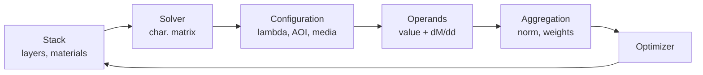

# Thin Film Design Software — Merit Function Specification

2026-09-17 · Javier Ruiz, Synapse Optics

## Purpose and scope

This document specifies the merit function subsystem for a new thin film design program: the operand library, the aggregation rules, and the contract each operand must satisfy so the subsystem can drive gradient, needle and global optimizers.

In scope: what quantities the user can target, how each is parameterized, how each is evaluated and differentiated, and how targets combine into a single scalar.

Out of scope, specified elsewhere: the characteristic-matrix / transfer-matrix solver itself, material and dispersion models, the optimization algorithms, deposition-monitoring simulation, and the UI.

The design assumption throughout is that the merit function is evaluated tens of thousands of times per design session and must return a value and an analytic gradient in one pass.

## Architecture

Four layers sit between the stack and the optimizer, each with a single responsibility.

**Configuration** fixes the evaluation context: incident and exit media, substrate, coated side, AOI set, wavelength grid, environment. One design carries many configurations.

**Operand** is the unit the user manipulates. It binds to one configuration, evaluates one quantity, and returns value plus gradient with respect to every free variable.

**Aggregation** turns the operand vector into one scalar under a chosen norm, with normalization and grouping.

**Optimizer interface** exposes the scalar, the gradient vector, and the residual vector separately, since damped least squares wants residuals and Jacobian while a global search wants only the scalar.

## Common operand model

Every operand inherits the same parameter set, so the merit function table is uniform regardless of operand type.

| Field | Type | Notes |
| --- | --- | --- |
| Type | enum | Operand identifier, e.g. `R`, `OD`, `GDD`, `DELE` |
| Configuration | ref | Which evaluation context; defaults to configuration 1 |
| Parameters | per-type | Wavelength or band, AOI, polarization, layer index, etc. |
| Comparison | enum | `=`, `<=`, `>=`, `range` |
| Target | real | Target value, or low bound for `range` |
| Target2 | real | High bound, `range` only |
| Tolerance | real | Deadband; residual is zero inside it |
| Weight | real | Relative weight within its group; 0 disables |
| Group | ref | For group-level weighting and reporting |
| Enabled | bool | Kept in the table but excluded from the sum |

### Return contract

Each operand implements a single entry point returning, in one pass:

1. The scalar value **v**
2. The residual **r**, after comparison type and tolerance are applied
3. The gradient **∂v/∂x** for every free variable x (layer thicknesses, and where applicable indices and material fractions)
4. The perturbation function **P(z)** for needle insertion, or a flag declaring it unsupported

An operand that cannot supply an analytic gradient must say so explicitly rather than silently falling back to finite differences; the aggregation layer then decides whether to approximate or to exclude it from gradient-based stages.

> **As built:** the one pass is `tf_evaluate_jacobian`, which returns the values, the residuals and the analytic Jacobian together. A second call, `tf_evaluate`, makes the same pass without the derivatives and is the faster one; it is what runs whenever derivatives are not needed - each trial step of the optimiser, every spectrum, the merit table. P(z) has its own call, `tf_evaluate_needle`. Which part of the program uses which is in [abi-and-allocation-contract.md](abi-and-allocation-contract.md).

## Primitive spectral operands

These are computed directly from the characteristic matrix. Every one takes wavelength (or band), AOI, and polarization ∈ {s, p, average}.

| Operand | Quantity | Units | Range | Notes |
| --- | --- | --- | --- | --- |
| `R` | Reflectance | fraction or % | 0–1 | Front or back side selectable |
| `T` | Transmittance | fraction or % | 0–1 | |
| `A` | Absorptance | fraction or % | 0–1 | First-class, not derived as 1−R−T, so it stays exact with scatter models |
| `OD` | −log₁₀(T) | dimensionless | 0–∞ | Required for blocking specs; linear T is numerically blind below ~1e−4 |
| `RAVG`, `TAVG`, `AAVG` | Band average with weight w(λ) | fraction | 0–1 | w(λ) selectable: flat, source spectrum, detector response, photopic |
| `ODAVG` | Band-average OD | dimensionless | | Averaged in log space, not linear |
| `PHR`, `PHT` | Phase on reflection / transmission | degrees | −180–180 or unwrapped | Sign and branch convention declared per project, exposed in UI |
| `PSI`, `DEL` | Ellipsometric Ψ, Δ | degrees | | For reverse engineering and index fitting against measured data |

### Notes

All of these differentiate analytically with respect to layer thickness through the derivative of the layer matrix, at a cost comparable to one extra matrix product per layer.

Band-average operands integrate on the internal evaluation grid (see Spectral sampling), not on the user's target grid. The weighting function w(λ) is a named, reusable object so the same solar or photopic weighting can be shared across operands.

`OD` needs a floor parameter (default OD 8) to keep the gradient finite when T underflows.

## Filter-shape operands

Users specify filters by shape, not by pointwise transmittance. Computing these internally removes the need to hand-build fragile composite targets.

| Operand | Definition | Parameters |
| --- | --- | --- |
| `LEDGE`, `SEDGE` | Long-wave / short-wave edge wavelength at a crossing level | Level (default 50 % T), search band |
| `SLOPE` | Edge steepness, Δλ between two levels, absolute or % of λₑ | Two levels, e.g. 5 % and 80 % |
| `CWL` | Center wavelength, midpoint of the two crossings | Level, search band |
| `BW` | Bandwidth at a level (FWHM at 50 %) | Level, search band |
| `SHAPE` | Shape factor, BW at low level ÷ BW at high level | Two levels |
| `RIPPV` | Passband peak-to-valley ripple | Band |
| `RIPRMS` | Passband RMS ripple about its mean | Band |
| `TMAX`, `TMIN` | Extreme T in a band | Band |
| `ODMIN` | Minimum blocking OD across a band | Band |
| `DEDGE` | Edge shift between two AOI values | Two configurations, level |

### Extraction and differentiability

Crossing-point operands are extracted by bracketing on the internal grid then refining with Brent or a cubic fit. The derivative follows from the implicit function theorem: ∂λₑ/∂dᵢ = −(∂T/∂dᵢ)⁄(∂T/∂λ), evaluated at the crossing. This is exact and cheap, and avoids finite-differencing the whole spectrum.

Two failure modes must be handled explicitly rather than left to produce silent garbage:

- **No crossing in the search band.** Return a large penalty proportional to the distance from the nearest attained level, with a gradient that pushes toward a crossing, rather than returning a sentinel.
- **Multiple crossings.** Report ambiguity and take the crossing nearest the previous iteration's value, so the operand does not jump discontinuously between optimizer steps.

Extremum operands (`TMAX`, `RIPPV`) are non-smooth where the argmax moves between grid points. Offer a smooth-max option (log-sum-exp with a user-set sharpness) for gradient stages, and the true max for reporting and minimax stages.

## Polarization operands

| Operand | Definition | Typical use |
| --- | --- | --- |
| `TSP`, `RSP` | Tₛ/Tₚ, Rₛ/Rₚ | Polarizing beamsplitter contrast |
| `EXTT`, `EXTR` | Extinction ratio in transmission / reflection, in dB or as a ratio | Polarizer specification |
| `DIAT` | Diattenuation, (Tₚ−Tₛ)⁄(Tₚ+Tₛ) | Machine vision, polarimetry |
| `NPOL` | \|Rₛ−Rₚ\| or \|Tₛ−Tₚ\| | Non-polarizing beamsplitters and folds at high AOI |
| `RETR`, `RETT` | φₛ−φₚ on reflection / transmission, degrees | Phase-compensated mirrors, low-retardance folds |

The non-polarizing operand `NPOL` is worth shipping separately from a pair of Rₛ and Rₚ targets: as a difference it has a well-conditioned gradient toward the balanced solution, whereas two independent targets fight each other and typically converge to a compromise that satisfies neither.

Retardance operands share the phase branch convention defined for `PHR` and `PHT`, and must unwrap continuously across the band before differencing.

## Phase and dispersion operands

Dispersion control is its own design discipline, and a coating program without it cannot address ultrafast optics.

| Operand | Definition | Units |
| --- | --- | --- |
| `GD` | Group delay, dφ/dω | fs |
| `GDD` | d²φ/dω² | fs² |
| `TOD` | d³φ/dω³ | fs³ |
| `GDDC` | Deviation from a target GDD curve over a band | fs² |
| `GDDOSC` | Oscillation penalty: RMS of GDD about its local smooth trend | fs² |

### Requirements

**Differentiate with respect to ω analytically.** Propagate d/dω through the characteristic matrix alongside the matrix itself. Finite-differencing φ on a wavelength grid loses roughly half the significant digits per derivative order, which makes TOD unusable in double precision at practical grid spacings, and it couples grid choice to the merit value in ways users cannot debug.

**Unwrap before differentiating.** Phase must be unwrapped continuously in ω across the whole evaluation band, with the unwrap done on the dense internal grid rather than the target grid.

**Ship `GDDOSC`.** Chirped mirror design is dominated by suppressing GDD ringing, not by hitting the mean GDD. A design that matches a target GDD curve in least-squares while oscillating ±200 fs² is worthless, and users cannot express "smooth" with pointwise targets. Define the local trend by a low-order polynomial or Savitzky-Golay fit over a user-set window.

**Support a target GDD slope** rather than only pointwise values, since the useful specification for a compressor is usually a required dispersion per bounce over a band.

## Colorimetric operands

Color is the acceptance criterion for consumer AR, display, architectural and cosmetic coatings, and it is the one users most often have to fake with pointwise spectral targets.

All colorimetric operands take illuminant (D65, A, E, F-series, user-supplied), observer (2° or 10°), path (reflection or transmission), and configuration.

| Operand | Quantity |
| --- | --- |
| `CIEX`, `CIEY`, `CIEZ` | Tristimulus values |
| `CIEx`, `CIEy` | Chromaticity coordinates |
| `CIEu`, `CIEv` | u′, v′ |
| `LSTAR`, `ASTAR`, `BSTAR` | CIELAB coordinates |
| `CHROMA` | C* = √(a*² + b*²), the neutrality operand |
| `DELE` | ΔE against a target color; CIE76, CIE94 or CIEDE2000 selectable |
| `DCOL` | Color shift between two configurations, as ΔE or Δu′v′ |
| `CCT` | Correlated color temperature, K |
| `CRI` | Color rendering index of transmitted light |

### Notes

`CHROMA` is the operand most AR designers actually want: it drives the residual reflection toward neutral grey without forcing them to guess a target a*b* pair.

`DCOL` — color shift across angle — is frequently the binding specification for display and AR coatings, and it cannot be expressed at all with single-configuration targets. Take two configurations differing only in AOI and return the color difference between them.

Tristimulus integrals use the internal grid over 360–830 nm; warn if the user's defined wavelength range does not cover the visible, rather than silently integrating over a truncated band.

Gradients follow by the chain rule from ∂R/∂dᵢ through the tristimulus integrals and the CIELAB transform; CIEDE2000 is piecewise but differentiable almost everywhere, so its analytic derivative is usable with a guard at the hue-rotation discontinuity.

## Application rollup metrics

Each is a weighted band integral over the primitives, but users specify them by name and expect the standard weighting and band built in. Getting the standards right is a small amount of work that buys direct credibility with each market.

| Operand | Definition | Band and weighting |
| --- | --- | --- |
| `TLUM`, `RLUM` | Luminous transmittance / reflectance | 380–780 nm, V(λ) × illuminant |
| `TSOL`, `RSOL`, `ASOL` | Solar transmittance / reflectance / absorptance | 300–2500 nm, AM1.5 or ISO 9845 |
| `SHGC` | Solar heat gain coefficient | TSOL plus inward-flowing fraction of ASOL |
| `EMIT` | Thermal emittance | 5–50 µm, blackbody at stated temperature |
| `AERATIO` | α/ε, solar absorptance over thermal emittance | Solar band and thermal band |
| `RPHOT` | Photopic-weighted average reflectance | 380–780 nm, V(λ) |
| `TDET` | Detector-weighted transmittance | User-supplied response curve |

The thermal band operands require material data out to 50 µm, which most optical constant databases do not carry. Specify the behaviour when data is missing: extrapolate with a declared model and flag the operand, or refuse to evaluate — but never extrapolate silently.

Source spectra, detector responses and illuminants are named, versioned library objects shared across operands and projects, not per-operand file paths.

## Physical and manufacturability operands

These enter the merit function as weighted terms, not only as hard variable bounds. A bound stops the optimizer at a wall with no gradient information; a penalty term gives it a direction well before it arrives.

| Operand | Definition | Purpose |
| --- | --- | --- |
| `MINT` | Penalty on layers below a minimum physical thickness | Drives sub-nanometre layers out of the design instead of letting the optimizer keep them alive |
| `MAXT` | Penalty above a maximum layer thickness | Deposition stability, stress |
| `TOTT` | Total physical thickness | Deposition time and cost |
| `TOTOT` | Total optical thickness | Correlates with sensitivity and with required spectral sampling |
| `NLAY` | Layer count | Used in discrete stages and in reporting |
| `MATT` | Thickness budget for one material | Target usage, crucible capacity |
| `ABSL` | Absorptance attributable to a specified layer | Locating loss |
| `EFIELD` | Peak \|E\|²/\|E₀\|² in the stack, or at a named interface | Laser damage threshold proxy |
| `STRESS` | Σ σᵢdᵢ over layers | Substrate bow; needs per-material stress data |
| `SMOOTH` | Total variation of the index profile | Rugate and graded-index designs |

### Peak electric field

`EFIELD` deserves particular attention. In most commercial packages the standing-wave field distribution is an analysis plot, so LIDT-driven design is done by iterating between optimization and inspection by hand. Exposing peak field intensity as a directly optimizable operand — both the maximum anywhere in the stack and the value at a specified interface, since interfaces fail first — is a genuine differentiator for the high-power laser optics market, and the quantity is already available inside the solver at essentially no extra cost.

The operand should report where the peak occurs alongside its value, and offer the smooth-max option described for extremum operands so it behaves in gradient stages.

## Robustness and yield operands

This is where most commercial packages are weakest and where production engineers feel the pain, so it deserves first-class treatment rather than a post-hoc analysis tab.

| Operand | Definition | Cost |
| --- | --- | --- |
| `SENS` | Σᵢ (∂M/∂dᵢ)²σᵢ², first-order merit sensitivity to thickness error | Nearly free — the gradient already exists |
| `SENSO` | Same, applied to a single named operand rather than the total merit | Nearly free |
| `YIELD` | Monte Carlo fraction of trials meeting a named spec set | Expensive; N × full evaluation |
| `WCASE` | Worst value of a named operand over a perturbation set | Moderate; minimax inner loop |
| `NSENS` | Sensitivity to index and dispersion uncertainty | Cheap if ∂M/∂n is carried |

### Error model

The error model is a project-level object, not an operand parameter, and should support:

- Per-layer σ, as absolute thickness or percentage, defaulting per material
- Systematic offsets (tooling factor error) separately from random error
- Index error, correlated across layers of the same material
- **Correlated error from optical monitoring**

That last item is the one worth building properly. Errors under optical monitoring are strongly correlated and partly self-compensating: a layer terminated late is followed by one terminated early. Independent random Monte Carlo systematically misjudges such designs, usually condemning ones that in fact manufacture well. Supporting a monitoring-strategy-aware correlated error model — direct monitoring, indirect on witness chips, trigger-point monitoring, quartz crystal — would put yield prediction ahead of what is generally available.

### Using yield as an objective

`YIELD` is too expensive for every iteration of a gradient stage. Offer it in two roles: as a refinement objective in a final stage, and as a selection criterion when ranking the population from a global search. The Monte Carlo trials are independent and vectorize cleanly, so a GPU evaluator makes a 10⁴-trial estimate practical at interactive speed — which turns robustness from an audit step into part of the design loop.

## Aggregation

The operand library is half the subsystem; how targets combine is the other half, and it determines whether the optimizer finds designs users accept.

### Norms

| Norm | Form | When it is right |
| --- | --- | --- |
| L2 | √(Σ wᵢrᵢ² / Σ wᵢ) | Default; pairs with damped least squares |
| L1 | Σ wᵢ\|rᵢ\| / Σ wᵢ | Tolerates a few bad points; useful when some targets are known unreachable |
| L∞ | maxᵢ wᵢ\|rᵢ\| | Matches how specs are written |
| Lp | general p | Continuation from L2 toward minimax |

Minimax matters more here than in lens design. Almost every coating specification reads "R < 0.5 % across the band," which is a Chebyshev problem; an L2 solution with excellent RMS can violate the spec at one wavelength and be rejected. Implement L∞ by p-continuation or by the exchange algorithm, and make the norm a per-stage setting so users can polish an L2 solution under L∞.

### Target types

One-sided targets are the most-used type in practice and must contribute exactly zero when satisfied, with zero gradient, so a satisfied constraint stops influencing the solution:

- `<=` : r = max(0, v − target − tol)
- `>=` : r = max(0, target − tol − v)
- `range` : zero inside [lo, hi], distance to the nearer bound outside
- `=` : r = v − target, with the deadband applied symmetrically

### Normalization

Residuals must be made commensurate before summing, or a phase target in degrees swamps a reflectance target in fractions. Specify a normalization policy per operand type — a characteristic scale (e.g. 0.01 for R, 1° for phase, 1 for ΔE) — with a user override. Report both the raw and the normalized contribution in the merit table so users can see which target is actually driving the design.

### Additional machinery

- **Robust norms**: Huber, or per-operand saturation, so one unreachable target cannot dominate the sum.
- **Groups**: operands grouped with a group weight, and a per-group merit contribution shown in the table.
- **Expression operands**: arithmetic and standard functions over other operand values, referenced by row. You cannot anticipate every specification, and this is cheap insurance.
- **Scripting hook**: a user-supplied function receiving the full spectral result and returning a value, for the cases expressions cannot reach. Gradient by finite difference, clearly labelled as such.

## Multi-configuration model

A configuration is the evaluation context a stack is measured in. Making configurations first-class — rather than bolting extra AOI columns onto each operand — keeps the operand table readable and lets one design be optimized against every condition it must survive.

A configuration carries:

| Field | Example |
| --- | --- |
| Incident medium | Air, glass, immersion fluid, cement |
| Substrate | BK7, fused silica, Si |
| Exit medium | Air, or second coating for a cemented assembly |
| Coated side | Front, back, both |
| AOI | Single angle, list, or cone |
| Wavelength range and grid | Per configuration, since a thermal band and a visible band need different grids |
| Environment | Temperature, humidity; for designs that must meet spec in more than one state |
| Backside treatment | Uncoated Fresnel, AR, absorbing |

### Binding rules

Every operand binds to exactly one configuration. Operands that compare conditions — `DCOL`, `DEDGE` — bind to two and are the only exception.

A design bound to several configurations evaluates the stack once per configuration; the solver caches per-layer matrices where the configuration difference does not affect them.

### Cone integration

An AOI cone (specified by half-angle, f/number or NA) integrates with proper solid-angle weighting, not by averaging equally spaced angles — the solid angle in an annulus grows as sinθ dθ, so equal-angle averaging systematically overweights the centre of the cone and makes a fast-beam design look better than it is.

Offer both a Gauss-Legendre quadrature over the cone (few points, exact for smooth response) and a uniform-in-solid-angle sampling (robust when the response has an edge inside the cone). Default to quadrature and warn when a filter edge falls within the cone, where quadrature accuracy degrades.

## Gradients and the needle perturbation function

This section drives the operand interface design and should be settled before any operand is written.

### Why it is architectural

Needle optimization and gradual evolution are the algorithms that make thin film synthesis work, and both depend on a quantity beyond the ordinary gradient: the derivative of the merit function with respect to inserting an infinitesimally thin layer of a new material at depth z. If the operand interface cannot supply that, the program is locked out of the methods that distinguish a design tool from a spectrum calculator — and retrofitting it later means touching every operand.

### Required derivatives

| Derivative | Used by | Requirement |
| --- | --- | --- |
| ∂v/∂dᵢ | Gradient descent, DLS, sensitivity | Analytic, mandatory |
| ∂v/∂nᵢ | Index optimization, GRIN, mixture fractions | Analytic where the material model allows |
| P(z) = ∂M/∂(insert at z) | Needle, gradual evolution | Analytic, for every operand that contributes to the needle-stage merit |
| ∂² | Optional second-order steps | Not required in the first release |

### Implementation

Compute ∂v/∂dᵢ by carrying, alongside the forward characteristic-matrix product, the partial products left and right of each layer. The cost is roughly two matrix sweeps for the whole gradient, not one per layer.

The needle perturbation function follows from the same partial products evaluated at a continuum of depths z, for each candidate insertion material. Its cost is comparable to one gradient evaluation per material, which is why the needle map is affordable to compute densely.

Both derivatives must be exercised against finite differences in the test suite for every operand, on designs with absorbing layers and at high AOI, where sign and branch errors hide.

### Operands without a perturbation function

Some operands — `YIELD`, scripted operands — cannot supply P(z). The merit function declares which of its terms are needle-capable; the needle stage optimizes the capable subset and reports which terms it ignored, rather than refusing to run or silently optimizing something other than what the user configured.

## Spectral sampling

Sampling density is part of the merit function, not a display setting, and treating it otherwise is the single most common source of user-visible wrongness in coating software.

### The failure

A user specifies twenty targets across a band, the optimizer drives all twenty to zero residual, and the resulting design ripples wildly between them. The merit value is excellent and the coating is useless. Users blame the optimizer.

### Requirement: separate the two grids

- **Target grid** — where the user places targets. Arbitrary and sparse.
- **Evaluation grid** — where the spectrum is actually computed. Dense, controlled by the program.

Band-average, ripple, extremum, edge and colorimetric operands all evaluate on the evaluation grid. Pointwise operands evaluate at their own wavelength, which need not lie on the grid.

### Minimum density

The spectral resolution a stack can produce scales with its total optical thickness: the finest feature has a period of roughly λ²/(2·OT). Set the default evaluation grid spacing from the current total optical thickness, at four or more points per finest feature, and update it as the stack grows during synthesis.

This means the grid is dynamic. A 40-layer bandpass needs far finer sampling than a 4-layer AR, and users should not have to know that.

### Warnings

Warn when the target grid is coarser than the evaluation grid by more than a set factor in a band where targets are meant to control behaviour — that is precisely the condition that produces inter-target ripple. Offer to convert a run of pointwise targets into a band-average or one-sided band target, which is almost always what the user meant.

Adaptive refinement — adding evaluation points where curvature is high — is worthwhile but secondary; get the thickness-derived default right first.

## Numerical and performance notes

### Parallel structure

The evaluation space is (wavelength × AOI × polarization × configuration × Monte Carlo trial), and the characteristic-matrix product is independent across every one of those axes. Keep the operand interface batch-oriented — an operand receives an array of spectral results, not one point at a time — so the whole space dispatches in one kernel launch rather than being serialized by the operand layer.

This matters most for `YIELD`: a 10⁴-trial Monte Carlo over a 500-point grid is 5×10⁶ independent stack evaluations, which is minutes on a CPU and well under a second on a GPU. That difference is what moves robustness from an audit step into the design loop.

### Precision

Double precision throughout the matrix product. Single precision is tempting for GPU throughput but fails on two common cases: high-rejection blocking filters, where T reaches 1e−8 and the matrix elements span many orders of magnitude, and thick stacks where accumulated phase error grows with layer count. If single precision is offered for a fast global-search stage, the result must be re-evaluated in double before being reported or ranked.

### Caching

Cache per-layer characteristic matrices keyed by (material, thickness, wavelength, angle). During local optimization only a few thicknesses change per iteration, so most of the product is reusable; during needle insertion the partial products either side of the insertion point are already available from the gradient computation.

### Cost tiers

Label each operand with an evaluation cost tier so the optimizer can schedule stages sensibly and the UI can warn before a user adds an operand that makes iteration slow.

| Tier | Operands | Relative cost |
| --- | --- | --- |
| 1 | Pointwise primitives, physical constraints | ~1 |
| 2 | Band averages, colorimetry, filter shape, dispersion | 10–100 |
| 3 | Cone integration, multi-configuration sets | 10–100 per configuration |
| 4 | `YIELD`, `WCASE` | 10³–10⁵ |

## Template library

Most of the value of a well-designed operand set is lost if users must assemble it themselves. Ship parameterized templates that generate a complete, weighted, normalized merit function from a few inputs.

| Template | User inputs | Generates |
| --- | --- | --- |
| Broadband AR | Band, AOI range, substrate | `RAVG` ≤ target over band, `R` ≤ max pointwise, `CHROMA` for neutrality, `MINT` |
| V-coat AR | Wavelength, AOI | `R` at λ₀, `RAVG` over a narrow band |
| Bandpass | CWL, FWHM, blocking band and OD | `TAVG` passband, `RIPPV`, `ODMIN` blocking, `CWL`, `BW`, `SLOPE` |
| Dichroic / edge filter | Edge λ, AOI, reflect and transmit bands | `LEDGE`, `SLOPE`, `TAVG`, `RAVG`, `DEDGE` across AOI tolerance |
| Chirped mirror | Band, GDD target curve | `RAVG` ≥ target, `GDDC`, `GDDOSC` |
| Polarizing beamsplitter | Band, AOI, contrast | `TSP`, `EXTT`, `TAVG` for p, `RAVG` for s |
| Low-e / architectural | Glazing configuration | `TLUM`, `EMIT`, `SHGC`, `DCOL` across viewing angle |
| Laser HR | λ, AOI, damage requirement | `R` ≥ target, `EFIELD` at interfaces, `A` ≤ max, `TOTT` |
| Solar absorber | Solar and thermal bands | `ASOL`, `EMIT`, `AERATIO` |
| Reverse engineering | Measured R, T or Ψ/Δ data file | Fit merit over measured data, with n, k and thickness as variables |

Each template should also set a sensible starting norm, normalization scales, and a robustness term (`SENS`) at low weight, so that a design produced from a template is manufacturable by default rather than merely spectrally correct.

The reverse-engineering template is worth including even though it is not a design task: it reuses the entire operand and optimizer stack with measured data as the target, and it is the feature that gets the program installed in deposition labs.

## Implementation phasing

Two things must be right from the first line of code even though they are not visible features: the batch-oriented operand interface with analytic gradients, and the separation of evaluation grid from target grid. Everything else can be added incrementally.

### Phase 1 — a usable design tool

- Operand model, return contract, analytic ∂v/∂dᵢ, needle perturbation function
- Primitives: `R`, `T`, `A`, `OD`, band averages, `PHR`, `PHT`
- Filter shape: edges, `SLOPE`, `CWL`, `BW`, ripple, `ODMIN`
- Polarization: `TSP`, `EXTT`, `NPOL`
- Constraints: `MINT`, `MAXT`, `TOTT`, `NLAY`
- Aggregation: L1, L2, L∞, one-sided and range targets, normalization, groups
- Multi-configuration with discrete AOI lists
- Dynamic evaluation grid tied to total optical thickness
- Templates: AR, V-coat, bandpass, dichroic

### Phase 2 — competitive parity plus the differentiators

- Colorimetry: full set including `DCOL` across angle
- Dispersion: `GD`, `GDD`, `TOD`, `GDDC`, `GDDOSC`
- `EFIELD`, `ABSL`, `STRESS`
- `SENS`, `WCASE`, and GPU `YIELD`
- Cone integration with solid-angle weighting
- Application rollups: `TLUM`, `TSOL`, `SHGC`, `EMIT`
- Expression operands
- Templates: chirped mirror, PBS, laser HR, low-e

### Phase 3 — depth

- Correlated error model tied to monitoring strategy
- Reverse engineering against measured R, T and ellipsometric data
- `SMOOTH` and rugate / GRIN support
- Scripting hook
- `CRI`, `AERATIO`, specialized rollups

### Why this order

Phase 1 is the minimum that lets someone design a real coating end to end; anything missing from it means the program cannot be evaluated at all by a prospective user. Phase 2 contains the three items most likely to win a switch from an incumbent — optimizable peak field, color shift across angle as a direct target, and GPU-speed yield — so it should not be deferred past a first commercial release. Phase 3 items are deep but narrow, each serving one market well.
