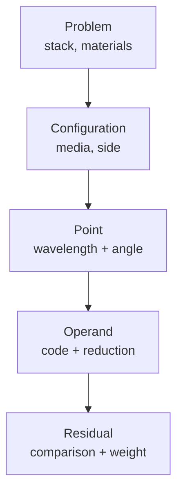

# Thin Film Engine — Evaluation Model Contract

2026-09-18 · Javier Ruiz, Synapse Optics

## What this decides

This contract defines how the engine is told what to evaluate, and how it hands results back. It is the one data model underneath the four blocked groups — O3 (operand model), C5 (configuration), A4 (aggregation norms) and G6 (spectral sampling) — and it is what section 7's eleven operand rows are waiting on.

The argument for doing it as one edit is the one already made in the ledger: those groups touch the same two structures. Landing them separately means several ABI breaks and several rounds of rework through every sweep, and the intermediate states are not meaningful — an operand model with no grid to aggregate over is not a working half of anything.

### This is a draft for correction

Everything below is a proposal. The parts most likely to be wrong are the ones reconstructed rather than read: field names, integer widths, and how closely the proposed records match the existing `tf_problem` and `tf_targets`. Those are marked where they occur. The design arguments — who owns the grid, where aggregation lives, what happens when a stack outgrows its sampling — are meant to be argued with rather than corrected.

### What it deliberately does not cover

The solver, the derivative sweeps, dispersion and material models, and the optimizer algorithms. The contract is the boundary between the merit function and everything on either side of it, and it should be possible to land it without reopening the physics.

## The grid question, answered

The apparent conflict dissolves once three things stop being called "the grid". They have different owners.

| Concept | What it is | Who decides | Who allocates |
| --- | --- | --- | --- |
| **Domain** | Which wavelengths this configuration is about — 380–780 nm, 5–50 µm | The caller, as design intent | — |
| **Density** | How many samples that domain needs to resolve what the stack can produce | The engine, from total optical thickness | — |
| **Storage** | The actual array of abscissae and the results over them | — | The caller |

The spec is right that the domain is configuration-owned: a thermal band and a visible band are different design intents and belong to different configurations. It is also right that density must be derived rather than typed in by a user — nobody should have to know that a 40-layer bandpass needs four points per λ²/(2·OT) feature, and making them know it is how the inter-target ripple failure happens.

Neither of those makes it native's job.

### The resolution: density is managed-side policy

The existing contract already answers this, in the needle map:

> THE CALLER CHOOSES THE DEPTHS rather than asking for a sample count, because the caller is the one that has to allocate the result (rule 1) and because a sampling policy — uniform per layer, uniform in optical thickness, refined where the map is steep — belongs above this boundary.

The evaluation grid is the same kind of object as the needle depths, and the same answer applies: **C# computes the density and fills the grid; native evaluates exactly the points it is handed.**

That is not a demotion of the requirement. "Derived, not user-chosen" is satisfied by managed code deriving it — the managed side has the layer thicknesses and the index table, so total optical thickness is a few lines there, and the user still never types a sample count.

### Why not have `tf_plan` report a density

I proposed that before reading the contract, and it is wrong for this codebase. The test the contract applies to `tf_plan` is whether a disagreement between the two sides could be **silent**:

> If the managed side decided it and the native side assumed something else, the disagreement would be silent and would surface as a wrong derivative.

That is why path selection and the polarisation mask are native and derived. Grid density fails that test in the opposite direction: native assumes nothing about density. It evaluates the points in `point_wavelength` and `point_angle`, and it would evaluate a different set just as correctly. There is nothing for the two sides to disagree about, so there is no reason to move the decision across the boundary — and moving it would either break rule 1 or add a fourth call to a sequence whose whole design is that there are three.

`scratch_doubles` is native's for the stated reason that it is the shape of an internal cache. A wavelength grid is a property of the problem, which is the caller's to state.

### What still has to be solved, just not here

The underlying problem is real and moving it to managed code does not dissolve it: density derives from total optical thickness, and needle synthesis grows the stack. A grid planned for a 10-layer stack is undersampled by the time the stack is 40 layers, and if the grid is re-derived mid-run the merit value changes discontinuously for reasons unrelated to the design — every convergence test in the optimiser is then lying.

The managed-side rule that follows:

1. Grid density is fixed at the start of an optimisation stage and pinned for its duration, so the merit function is a fixed function while the optimiser is working on it.
2. It is re-derived only at stage boundaries — between a needle insertion round and the next refinement — which is also where `tf_plan` has to run again anyway, because the stack shape changed.
3. The re-derivation is reported to the user, because a merit value before and after a re-grid are not comparable numbers and a log that implies they are is worse than no log.

None of that touches the ABI, which is the point. It belongs in the stage driver above it, next to the decision to run a needle round at all.

## Object model

Five levels, each owning exactly one thing. Today's model has the first, third and fifth and is missing the second and fourth, which is why O3, C5 and section 7 are all blocked on the same edit.



| Level | Owns | Today |
| --- | --- | --- |
| Problem | Layers, materials, the index table | `tf_problem` |
| Configuration | Incident and exit media, coated side, environment | missing |
| Point | One (wavelength, angle) pair, in one configuration | `point_wavelength`, `point_angle` |
| Operand | A quantity over one or more points, and how they reduce | missing — `target_code` is per-point |
| Residual | One scored comparison of an operand against a target | `tf_targets` |

### The operand is the new level, and it is what unblocks section 7

Today a residual names one point. Every operand in section 7 that the spec calls band-, shape- or color-valued names many: `RAVG` integrates over a band, `RIPPV` takes a peak-to-valley across one, `CIEX` is a tristimulus integral, `LEDGE` finds a crossing inside one. There is nowhere in `tf_targets` to say "these forty points, with these weights."

The representation is a span, in the flat CSR form that obeys rule 2 and ports to a kernel unchanged:

```
operand_point_first[o]           index into operand_point_index
operand_point_count[o]           how many points this operand spans
operand_point_index[]            -> point index          (sum of counts, long)
operand_point_weight[]           quadrature weight, parallel to the above
```

A pointwise operand has `count == 1` and weight 1, so today's behaviour is the degenerate case and no existing target changes meaning.

### One mechanism covers more than it looks like

The per-point quadrature weight is the whole of spectral weighting. `RAVG` with a flat w(λ), `TLUM` with V(λ) × illuminant, `TSOL` against AM1.5, `CIEX` against the 2° observer, and a cone integral with sinθ dθ solid-angle weighting are the same operation with different numbers in `operand_point_weight`.

That matters for where the standards live. AM1.5, V(λ), the CIE observers and the illuminants become managed-side library objects — named, versioned, shared, exactly as the spec asks — and native never grows a table of standards it would then have to keep current. It also means a user-supplied detector response needs no new code path at all.

### How the points reduce

The span says which points; a reduction code says how they combine.

| Reduction | Operands it serves |
| --- | --- |
| `SUM` | Band averages, all weighted integrals, colorimetry |
| `MAX` / `MIN` | `TMAX`, `TMIN`, `ODMIN` |
| `PTV` | `RIPPV` |
| `RMS_DEV` | `RIPRMS` |
| `CROSSING` | `LEDGE`, `SEDGE`, `CWL`, `BW`, `SLOPE` |

`CROSSING` is the one that carries extra parameters (the level, and which crossing when there are several) and the one whose derivative comes from the implicit function theorem rather than the chain rule — which is exactly what `tf_evaluate_wavelength_derivative` already exists to supply. That call was built for this and does not change.

### Derived operands, and why this is a DAG

`CHROMA` is a function of `ASTAR` and `BSTAR`. `DELE` is a function of three. `DCOL` is a function of two colorimetric operands **in different configurations**, which is the two-configuration case C5 needs and it falls out for free once operands can take operands.

So an operand has a second span, over inputs:

```
operand_input_first[o] / operand_input_count[o] / operand_input_index[]   -> operand index
```

An operand reads points or operands, not both. Evaluation is then a topological walk, and the ordering is native's to derive and check — a cycle is `TF_OPERAND_CYCLE` at plan time, never a hang in the inner loop. Deriving it follows the precedent already set for the polarisation mask: a caller-supplied order is one more thing that can silently disagree with the graph it describes.

### Not every operand is scored

`CIEX` exists to feed `DELE`; it is not itself a target. An operand with comparison `NONE` is evaluated and contributes no residual, so `n_operands ≠ n_residuals` and the mapping between them is derived by `tf_plan` and reported, alongside `n_residuals` itself — which the caller needs before it can allocate `residual` and `jacobian`.

## The configuration record

Today `tf_problem` carries `index_incident` and `index_exit` as `[n_wavelengths]` — one incident medium and one exit medium for the whole problem. A configuration is exactly the set of things that are currently problem-wide and should not be.

```c
typedef struct tf_configurations
{
    int32_t n_configurations;

    /* [n_configurations * n_wavelengths], configuration-major, matching the
     * material-major convention of material_index. */
    const tf_complex* index_incident;
    const tf_complex* index_exit;

    /* [n_configurations] non-zero reverses the layer order for this configuration:
     * the same stack seen from the substrate side. */
    const int32_t*    reversed;
} tf_configurations;
```

and one array joins it to the existing point list:

```c
/* added to tf_problem */
const int32_t* point_configuration;   /* [n_points] -> configuration index */
```

That is the whole of C5's first-class-configuration row. A point is now (wavelength, angle, configuration), and everything downstream of it — path selection, the polarisation mask, the sweeps — works on a point exactly as it does today.

### Why `reversed` rather than a coated-side flag

Front, back and both are three different things and only one of them is a property of the stack. Front and back are the same stack traversed in opposite directions, which `reversed` expresses and which costs the solver nothing — it already walks the layer list in an order. "Both sides coated" is not one evaluation at all: it is two coherent stacks separated by a substrate thick enough to be incoherent, which is the `TF_PATH_INCOHERENT` path that is designed for and not built. Folding it into a side flag would promise something the engine cannot do.

So: `reversed` now, both-sides when the incoherent path lands, and the contract should say that plainly rather than leave a `coated_side` enum with a value that refuses.

### What deliberately is not in it

**Substrate** is not a configuration field. A substrate is a medium, and `index_exit` already names it per configuration. Adding a separate substrate concept would create two places that mean the same thing.

**Environment** (temperature, humidity) is not a field either, and this is the more debatable omission. Temperature acts on the design through `material_index` and `layer_thickness` — it changes n(λ, T) and it expands the layers. The engine has no material model and therefore cannot apply it; the managed side that owns the dispersion model can, by handing over a different index table. A `temperature` field in this struct would be inert data that looks load-bearing. When dispersion models exist, environment becomes a managed-side transform that produces per-configuration index tables — which the struct above already supports.

**Wavelength grid** is not a field, for the reason given in §2: the grid is the point list, and which points belong to which configuration is already stated by `point_configuration`. A configuration "owning a grid" is the managed-side object; at the ABI it is a subset of points.

### Cost

One pointer array added to `tf_problem`, one new struct, one extra indirection in the per-point setup (`index_incident[cfg * n_wavelengths + w]` in place of `index_incident[w]`). The solver, both sweeps, the needle map and the index derivative are untouched.

## Sampling, and the rule that replaces G6

G6's two rows — evaluation grid versus target grid — turn out not to be ABI rows at all, given §2 and §3. They are a managed-side invariant, and it is worth stating it in one line so it can be tested:

> **Every point in `point_wavelength` belongs to the evaluation grid. A target grid does not exist at the boundary.**

The distinction the spec draws is real, but it lives one level up. What the user places are operands with a wavelength or a band. What the managed side sends down is a dense point set covering every band any operand touches, at the derived density. An operand's span then indexes into that set.

### The consequence that makes the failure mode go away

The ripple failure happens when the optimiser is scored only where the user put targets. Under this model it cannot be: a user placing twenty pointwise targets across a band produces twenty **operands**, but the point set underneath them is at the derived density, and the twenty operands index twenty of those points.

That by itself does not score the gaps — it just makes them cheap to score, because the points are already there and already evaluated. The warning the spec asks for becomes computable at the managed layer: *this band has 400 evaluation points and 20 scored operands; the design is unconstrained between them; convert to a band target?*

The engine evaluates what it is told either way. The difference is that the information needed to give that warning now exists in one place.

### A pointwise operand costs nothing extra

A worry with a dense point set is that it multiplies work. It does not, much: the sweeps are per point and a point is one 2×2 chain, and the polarisation mask already halves the common case. What it does multiply is `n_points`, and therefore the plan buffers and the scratch, both of which scale linearly and both of which are sized by the existing calls without change.

The number worth watching is `n_residuals × n_variables` for the Jacobian, and that is driven by operand count, not point count. Making the point set dense does not grow the Jacobian at all.

### The re-plan boundary

Restating the rule from §2 in the form the driver implements:

| Event | Re-derive density | Re-run `tf_plan` | Merit comparable across it |
| --- | --- | --- | --- |
| Optimiser iteration | no | no | yes |
| Needle insertion | yes | yes — `n_layers` changed | **no** |
| Layer removal | yes | yes | **no** |
| Stage change (L2 → L∞ polish) | no | no | yes |
| Configuration or operand edit | yes | yes | **no** |

`TF_PLAN_STALE` already exists for the rows that need it, which is the engine's half of this being enforced rather than remembered.

## Growth: capacity allocation and the active count

C# allocates for a user-set maximum layer count and passes the number of layers currently in the stack. Native reads the prefix and ignores the rest. This is how the legacy code worked, it is the right answer here, and it removes most of what the re-plan boundary above treats as a problem.

```c
/* tf_problem */
int32_t n_layers;        /* layers currently in the stack - what native iterates */
int32_t layer_capacity;  /* what the caller allocated; n_layers may grow to this */
```

### This is not a rule 2 violation, and the contract should say so

Rule 2 says there is no `MAX_LAYERS` and never will be. A reviewer applying that rule to `layer_capacity` would flag it, so the distinction belongs in writing:

- What rule 2 forbids is a **constant in the native source** that dimensions an array. Native still declares nothing, dimensions nothing, and assumes no bound.
- `layer_capacity` is a **number the caller passes**, describing memory the caller has already allocated. Native's only uses for it are sizing scratch and refusing when `n_layers` exceeds it.

The rule is intact: the ceiling lives in the caller's settings, where a user can raise it, not in a header where raising it means a rebuild.

### Keep `n_layers` meaning the live count

You described a current-layer-count alongside a maximum, which is exactly the model above. The only open choice is which field carries which, and the direction matters more than it looks.

**Recommended:** `n_layers` stays the live count and `layer_capacity` is added. Every existing loop — both sweeps, the clamp, the needle split — keeps its current meaning, and the diff is purely additive.

**The alternative** is the legacy spelling, `n_layers` becoming the maximum with a separate current count. That requires auditing every loop in the engine, and a loop missed in the audit reads uninitialised layers and returns a plausible number. A rename that changes an existing field's meaning in a direction that fails *silently* is the one kind rule 5 exists to prevent, so if you prefer the legacy names I would rename the capacity field rather than the active one.

### What is capacity-sized

Layer growth drags variable growth with it — each inserted layer brings a thickness variable — so both counts need the same treatment.

| Buffer | Allocated to | Native touches |
| --- | --- | --- |
| `layer_thickness`, `layer_material`, `layer_is_incoherent` | `layer_capacity` | first `n_layers` |
| `variable_kind`, `variable_layer`, `variable_material`, `variable_coefficient` | `variable_capacity` | first `n_variables` |
| `variable_inert` | `variable_capacity` | writes first `n_variables` |
| `scratch` | planned at `layer_capacity` | as the plan says |
| `jacobian` | `n_residuals * variable_capacity` | prefix columns |
| Point- and operand-indexed buffers | unchanged | unchanged |

Point and operand counts do not move during synthesis — inserting a layer does not change what the design is being scored against — so they keep their exact sizing.

### The Jacobian stride has to be the capacity

`jacobian[v * n_residuals + r]` is column-major with a stride of `n_residuals`. Since `n_residuals` does not change during synthesis, growing `n_variables` only appends columns and the used region stays a contiguous prefix. That works.

It stops working if residual count ever grows in place, because the stride would change and every column would have to move. If that is ever wanted, the stride must be a residual capacity fixed at plan time rather than the live count. Today it is not needed and I would not add it; it is recorded here so that the day someone wants operands added mid-run, the reason it is not free is on paper.

### Cost

Scratch is `(n_layers + 1)` matrices plus a per-layer derivative record, per worker. Planned at a capacity of 200 layers over 8 workers that is on the order of a hundred kilobytes — negligible against the point-indexed buffers, and it buys a synthesis run that never reallocates.

### Hitting the ceiling must not look like convergence

Two halves, in the two places that can see it:

- Native validates `n_layers <= layer_capacity` and refuses with `TF_LAYER_CAPACITY_EXCEEDED`, in the caller-error band. It is a contract violation, and a silent one otherwise, since a too-small capacity means the arrays behind those pointers are shorter than native believes.
- The managed synthesis driver stops when the next insertion would exceed the ceiling, and reports *stopped at the layer limit you set* — distinctly from *converged*. A synthesis run that quietly stops improving because it ran out of room, and reports success, is the same failure as a plausible zero.

### What this buys back

A needle insertion now needs `tf_plan` re-run but **nothing re-allocated**: paths and the polarisation mask may change because the material set changed, and those are plan outputs written into buffers that already exist at capacity. `TF_PLAN_STALE` remains the right guard, and the cost of respecting it drops to one cheap call.

The grid question is unaffected — evaluation density still derives from total optical thickness, which still moves as the stack grows, and re-gridding still changes the point set. Capacity allocation solves the layer axis, not the wavelength axis.

## The operand record

`tf_targets` becomes `tf_operands`. The six existing arrays survive with their meaning intact; the additions are the spans from §3 and the comparison machinery from O3.

```c
typedef struct tf_operands
{
    int32_t n_operands;
    int32_t delta_convention;      /* unchanged, still system-wide */

    const int32_t* code;           /* [n_operands] tf_target_code */
    const int32_t* reduction;      /* [n_operands] tf_reduction */
    const int32_t* comparison;     /* [n_operands] tf_comparison; NONE = unscored */
    const double*  target;         /* [n_operands] */
    const double*  target_hi;      /* [n_operands] RANGE only; ignored otherwise */
    const double*  tolerance;      /* [n_operands] deadband, in operand units */
    const double*  scale;          /* [n_operands] normalisation; see below */
    const double*  weight;         /* [n_operands] unchanged: already a root */

    /* points this operand spans */
    const int32_t* point_first;    /* [n_operands] */
    const int32_t* point_count;    /* [n_operands] */
    const int32_t* point_index;    /* [sum of point_count] -> point */
    const double*  point_weight;   /* [sum of point_count] quadrature weight */

    /* operands this operand consumes, for derived operands */
    const int32_t* input_first;    /* [n_operands] */
    const int32_t* input_count;    /* [n_operands] */
    const int32_t* input_index;    /* [sum of input_count] -> operand */

    /* reduction parameters, meaning set by reduction code; CROSSING uses [0] as the
     * level and [1] as which crossing. Two doubles is enough for every reduction
     * defined today and the array can widen without moving a field. */
    const double*  reduction_param; /* [n_operands * 2] */
} tf_operands;
```

### Comparison and the residual

```c
typedef enum tf_comparison
{
    TF_COMPARE_NONE    = 0,   /* evaluated, not scored: feeds derived operands */
    TF_COMPARE_EQUAL   = 1,
    TF_COMPARE_LE      = 2,
    TF_COMPARE_GE      = 3,
    TF_COMPARE_RANGE   = 4
} tf_comparison;
```

The residual generalises without disturbing the pinned convention:

```
e = EQUAL : value - target
    LE    : max(0, value - target)
    GE    : max(0, target - value)
    RANGE : max(0, value - target_hi) + max(0, target - value)

e = 0 where |e| <= tolerance, else e shrinks by tolerance toward zero

residual = sqrt(weight) * e / scale
```

With `comparison = EQUAL`, `tolerance = 0` and `scale = 1` this is exactly today's `sqrt(w) * (value - target)`, so every existing target keeps its number and `tests/native/test_evaluate.cpp` keeps passing unchanged. That is the compatibility test this record has to meet and I think it meets it.

### Two things this does to the optimiser, which should be decided knowingly

**One-sided targets make the residual non-smooth.** At the boundary the derivative jumps from zero to its full value. Levenberg-Marquardt tolerates this better than most methods — the kink is in one residual, not the merit surface as a whole — but a design sitting exactly on a satisfied constraint can chatter. The fix, if it turns out to matter, is a smoothing width on the clamp; the field for it is `tolerance` and it needs no new ABI. I would ship the hard clamp and see.

**A satisfied one-sided target puts a zero row in the Jacobian.** That is not the same problem as `variable_inert`'s zero column, which is singular; a zero row is harmless to LM. But it does mean the effective residual count moves during a run, which makes a residual-count-based convergence test misleading. Worth a note wherever that test lives.

### Where `scale` sits relative to `weight`, and why they are separate

The merit is pinned to LensHH-LT as `sqrt(Σ r² / Σ w)` with the weight already a root. If normalisation were folded into the weight, that denominator would absorb it and scaling an operand's units would change the merit — which is exactly the property the measured convention was chosen to avoid.

Kept separate, `scale` divides the error and never enters the denominator. A weight stays what it is in LensHH-LT, relative importance and nothing else; `scale` is the unit conversion that makes a phase target in degrees and a reflectance target in fractions comparable before the weight is applied. The two programs still mean the same thing by a weight, which was the point of measuring it.

### The O3 rows that are not ABI

**`enabled`** — managed drops the row before the call. Native never sees a disabled operand, there is no dead row in the Jacobian, and nothing in the contract has to describe it.

**`group`** — reporting and grouped weighting, both managed, for the reason in §10.

**`cost tier`** — a scheduling and UI concern. It is a property of the operand *code*, which is a compile-time fact, so it belongs in a managed table beside the operand names rather than in a buffer sent across per evaluation.

That takes O3 from seven rows to four.

## Results and row identity

`tf_output` does not change shape. What changes is that its rows are now operands, and which operands is derived rather than assumed.

```c
/* added to tf_plan_report */
int32_t n_residuals;        /* operands whose comparison is not NONE */
int32_t n_operands_unscored;
int32_t n_operand_levels;   /* depth of the derived-operand DAG; 1 means none */

/* added to tf_plan_buffers */
int32_t* operand_residual;  /* [n_operands] -> residual row, or -1 if unscored */
int32_t* operand_order;     /* [n_operands] topological evaluation order */
```

`operand_residual` is the mapping the caller needs to put a number back beside the row the user typed. `operand_order` is the DAG walk. Both are derived by `tf_plan` for the reason the polarisation mask is: a caller-supplied ordering is one more thing that can disagree with the graph it describes, and the disagreement would be silent.

### Jacobian shape and column-major order survive intact

```
jacobian[v * n_residuals + r]
```

unchanged, with `n_residuals` now coming from the plan report rather than from the caller's own count. The coalescing argument and the MINPACK argument both hold exactly as written: one thread per residual, consecutive threads writing consecutive addresses.

### The value buffer stops being optional

Today only `tf_evaluate_wavelength_derivative` and `tf_evaluate_index_derivative` return `value` alongside their derivative; `tf_evaluate` returns residuals and merit. With unscored operands that no longer works — a `CIEX` operand has no residual, and its value is the only thing it produces.

```c
/* added to tf_output */
double* value;   /* [n_operands] every operand's value, scored or not */
```

This is not only for derived operands. It is what the merit function table displays, it is what the spec asks for when it says report both the raw and the normalised contribution, and a user cannot debug a merit function whose intermediate values are invisible. The cost is one array of `n_operands` doubles, written once per evaluation.

### Chain rule through the DAG

A derived operand's Jacobian row is the chain rule over its inputs' rows, accumulated in `operand_order`:

```
d(value_o)/dx = sum over inputs i of  d(value_o)/d(value_i) * d(value_i)/dx
```

The local factors are two-line hand derivatives, as they are for the existing ten families — `CHROMA = sqrt(a*² + b*²)` differentiates in one line, CIELAB's cube root in one more. The structure this needs is a scratch row of `n_variables` per operand level, which is a scratch-size question and therefore already `tf_plan`'s to answer. No new allocation call.

CIEDE2000 is the one local factor that is not two lines and has a hue-rotation discontinuity. It is a Phase 2 operand and can arrive with an analytic derivative and a guard, or refuse with `TF_NOT_IMPLEMENTED_TARGET` until it has one — which, given there is deliberately no finite-difference fallback anywhere in this engine, is the consistent choice.

### What an operand with no derivative writes

Nothing. It refuses, as `TF_VARIABLE_MATERIAL_COEFFICIENT` already does, with `TF_NOT_IMPLEMENTED_TARGET` and untouched output buffers. The spec's "declare which terms are needle-capable and optimise the capable subset" is a managed-side stage policy — the managed side drops those operands and tells the user which it dropped. Native never silently optimises a subset of what it was handed.

## The call sequence

Unchanged in shape. Three calls, in order, native allocating nothing. The additions fit inside the existing steps rather than adding a step.

```
1.  C#    derive the point set: bands x density from total optical thickness
2.  C#    tf_query_plan_sizes(n_points, n_variables, n_operands)   <- one argument added
3.  C#    allocate plan buffers
4.  C++   tf_plan(problem, configurations, operands, variables, n_workers, plan)
              -> paths, point order, polarisation mask, operand order,
                 operand -> residual map, n_residuals, scratch_doubles
5.  C#    allocate scratch, and now also residual[n_residuals],
              jacobian[n_residuals * n_variables], value[n_operands]
6.  C++   tf_evaluate / tf_evaluate_jacobian        <- the inner loop, unchanged
```

Step 5 is where the sequence earns the extra plan output. `n_residuals` cannot be known before the plan without the caller re-deriving which operands are scored, which is the kind of duplicated decision the contract exists to prevent. Because output buffers were already allocated after `tf_plan`, nothing about the ordering has to move.

### `tf_query_plan_sizes` grows one argument

```c
TF_API tf_status tf_query_plan_sizes(int32_t n_points, int32_t n_variables,
                                     int32_t n_operands,
                                     tf_plan_sizes* out_sizes);
```

with two counts added to `tf_plan_sizes` for `operand_residual` and `operand_order`. It stays a pure function of counts, which is the property that makes it safe to call before anything else exists.

### What may be reused between iterations

Unchanged, and worth restating because the operand DAG might look like it introduces state:

| Object | Survives an iteration | Survives a needle insertion |
| --- | --- | --- |
| Point set | yes | no — density re-derived |
| Plan buffers | yes | allocation yes, contents no — re-run `tf_plan` in place |
| Scratch | yes | yes, when planned at `layer_capacity` |
| Layer and variable buffers | yes | yes, when allocated at capacity |
| Operand DAG | yes | yes, if the operands did not change |
| Output buffers | yes | yes — `n_residuals` does not move under synthesis |

The DAG is pure structure: it holds no values between calls, and `tf_evaluate` walking it in `operand_order` writes only into `value` and `residual`. Nothing about it breaks rule 3 — the walk is a fixed sequence of levels decided at plan time, which is what a kernel launch sequence is.

### The other four entry points

`tf_evaluate_wavelength_derivative`, `tf_evaluate_needle` and `tf_evaluate_index_derivative` take `tf_targets` today and would take `tf_operands` instead. Their outputs are indexed by residual and stay that way.

One genuine question in that group: the needle map's `dsumsq_dinsertion` is the derivative of the residual sum of squares. Under one-sided comparisons a satisfied operand contributes zero to that sum and therefore zero to the needle map, which is correct — a needle that improves an already-satisfied constraint should not be rewarded for it. I believe that falls out with no code change, but it is the kind of thing that is obvious in a document and wrong in practice, so it wants a test.

## Migration

One ABI break, 6 → 7, taken deliberately and once. `TF_ABI_VERSION` and `tf_abi_version()` already exist to make a stale wrapper fail loudly rather than read fields that moved, which is the mechanism this relies on.

### What changes

| Item | Change |
| --- | --- |
| `tf_problem` | `point_configuration` and `layer_capacity` added |
| `tf_variables` | `variable_capacity` added |
| `tf_configurations` | new struct |
| `tf_targets` | renamed `tf_operands`; six arrays kept, twelve added |
| `tf_plan_sizes` | two counts added; plan buffers sized at capacity |
| `tf_plan_report` | `n_residuals`, `n_operands_unscored`, `n_operand_levels` added |
| `tf_plan_buffers` | `operand_residual`, `operand_order` added |
| `tf_output` | `value` and `operand_flag` added |
| `tf_query_plan_sizes` | `n_operands` argument added; takes capacities, not live counts |
| `tf_plan` | `configurations` argument added; scratch planned at `layer_capacity` |
| Five evaluators | `tf_targets*` → `tf_operands*` |

### What does not change

The list is longer than the one above, which is the argument for having built the derivative layer first.

- The solver. It takes a point and a polarisation and returns amplitudes; a point still resolves to one wavelength, one angle and one pair of media.
- Both sweeps. Prefix products forward, suffix in registers, `dM/dt_j = prefix[j] · dM_j/dt_j · S`, O(n) matrix products. Untouched.
- `tf_matrix2`, `tf_matrix2s`, the structured path, the closure property, `det M = 1`.
- Path selection, `point_order`, the polarisation mask, the clamp and its overflow guard.
- The residual and merit conventions, and `tests/native/test_evaluate.cpp` with them.
- Column-major Jacobian and every reason for it.
- The delta convention and its warning.
- Scratch being native's to size.

### The compatibility test to write first

Before any of the new fields are populated, the new structs must reproduce the old numbers exactly: one configuration, every operand pointwise with `count = 1`, `comparison = EQUAL`, `tolerance = 0`, `scale = 1`, `reduction = SUM`. Every existing test then passes bit-for-bit, and it does so because the new model's degenerate case *is* the old model rather than approximating it.

If that test cannot be made to pass, the design above is wrong somewhere and it is much cheaper to find out at that point than after section 7 is built on it.

### Ordering within the break

The pieces are separable inside the single version bump, and this order keeps a working build at every step:

1. `tf_operands` rename with no behaviour change; all tests green.
2. Comparison, tolerance, scale. Degenerate case tested; one-sided targets now work. This alone unblocks a large fraction of real specifications.
3. Point spans and reductions. `RAVG`, `TMAX`, `RIPPV`, `ODMIN` become expressible.
4. Configurations. Multi-AOI and multi-substrate designs.
5. Operand inputs and the DAG. Colorimetry and `DCOL`.

Steps 2 and 3 are where most of section 7 unblocks; 5 is the largest and the one that can wait if something else becomes urgent.

### The alternative you ranked second

S6.3, stack truncation at the first opaque layer, is genuinely independent of all of this — it touches the clamp and the needle map, and nothing above. If it is done first it does not make this harder, and if this is done first it does not make S6.3 harder. The ordering between them is a question of which value you want sooner, not of dependency.

## Where aggregation lives

A4's five rows — L1, L∞, Lp, per-stage, robust — need no ABI surface at all. That is the most useful thing in this document if it holds.

The existing contract already made the decision that settles it:

> `tf_evaluate_jacobian` returns **residuals and the Jacobian of the residuals**, not the scalar merit and its gradient.

Every norm on the A4 list is a reweighting of a residual vector. Given `r` and `J`, the managed side computes a per-iteration weight `ωᵢ` and hands back `ωᵢrᵢ` and `ωᵢJᵢ`; the native side never learns which norm is in force.

| Norm | How it is expressed | Where |
| --- | --- | --- |
| L2 | as returned | native, already |
| L1 | IRLS: ωᵢ = \|rᵢ\|^(−1/2) | managed |
| Lp | IRLS: ωᵢ = \|rᵢ\|^((p−2)/2) | managed |
| L∞ | p-continuation, or exchange on the active set | managed |
| Huber | ωᵢ = min(1, δ/\|rᵢ\|)^(1/2) | managed |
| Per-stage | a stage picks its ω rule | managed |

Each of those is a few lines over arrays the managed side already holds, and each is testable there without a native build.

### Why not put the norm in native

The reasonable counter-argument is that a minimax step is inside the optimiser's inner loop, so the norm should be where the numbers are. It does not survive contact with the rest of the contract:

- The reweighting is O(n\_residuals), and one evaluation is O(n\_points × n\_layers). The norm is free wherever it sits.
- Native would need a mode flag, a per-norm code path, and a documented interaction between that flag and the weight and merit conventions pinned to LensHH-LT. That is three new ways for the two programs to stop meaning the same thing by a merit.
- Rule 3. A reweighting is a trivially parallel map that the managed side can also do on a GPU when it gets there; a norm-selecting branch inside the evaluator is warp divergence on the one code path most carefully kept free of it.

### The one thing native should keep doing

Report `merit` under the single pinned convention, unconditionally, as the thing the two programs agree on. A stage-specific norm is the optimiser's business and its value belongs in the optimiser's log, not in `tf_output`.

Which raises the inconsistency worth fixing in the same edit: the header comment on `tf_output.merit` says

> `double* merit;  /* [1] sum of residual^2 — a convenience, not the primary result */`

while `tf_targets` and the contract document both define

```
merit = sqrt( sum residual_i^2 / sum weight_i )
```

Those are different numbers. The comment is almost certainly the stale one, given the measured LensHH-LT pinning and the test that enforces it, but since `merit` is the number a user reads it is worth confirming which the code actually writes rather than assuming the prose is right.

### Groups

A group weight multiplies every residual in its group, which is a reweighting like any other and belongs beside them. Per-group merit contributions are a reduction over `value` and `residual`, both of which the caller has. Native needs no `group` array.

## Status codes

Rule 5 applied to the new surface. Each is a caller error or an unimplemented path, in the two existing bands, and each leaves the output buffers untouched.

| Code | Band | Raised when |
| --- | --- | --- |
| `TF_UNKNOWN_REDUCTION` | caller | `reduction` is not a `tf_reduction` |
| `TF_UNKNOWN_COMPARISON` | caller | `comparison` is not a `tf_comparison` |
| `TF_OPERAND_CYCLE` | caller | the input graph is not acyclic |
| `TF_OPERAND_INPUT_KIND` | caller | an operand's inputs are wrong for its code — `DELE` handed two, a reduction handed both points and inputs |
| `TF_EMPTY_SPAN` | caller | `point_count` and `input_count` both zero on a scored operand |
| `TF_NO_SCORED_OPERAND` | caller | every operand is `NONE`: there is nothing to optimise |
| `TF_CROSSING_NOT_FOUND` | see below | a `CROSSING` reduction finds no crossing in its span |
| `TF_NOT_IMPLEMENTED_REDUCTION` | not implemented | reduction understood, not yet evaluable |

`TF_NO_SCORED_OPERAND` is the operand-side twin of the existing `TF_NO_LIVE_VARIABLE`, and exists for the same reason: an optimisation with nothing to score is a caller mistake that otherwise presents as instant convergence.

### The one that does not fit the pattern

`TF_CROSSING_NOT_FOUND` is different in kind and the contract should say which way it goes.

A missing crossing is not a caller error. The user asked for the 50 % edge and at this iteration the design has no 50 % point in the search band — which is a normal thing for a design to do early in an optimisation, and refusing the whole evaluation over it stops the run at the moment the optimiser most needs a number to move on.

The merit function spec says what should happen instead: return a large penalty proportional to the distance from the nearest attained level, with a gradient that pushes toward a crossing. That keeps the run alive and pointed the right way.

But it conflicts with rule 5 as written — it is a code path returning a plausible number where the honest answer does not exist — and that rule has been load-bearing here. **The resolution I would propose:** it is not a status at all. It is a defined value of the `CROSSING` reduction, documented as a penalty rather than a measurement, reported through a per-operand flag so the caller can show the user which rows are extrapolating:

```c
/* added to tf_output */
int32_t* operand_flag;   /* [n_operands] bit 0: value is a penalty, not a measurement */
```

That satisfies both: the number is never silently a fabrication, because the flag is beside it, and the optimiser gets a usable gradient. It is the same move as `variable_inert` — tell the caller the thing it needs to know rather than either hiding it or refusing.

This is the paragraph in the document I am least sure of, and the one where the rule it bends was chosen deliberately.

### Ambiguity, not failure

Multiple crossings are not an error either. The spec's answer — take the crossing nearest the previous iteration — needs state across calls, which nothing in this engine has and which rule 1 makes awkward. Two stateless options: take the crossing nearest a caller-supplied hint in `reduction_param[1]`, or take the nth crossing, n also from `reduction_param[1]`. The hint costs the caller a write per iteration and keeps the continuity the spec is after; the index is simpler and can jump. I lean toward the hint, with a flag bit when the chosen crossing is not the one nearest the hint by a clear margin.

## Open questions

Ranked by how much rework a wrong answer causes.

### 1. Is the operand DAG one step too far for this break?

It is the largest single addition here — three arrays, a topological order, chain rule accumulation, a new scratch term — and it buys colorimetry and `DCOL`, which are Phase 2 in the spec. The alternative is a fixed set of composite operand codes: `CHROMA` as one code that internally computes a\* and b\*, no input spans at all.

That is less general and needs a new code per composite, but it is a great deal less machinery and it can be upgraded to the DAG later without re-breaking the ABI, because a composite code would simply become an operand with inputs. **My recommendation is to define the DAG in the contract now and implement it in step 5, so the ABI absorbs it once**, but if you would rather not carry unimplemented structure in the header, the composite-code route is defensible and I would not argue hard.

### 2. `n_points` as a list or a grid — already open, now sharper

The existing contract records this as undecided. The dense evaluation point set makes the list more attractive: bands differ per configuration, so a full (wavelength × angle × configuration) product is mostly waste. But it also makes the grid more attractive, because a per-configuration band **is** a factorable rectangle and the material index lookup would be shared down a column.

I have assumed a list throughout. If you want the factorisation, the place it changes this document is `operand_point_index`, which would index a rectangle rather than a flat list.

### 3. `merit`: which formula does the code actually write?

The header comment and the contract document disagree (§10). One of them needs correcting and I could not tell which from the header alone.

### 4. Does the wavelength derivative need a configuration argument?

`tf_evaluate_wavelength_derivative` needs `dn/dλ` for every medium, including incident and exit. Those become per-configuration, so `dindex_incident_dwavelength` becomes `[n_configurations * n_wavelengths]`. I have assumed so, and it is a small change, but it means the configuration break touches that call too rather than only its signature.

### 5. Is `reversed` enough for back-side evaluation?

It assumes the only difference is traversal order. That is true optically for a coherent stack between two media, and it is what I have proposed. If your intended use is a coating on the second surface of a substrate that is itself thick, that is the incoherent path and `reversed` does not reach it.

### 6. Marshalling shape — does this decide it?

The contract leaves open whether the boundary is a POD struct of pointers or a flat pointer table. `tf_operands` as proposed has eighteen arrays, and `tf_configurations` three more. That pushes toward the struct, since a flat table with twenty-odd positional entries is a transcription error waiting to happen. Not decisive, but it is new evidence and this is the moment it would be cheap to settle.

### 7. Everything in §11's crossing penalty

Restated here because it is the one place I have proposed bending rule 5, and rule 5 has been earning its keep.
