# 1. A narrow bandpass filter from one thick layer

A narrow bandpass filter is a stack of mirrors with cavities between them. The usual way to
design one is to write the stack down from theory: choose the mirror and cavity structure,
then refine it. In this chapter we don't do that. We give the program only the specification
and a single thick layer of silica, and let **needle optimisation** find the structure.

The specification:

| Band | Requirement |
|---|---|
| 546 – 554 nm | transmittance at least 95% |
| 450 – 535 nm | transmittance at most 0.5% |
| 565 – 650 nm | transmittance at most 0.5% |

That is an 8 nm passband with edges that must fall from 95% to 0.5% within 11 nm on each
side. Ta2O5 and SiO2 are the coating materials, and the substrate is N-BK7. Light arrives from
air at normal incidence.

The finished design is [narrow-bandpass-550.tfd](../../samples/User%20guide/1%20Narrow%20bandpass%20filter/narrow-bandpass-550.tfd), and
the starting point is [narrow-bandpass-start.tfd](../../samples/User%20guide/1%20Narrow%20bandpass%20filter/narrow-bandpass-start.tfd).

## 1.1 Create the design

Choose **File > New design…**.

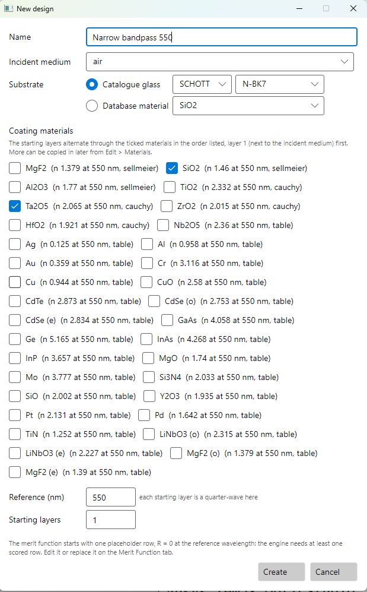

- **Name**: `Narrow bandpass 550`
- **Incident medium**: Air
- **Substrate**: choose **Catalogue glass**, pick **SCHOTT** in the first list and **N-BK7**
  in the second.
- **Coating materials**: tick **Ta2O5** and **SiO2**.
- **Reference (nm)**: `550`
- **Starting layers**: `1`

Press **Create**. The design opens with one quarter-wave layer of Ta2O5. Its merit function
has one placeholder row, R = 0 at 550 nm.

## 1.2 Start from one thick layer

The needle method grows a design by inserting thin layers *inside* existing ones. A thick
layer gives it room to work. Two microns of silica is about 13 quarter-waves at 550 nm.

The program won't let the optimiser take any layer above 600 nm unless you allow it. Raise
that limit first. Choose **Edit > System Parameters…** and set **Maximum for unconstrained
layers** to `5000` nm. Press **OK**.

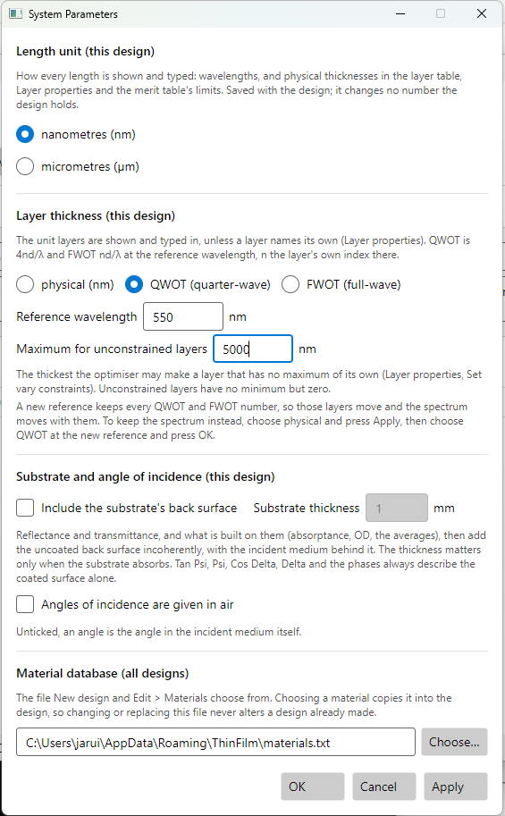

In the **Design** tab, change layer 1:

- **Material**: SiO2
- **Thickness**: `2000`
- **Unit**: nm

> If you skip the System Parameters step, the needle window refuses to start. It says:
> *layer 1 is thicker than the design's maximum for unconstrained layers, 600 nm; raise it in
> Edit > System Parameters, or give the layer a maximum of its own.*

## 1.3 Write the specification as a merit function

Open the **Merit Function** tab and press **Clear all** to remove the placeholder row.

Press **Add operands…** three times, once for each band:

| Code | Mode | Target | WV1 | WV2 | Step WV |
|---|---|---|---|---|---|
| TA | Min | 0.95 | 546 | 554 | 1 |
| TA | Max | 0.005 | 450 | 535 | 1 |
| TA | Max | 0.005 | 565 | 650 | 1 |

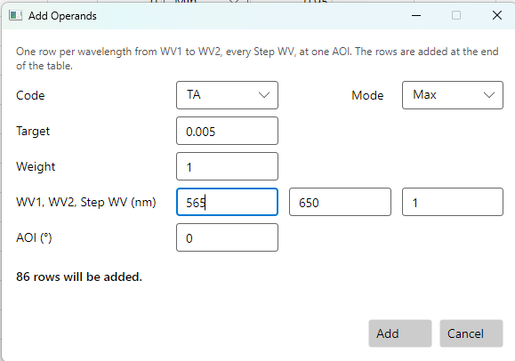

**TA** is the transmittance into the substrate, averaged over s and p. At normal incidence s
and p are the same. **Min** means "at least the target", so a value above it costs nothing.
**Max** means "at most the target".

This gives 181 rows: 9 in the passband and 86 in each blocking band. The blocking bands are
sampled every nanometre. [Section 1.6](#16-check-between-the-sample-points) shows what goes
wrong with coarser sampling.

The merit is now about 187. The silica layer transmits about 97% everywhere, so every
blocking row misses by a factor of almost 200. The passband rows are already met.

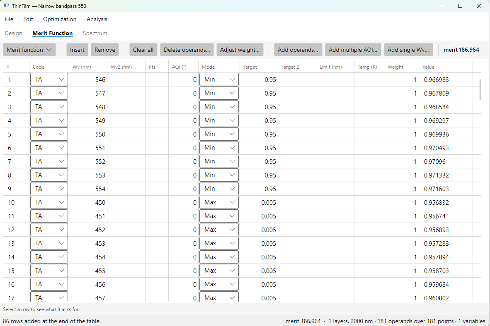

Set the spectrum to **420 – 700 nm** with **TA** so you can watch the design take shape.

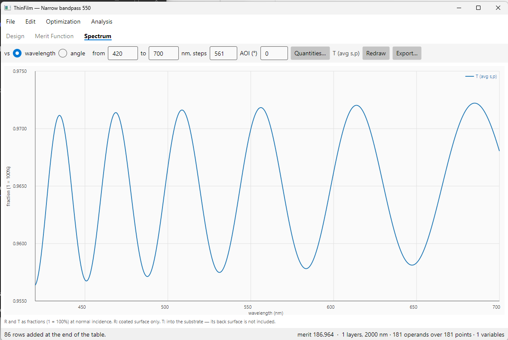

## 1.4 Needle optimisation

Choose **Optimization > Needle optimisation…**. Set **Max insertions** to `40` and **Max
iterations per refine** to `50`, then press **Start**.

The program runs these steps:

1. It refines the starting design.
2. It computes the **needle map**: for every depth in the stack and every material, how much
   the merit would fall if a vanishingly thin layer of that material were inserted there.
3. It inserts a thin layer at the deepest point of the map.
4. It refines the new stack.
5. It repeats steps 2 to 4 until the target is met, the map shows nowhere to insert, or it has
   made the maximum number of insertions.

Each insertion splits a layer in two, so a single insertion adds two layers. The log shows
each one, with the depth measured from the incident medium:

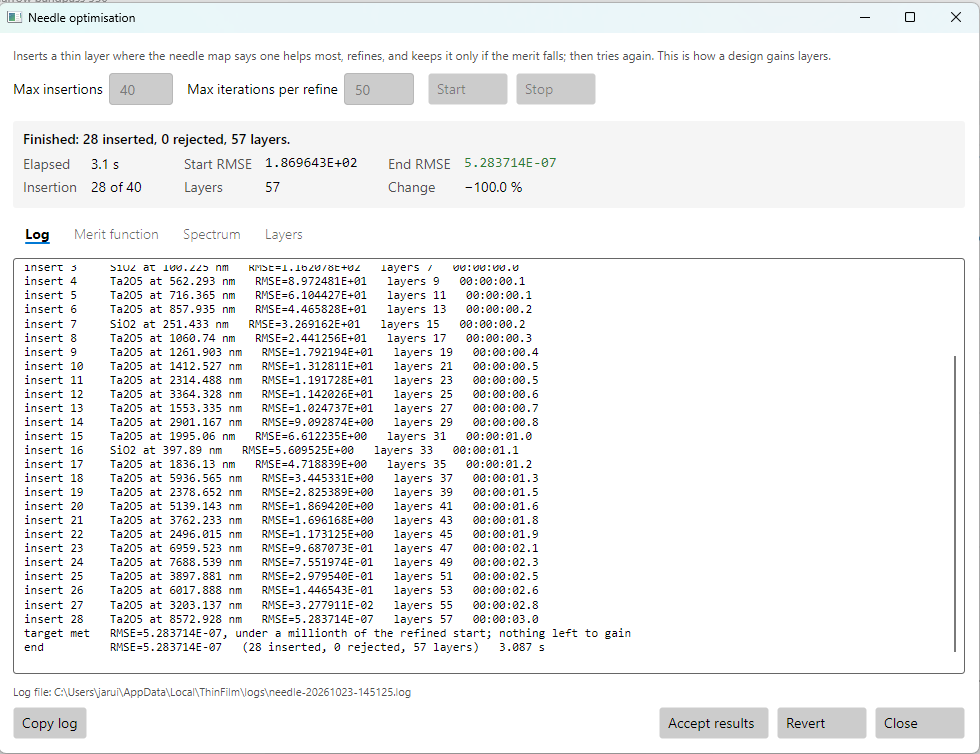

In about three seconds the merit falls from 187 to 5×10⁻⁷ and the design has 57 layers.

Before you accept the result, use the **Merit function**, **Spectrum** and **Layers** tabs of
the window to compare it with the start. The **Layers** tab shows what the needles built:

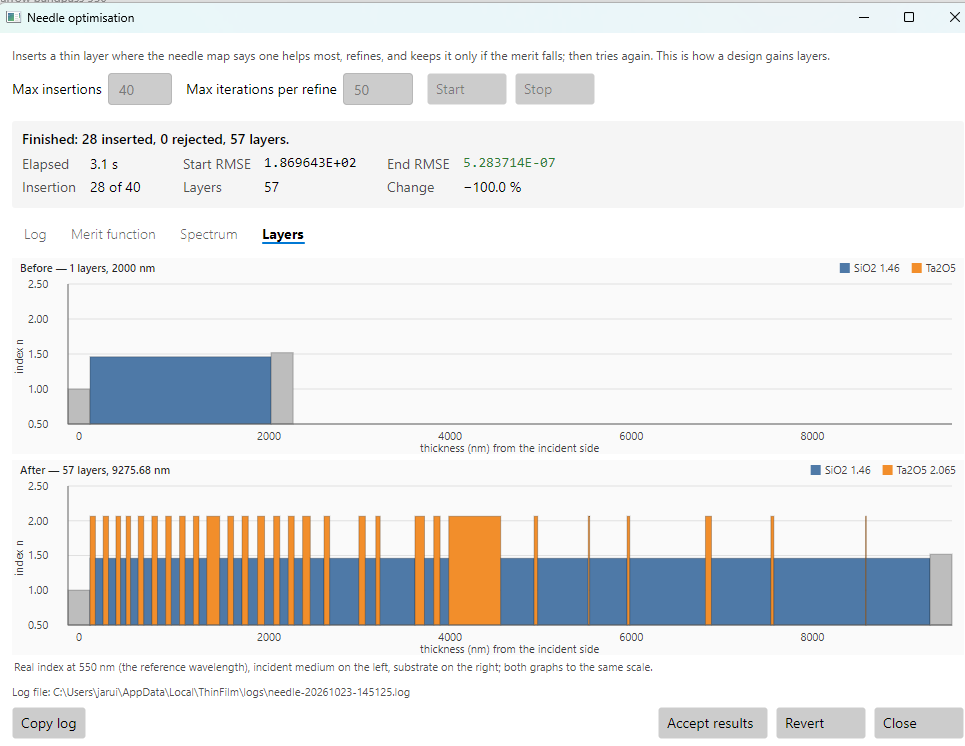

The first needles build a mirror next to the air. Later ones work deeper into the silica, and
as refinement thickens them the silica between them is cut into quarter-waves (about 90 nm) and
much thicker layers (320 – 1000 nm). The quarter-wave pairs are the mirrors and the thick
layers are the cavities. The program found the structure of a multi-cavity filter without being
told it. The total thickness grew from 2 µm to over 9 µm, because refinement thickens the
layers as the structure forms.

The **Spectrum** tab shows the passband and the blocking, with the start dashed:

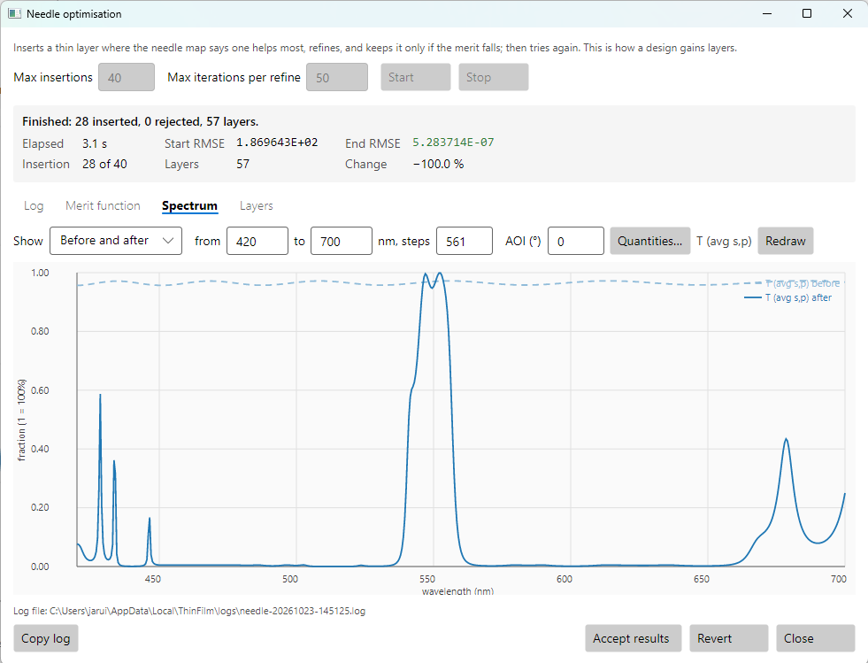

Press **Accept results**.

> **Why 50 iterations?** After each insertion the design is refined. With the default of 300
> iterations, each refinement keeps polishing a design that the next needle will change anyway.
> On this filter that took 199 s and ended with 77 layers. With 50 it took 3 – 5 s and ended
> with 57 layers and a lower merit.

## 1.5 Remove thin layers with gradual evolution

The design meets the specification, but look at the **Design** tab. Three layers are thinner
than 15 nm, and layer 1 is only 0.44 nm. Layers that thin are hard to deposit accurately, and
each one is a separate step in the coating run.

Choose **Optimization > Gradual evolution…** and set:

- **Growth steps**: `2`
- **Minimum thickness**: `15` nm
- **Allowed degradation**: `5` % **or merit up to** `0.1`


Press **Start**. Gradual evolution tries removing every layer thinner than the minimum,
thinnest first. After each removal it refines what remains, and keeps the removal only if the
merit is still good enough:

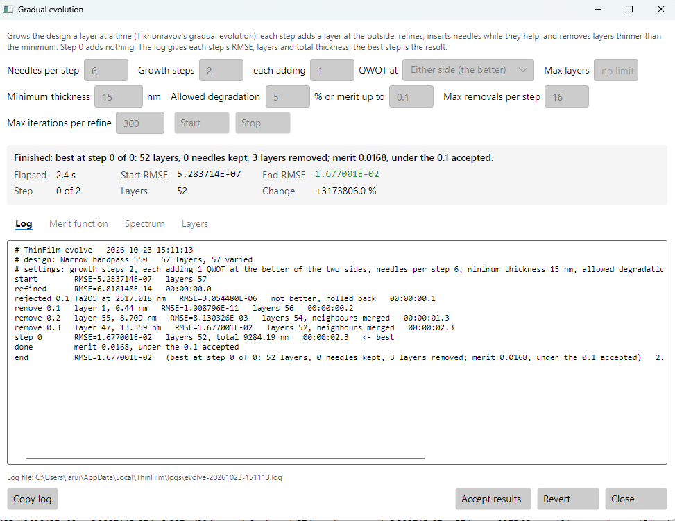

When a removed layer has the same material on both sides, those two layers are merged, so the
stack loses two layers. The merit rises from about 10⁻¹³ to 0.017, which is still a filter that
meets its specification almost everywhere. Evolution stops there: the merit is under the 0.1
you accepted, so growing the stack further would only add layers.

**Why both numbers?** *Allowed degradation* is relative. A removal may cost up to 5% of the
merit. When a design meets its specification, its merit is essentially zero and 5% of zero is
nothing, so no removal would ever be allowed. *Merit up to* is absolute. A removal that leaves
the merit at or under it is kept whatever it costs. Set it to 0 to turn it off.

The window's **Change** shows a dash. A percentage of a starting merit that is essentially zero
would tell you nothing, so read the two RMSE values instead. (The screenshot above was taken
before this was changed, and shows +3173806 %.)

The **Layers** tab shows that the structure is untouched. Only the slivers have gone:

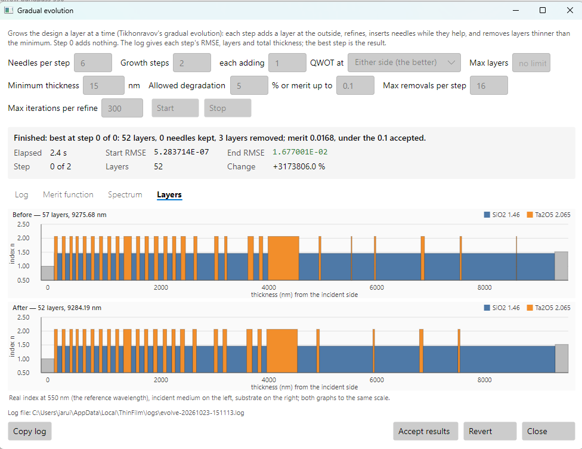

The **Spectrum** tab shows the cost. The passband and the blocking barely move:

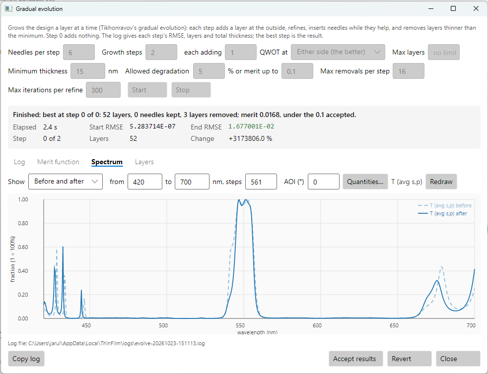

Press **Accept results**.

## 1.6 Check between the sample points

The merit function only sees the wavelengths it samples. A thick filter can have a resonance
narrower than the spacing between them. Always look at the finished spectrum at a finer step
than the merit function used.

Set the spectrum to **440 – 680 nm** with **24001** steps (0.01 nm) and look across the
blocking bands.

This chapter's first attempt, [narrow-bandpass-coarse-sampling.tfd](../../samples/User%20guide/1%20Narrow%20bandpass%20filter/narrow-bandpass-coarse-sampling.tfd), sampled the blocking bands every 2.5 nm. It met that merit
function, but at 466.2 nm, between two sample points, it had a spike 0.3 nm wide that reached
55% transmittance. That design opens zoomed on it:

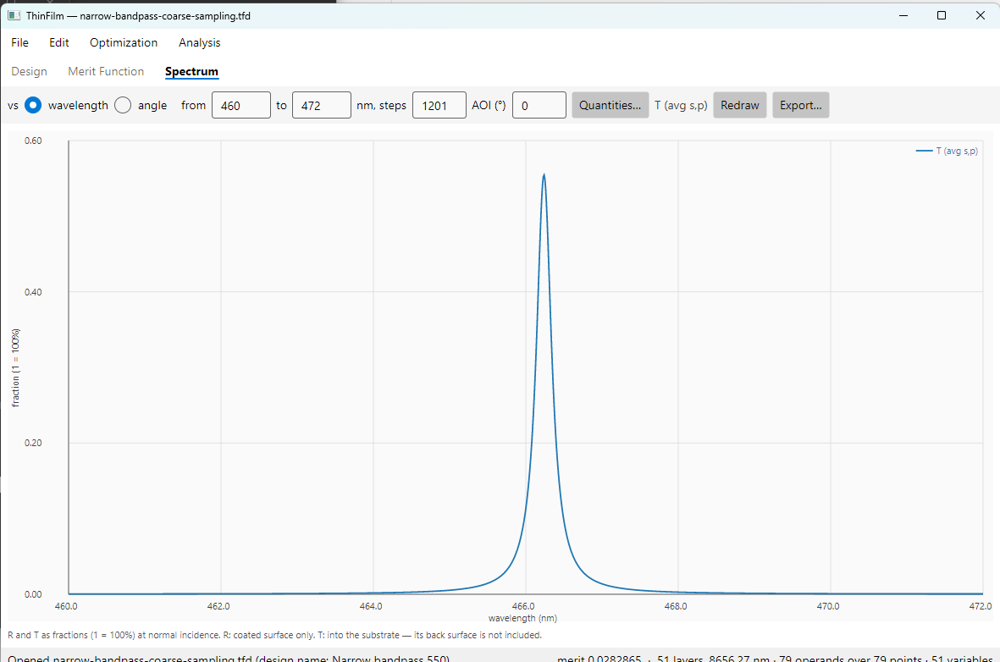

Sampling every nanometre removed it. The design in this chapter, checked every 0.01 nm,
transmits at most 0.56% in both blocking bands.

## 1.7 The result

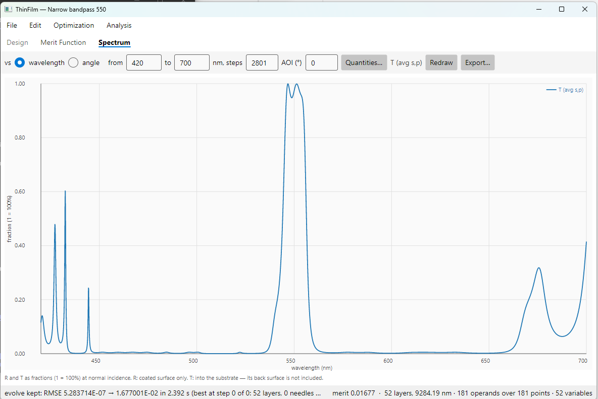

| | |
|---|---|
| Layers | 52, none under 15 nm (the thinnest is 31.5 nm) |
| Total thickness | 9.28 µm |
| Passband, 546 – 554 nm | 94.8 – 99.9% |
| Edges | 14% at 540, 73% at 545, 95% at 546 nm; 87% at 555, 30% at 557, 3.6% at 560 nm |
| Blocking, 450 – 535 and 565 – 650 nm | at most 0.56%, checked every 0.01 nm |

The final merit of 0.017 measures how far it falls short: the passband dips to 94.8%, and the
blocking peaks at 0.56% instead of 0.5%.

Outside 450 – 650 nm the filter transmits again, because nothing in the merit function asked it
not to. To block more widely, add rows over a wider range. That usually needs more layers. An
absorbing glass or a separate blocking coating is the usual answer.

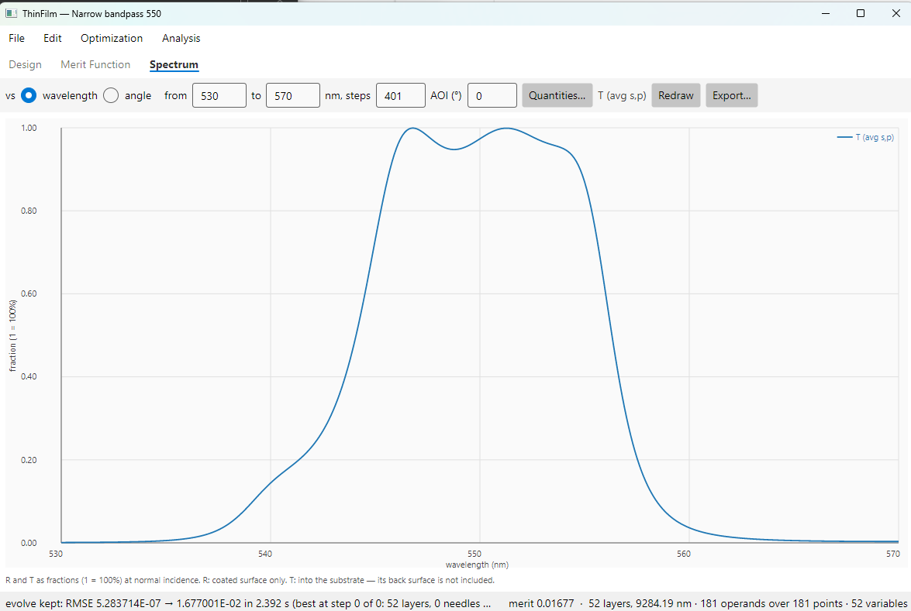

Save the design with **File > Save As…**.

## 1.8 Things to try

- **Start thinner or thicker.** The start changes the design you get, not whether you get one.
  With blocking sampled every 2.5 nm, starts of 1000, 2000 and 4000 nm all met the merit
  function, ending with 65, 53 and 77 layers.
- **Make it harder.** Ask for a 4 nm passband, or blocking at 0.1%. The design needs more
  layers. Raise **Max insertions**, or let gradual evolution grow the stack with more
  **Growth steps** and **merit up to** set to 0.
- **Look at the needle map.** `thinfilm needle-map` prints the map for the current design, so
  you can see where the next needle would go.

## 1.9 The same design from the command line

The GUI, the command line and the MCP server all go through the same program interface. From
the command line, the whole chapter is:

```sh
thinfilm new --materials Ta2O5,SiO2 --substrate N-BK7 --name "Narrow bandpass 550" \
             --reference 550 --layers 1 -o bp.tfd
thinfilm units bp.tfd --maximum 5000
thinfilm layer set bp.tfd --layer 1 --material SiO2 --thickness 2000 --unit nm
thinfilm merit clear bp.tfd
thinfilm merit add bp.tfd --code TA --mode Min --target 0.95  --from 546 --to 554 --step 1
thinfilm merit add bp.tfd --code TA --mode Max --target 0.005 --from 450 --to 535 --step 1
thinfilm merit add bp.tfd --code TA --mode Max --target 0.005 --from 565 --to 650 --step 1
thinfilm needle bp.tfd --insertions 40 --iterations 50 -o bp.tfd
thinfilm evolve bp.tfd --growth-steps 2 --min-thickness 15 --accept-merit 0.1 -o bp.tfd
thinfilm spectrum bp.tfd --from 440 --to 680 --steps 24001 --quantities TA -o bp.csv
```

`needle` and `evolve` print the same log as the GUI windows. Without `-o` they show the result
but don't save it.
