# 2. A polarising beam splitter plate immersed in oil

A polarising beam splitter (PBS) reflects s-polarised light and transmits p-polarised light.
In this chapter we design one that has to work over a cone of light, not just a single ray.
That is where a PBS gets hard.

The coating goes on a glass plate. The plate is immersed in an oil whose index matches BK7, so
the coating has BK7-index glass on both sides.

## 2.1 Why a plate in oil, at 54°

The textbook PBS is a MacNeille cube: the coating is cemented between two glass prisms, at 45°.
There are two reasons to use a plate in oil instead.

- **Stress birefringence.** Glass under stress becomes birefringent, and that changes the
  polarisation of the light passing through it. A solid block of BK7 large enough for a cube
  carries enough stress to spoil a high-contrast beam splitter. A liquid can't hold stress, so
  the oil adds no birefringence, and a thin plate adds very little.
- **The angle.** A cube's geometry fixes the angle of incidence at 45°. A plate can be tilted to
  whatever angle the coating needs.

The angle that TiO2/SiO2 needs comes from Brewster's angle. At one particular angle, p-polarised
light crosses every TiO2/SiO2 interface without reflecting, while s-polarised light still
reflects. That happens when

    n₀ sin θ₀ = n_H n_L / √(n_H² + n_L²)

where n₀ is the index of the medium the light arrives from. For TiO2 (n_H = 2.33) and SiO2
(n_L = 1.46) the right-hand side is 1.24. In BK7-index oil (n₀ = 1.52) that gives θ₀ ≈ 54.6°.
At 45° in BK7, n₀ sin θ₀ is only 1.07, too far from 1.24 to work over a wide band. That is why
a 45° BK7 cube with these materials isn't practical, and a 54° plate in oil is.

**The light is an f/4.8 cone.** Its half-angle is 6.0° in air and 3.9° inside the oil, so the
coating sees angles from 50° to 58°.

The specification, from 430 to 680 nm:

| | Requirement |
|---|---|
| Ts (s transmitted, the leak) | at most 0.1%, a contrast of 1000:1 |
| Tp (p transmitted, the signal) | at least 95% |

The designs from this chapter are in [samples/User guide/2 Polarising beam splitter plate](../../samples/User%20guide/2%20Polarising%20beam%20splitter%20plate):

| File | What it is |
|---|---|
| [pbs-plate-start.tfd](../../samples/User%20guide/2%20Polarising%20beam%20splitter%20plate/pbs-plate-start.tfd) | start for 2.3: one 2000 nm SiO2 layer, the spec at 54° |
| [pbs-plate-54.tfd](../../samples/User%20guide/2%20Polarising%20beam%20splitter%20plate/pbs-plate-54.tfd) | the result of 2.3: 15 layers for 54° only |
| [pbs-plate-cone-start.tfd](../../samples/User%20guide/2%20Polarising%20beam%20splitter%20plate/pbs-plate-cone-start.tfd) | start for 2.5: the spec over the whole cone |
| [pbs-plate-cone.tfd](../../samples/User%20guide/2%20Polarising%20beam%20splitter%20plate/pbs-plate-cone.tfd) | the result of 2.5: 29 layers for the cone |
| [pbs-plate-thick.tfd](../../samples/User%20guide/2%20Polarising%20beam%20splitter%20plate/pbs-plate-thick.tfd) | the result of 2.7: 58 layers that leak between sample points |

## 2.2 Create the design

Choose **File > New design…**.

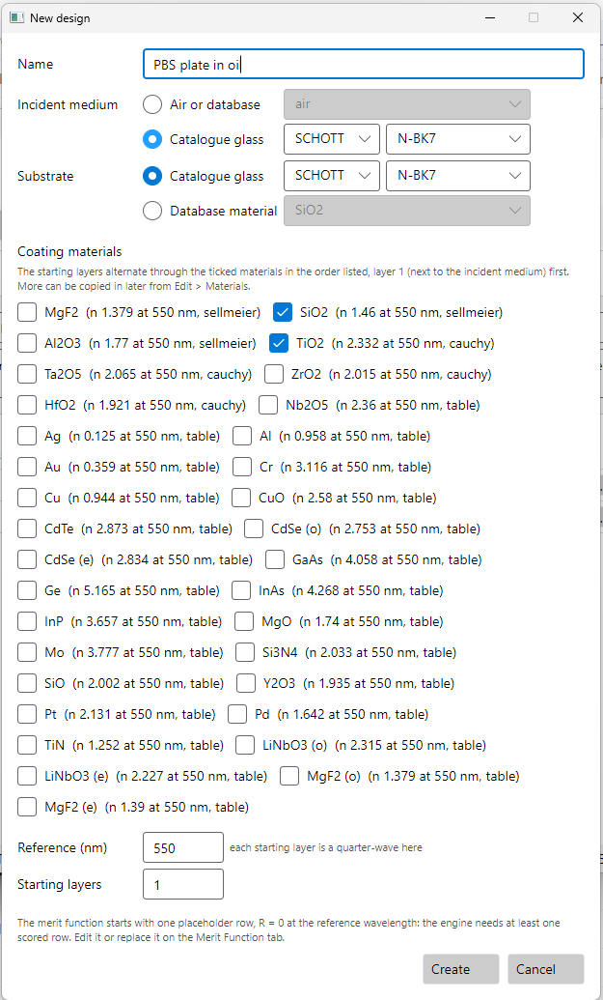

- **Name**: `PBS plate in oil`
- **Incident medium**: click the **Catalogue glass** button, then choose **SCHOTT** and
  **N-BK7**. The oil matches BK7, so it is modelled as N-BK7. Only the row whose button is
  selected counts; the other row's boxes are greyed out. Left on **Air or database**, the plate
  would be in air.
- **Substrate**: also **Catalogue glass**, **SCHOTT**, **N-BK7**.
- **Coating materials**: tick **TiO2** and **SiO2**.
- **Reference (nm)**: `550`
- **Starting layers**: `1`

Press **Create**.

As in [chapter 1](01-narrow-bandpass.md), two settings before the merit function. Don't skip
them: needle needs a thick layer to work in. In a layer of 1 QWOT or less, an inserted needle has
nothing to interfere with, so needle stops at once and says the stack is too thin.

1. In **Edit > System Parameters…**, set **Maximum for unconstrained layers** to `5000` nm.
   Leave **Angles of incidence are given in air** unticked. The angles in this chapter are
   angles inside the oil.
2. In the **Design** tab, set layer 1 to **SiO2**, `2000`, **nm**.

## 2.3 First, 54° only

On the **Merit Function** tab, press **Clear all**. Then press **Add operands…** twice:

| Code | Mode | Target | WV1 | WV2 | Step WV | AOI (°) |
|---|---|---|---|---|---|---|
| TS | Max | 0.001 | 430 | 680 | 2 | 54 |
| TP | Min | 0.95 | 430 | 680 | 2 | 54 |

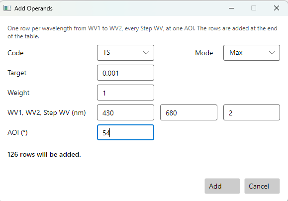

**TS** and **TP** are the transmittance for s and for p. There are 252 rows, and the merit is
about 701.

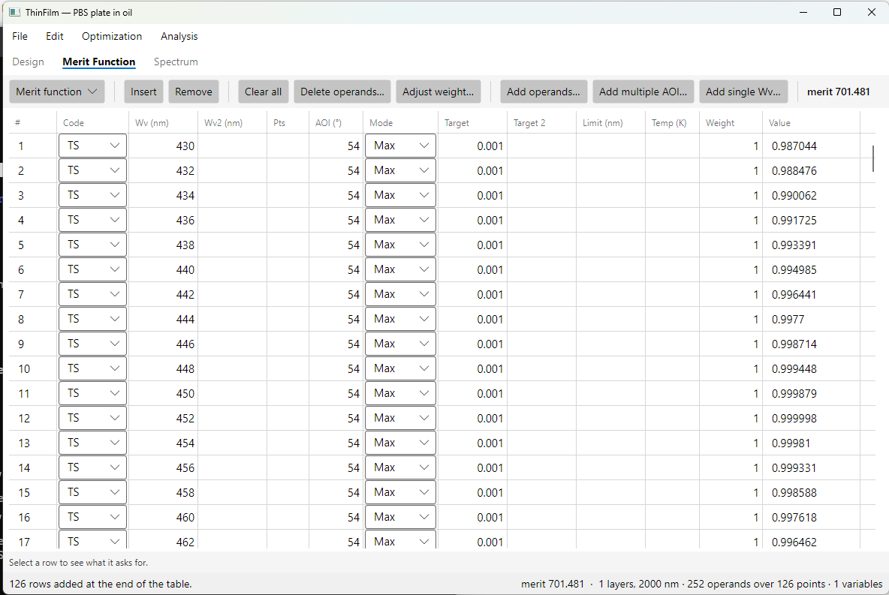

With N-BK7 on both sides, the 2000 nm SiO2 layer hardly reflects at all, so Ts is close to 1.
That is the leak, and it makes the merit large.

Choose **Optimization > Needle optimisation…**, set **Max insertions** to `40` and **Max
iterations per refine** to `50`, and press **Start**.

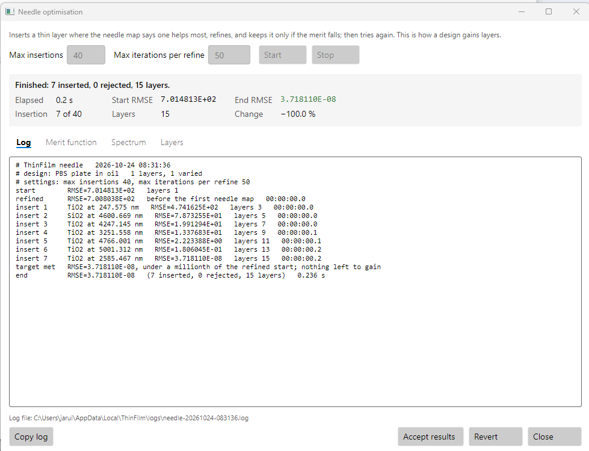

It meets the spec in seven insertions and a fraction of a second: 15 layers, with merit 4×10⁻⁸.
At 54° the Brewster condition does most of the work. Press **Accept results**.

## 2.4 The cone breaks it

On the **Spectrum** tab, plot **TS** and **TP** (choose them with **Quantities…**) from 430 to
680 nm, with **steps** `2501`. At 54° it is what was asked for: Ts near 0 and Tp near 1.

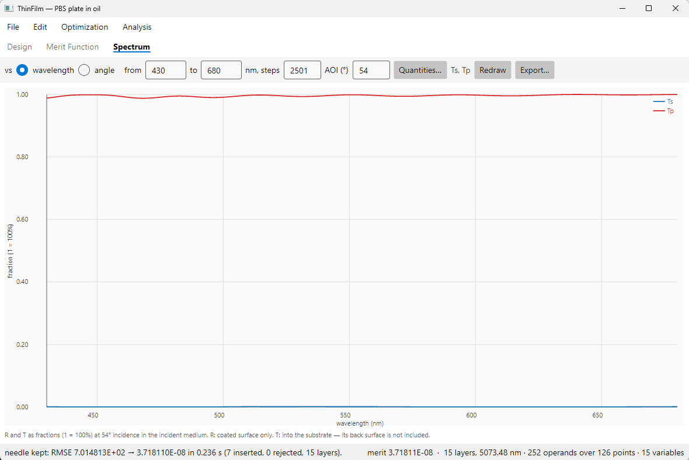

Now change **AOI** to 50, then to 58:

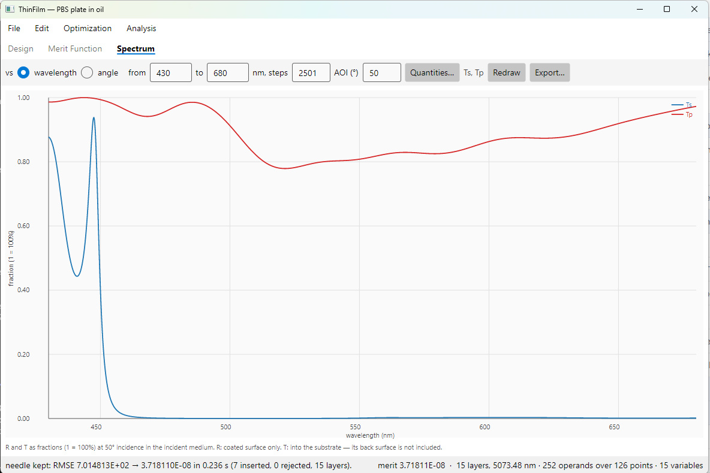

Five degrees off, the design falls apart. Checked every 0.01 nm:

| AOI | Ts, worst | Tp, worst |
|---|---|---|
| 50° | **93.8%** | 77.9% |
| 52° | **99.6%** | 92.0% |
| 54° | 0.10% | 98.8% |
| 56° | 0.23% | 95.6% |
| 58° | 0.61% | **76.1%** |

The design meets its spec only at the angle it was asked about. To make it work over the cone,
the merit function has to ask about the cone.

## 2.5 Design for the whole cone

Open [pbs-plate-cone-start.tfd](../../samples/User%20guide/2%20Polarising%20beam%20splitter%20plate/pbs-plate-cone-start.tfd), or build the same
thing yourself:

1. Open [pbs-plate-start.tfd](../../samples/User%20guide/2%20Polarising%20beam%20splitter%20plate/pbs-plate-start.tfd), which has one 2000 nm SiO2 layer.
2. On the **Merit Function** tab, press **Clear all**.
3. Press **Add multiple AOI…** twice. It adds the rows at every angle from **Start AOI** to
   **End AOI**, every **Step AOI**:

| Code | Mode | Target | WV1 | WV2 | Step WV | Start AOI | End AOI | Step AOI |
|---|---|---|---|---|---|---|---|---|
| TS | Max | 0.001 | 430 | 680 | 2 | 50 | 58 | 2 |
| TP | Min | 0.95 | 430 | 680 | 2 | 50 | 58 | 2 |

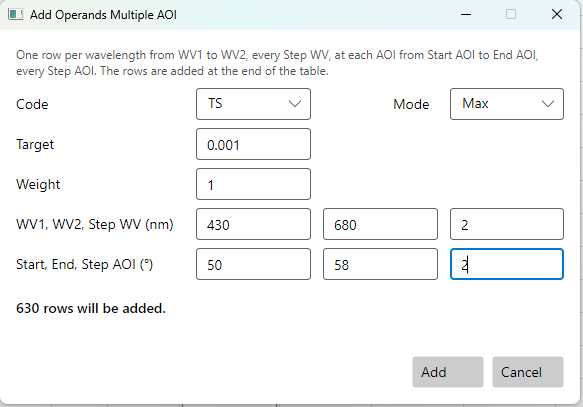

Each press adds 630 rows, so there are 1260 rows in all: two codes, 126 wavelengths, five angles.

**Needle optimisation**, with **Max insertions** `60` and **Max iterations per refine** `50`:

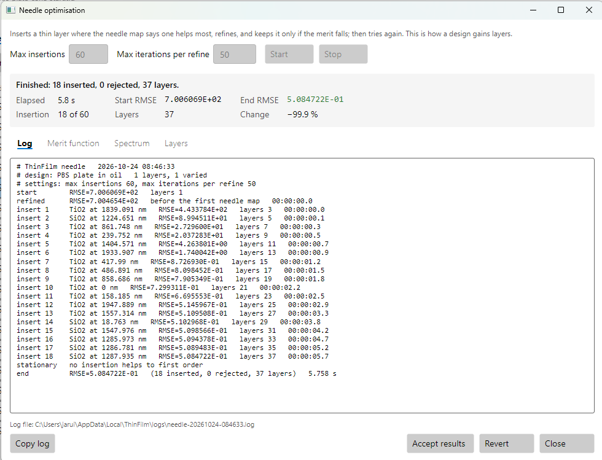

This time needle stops before it runs out of insertions:

```
stationary   no insertion helps to first order
end          RMSE=5.084722E-01   (18 inserted, 0 rejected, 37 layers)
```

*Stationary* means the needle map has no point where a new layer would help. For this total
thickness, no layer can be usefully added. To do better, the stack has to get thicker, and
that is what gradual evolution does. Press **Accept results**.

**Gradual evolution**, with **Growth steps** `12`, **Minimum thickness** `15` nm and **Max
iterations per refine** `50`:

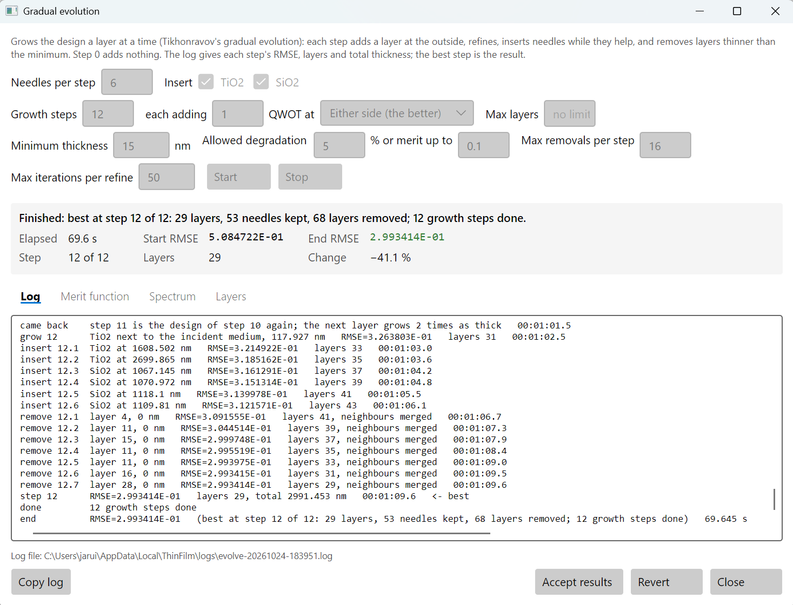

```
step 0       RMSE=5.069892E-01   layers 17, total 1877.199 nm   <- best
step 1       RMSE=4.535974E-01   layers 19, total 2095.851 nm   <- best
step 2       RMSE=4.535974E-01   layers 19, total 2095.851 nm
came back    step 2 is the design of step 1 again; the next layer grows 2 times as thick
step 3       RMSE=4.223937E-01   layers 23, total 2432.829 nm   <- best
...
step 12      RMSE=2.993414E-01   layers 29, total 2991.453 nm   <- best
done         12 growth steps done
```

In step 0 the stack goes from 37 layers to 17 as the layers needle had driven thin are removed,
and the merit hardly moves: they were doing nothing. Step 1 adds a layer, needles again and
improves the merit.

Step 2 adds a layer, but refining thins it away and removing thin layers takes the stack straight
back to the step 1 design. Growing the same layer again would only repeat that, so evolution
**came back** and grows the next layer twice as thick. That one survives, and step 3 is better. The
same happens several more times on the way, once at four times as thick, and evolution runs all
12 steps to 29 layers at a merit of 0.30. It takes about a minute. Press **Accept results**.

## 2.6 Reading the result

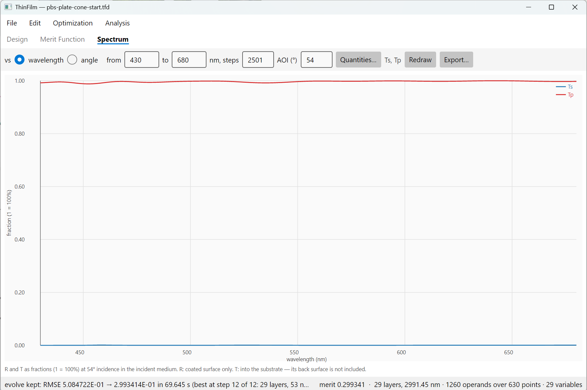

The design has 29 layers and is 2.99 µm thick. The TiO2 layers get thinner from the incident oil
to the plate, from 110 nm to 30 nm, though not steadily. Different depths reflect s light at
different wavelengths and angles. Checked every 0.01 nm:

| AOI | Ts, worst | Tp, worst |
|---|---|---|
| 50° | 0.18% | 86.4% |
| 52° | 0.11% | 94.7% |
| 54° | 0.11% | 98.8% |
| 56° | 0.12% | 97.9% |
| 58° | 0.25% | 91.2% |

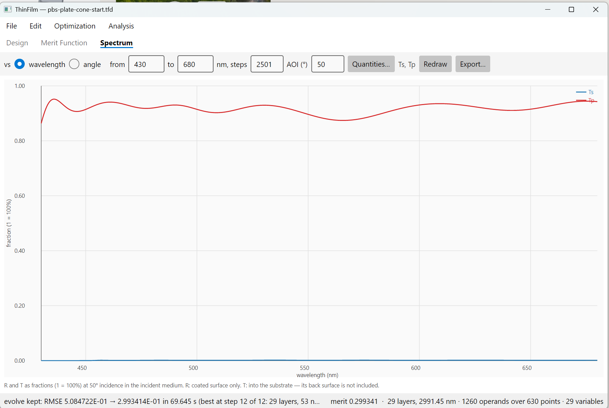

The merit of 0.30 doesn't meet the specification:

- **Ts** is at most 0.25% at every angle. That is a contrast better than 400:1 across the whole
  cone, and 900:1 at 54°.
- **Tp** is 99% at the centre but falls to 86% at 50° and 91% at 58°, the edges of the cone.

The edges are the physics, not the optimiser. Brewster's condition holds at one angle. Five
degrees away, p light reflects at every TiO2/SiO2 interface, and the more layers there are, the
more of it is lost. Contrast across the cone and p transmission at its edges pull against each
other, so the optimiser trades one against the other.

The literature agrees. L. Li and J. A. Dobrowolski, *Appl. Opt.* **39**, 2754 (2000), compare
their own design with a conventional MacNeille polariser at 51.5° in glass of index 1.52, from
420 to 760 nm. They report a transmission contrast below 1000:1 at the design angle. Their design
is in the samples: **File > Open sample… > Literature > Polarizers > Li 2000 >
Li2000-MacNeille-comparison**.

To trade differently, change the merit function. For example, accept Tp ≥ 90% at 50° and 58°
by giving those rows a target of 0.90. Or give the 54° rows more **Weight**, if most of the
light arrives near the axis.

## 2.7 Push harder, and get caught

What if the merit could go lower? Start again from
[pbs-plate-cone-start.tfd](../../samples/User%20guide/2%20Polarising%20beam%20splitter%20plate/pbs-plate-cone-start.tfd) with more room:

- Layer 1: `5000` nm instead of 2000.
- **Needle optimisation**: **Max insertions** `100`, **Max iterations per refine** `50`.
- **Gradual evolution**: **Growth steps** `12`, **each adding** `3` QWOT, **Minimum thickness**
  `10` nm, **Max iterations per refine** `50`. This takes a few minutes.

The merit falls to 0.22, against the 29-layer design's 0.30, with 58 layers. The lowest merit came
at step 12, 0.214 with 62 layers. Evolution keeps step 11 instead, because its merit is within the
**Allowed degradation** of 5% and it has 4 fewer layers. The log says so:

```
step 11      RMSE=2.206951E-01   layers 58, total 6013.771 nm   <- best
step 12      RMSE=2.139870E-01   layers 62, total 6179.25 nm    <- best
done         12 growth steps done
chose        step 11: 58 layers at 0.2207, within 5% of step 12's 0.214 with 4 fewer layers
```

The design looks better than the 29-layer one. But the run's state line and the end of its log
say otherwise:

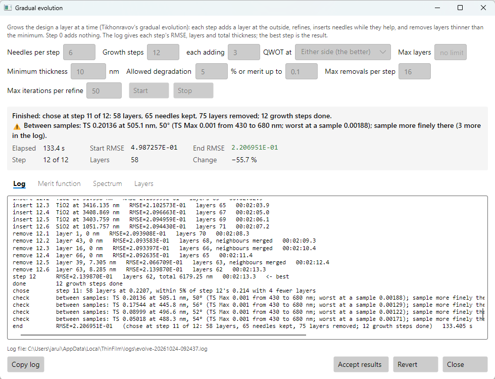

```
check   between samples: TS 0.20136 at 505.1 nm, 50° (TS Max 0.001 from 430 to 680 nm;
        worst at a sample 0.00188); sample more finely there
check   between samples: TS 0.17544 at 445.8 nm, 56° (...)
check   between samples: TS 0.08999 at 496.6 nm, 52° (...)
check   between samples: TS 0.05018 at 488.3 nm, 54° (...)
```

After every run, the program checks the result at 20 times the merit function's wavelength
sampling. It reports any place where a Min or Max row's spec is missed by clearly more than at
any sample point. The 58-layer stack has narrow resonances that fall between the 2 nm samples.
At the samples, Ts is 0.19% at most. Between them it reaches 20%, and a spectrum every 0.01 nm
finds 70% at 464.4 nm at 50°:

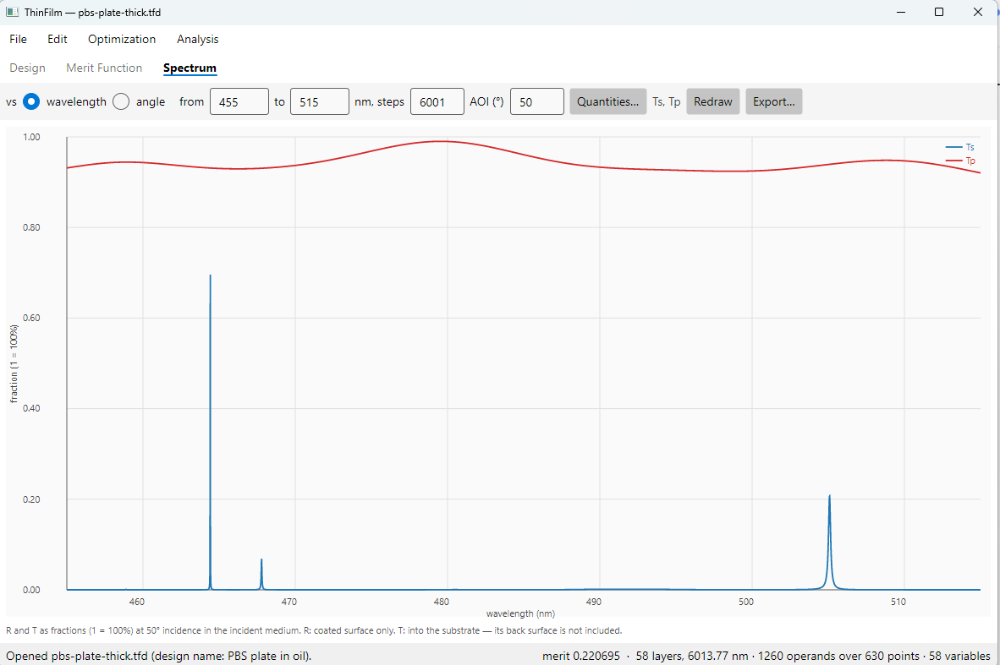

[pbs-plate-thick.tfd](../../samples/User%20guide/2%20Polarising%20beam%20splitter%20plate/pbs-plate-thick.tfd) opens zoomed on that leak. A lower merit is
not always a better design. The 29-layer design is the better beam splitter, and it is also
much easier to make.

`thinfilm evaluate` prints the same check for any design, and so does the MCP's
`check_between_samples` tool.

## 2.8 The same design from the command line

```sh
thinfilm new --materials TiO2,SiO2 --incident N-BK7 --substrate N-BK7 \
             --name "PBS plate in oil" --reference 550 --layers 1 -o pbs.tfd
thinfilm units pbs.tfd --maximum 5000
thinfilm layer set pbs.tfd --layer 1 --material SiO2 --thickness 2000 --unit nm
thinfilm merit clear pbs.tfd
thinfilm merit add pbs.tfd --code TS --mode Max --target 0.001 --from 430 --to 680 --step 2 \
                           --aoi-from 50 --aoi-to 58 --aoi-step 2
thinfilm merit add pbs.tfd --code TP --mode Min --target 0.95  --from 430 --to 680 --step 2 \
                           --aoi-from 50 --aoi-to 58 --aoi-step 2
thinfilm needle pbs.tfd --insertions 60 --iterations 50 -o pbs.tfd
thinfilm evolve pbs.tfd --growth-steps 12 --min-thickness 15 --iterations 50 -o pbs.tfd
thinfilm evaluate pbs.tfd
thinfilm spectrum pbs.tfd --from 430 --to 680 --steps 2501 --angle 50 --quantities TS,TP -o pbs-50.csv
```
