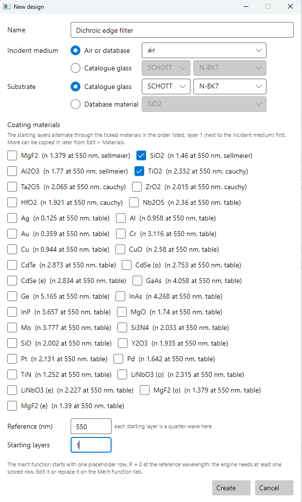
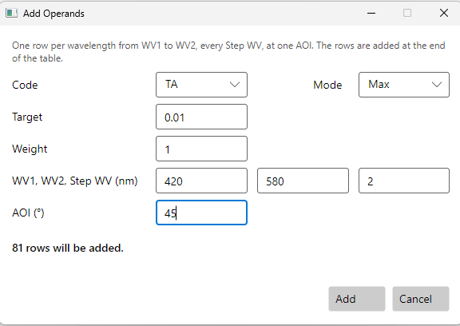
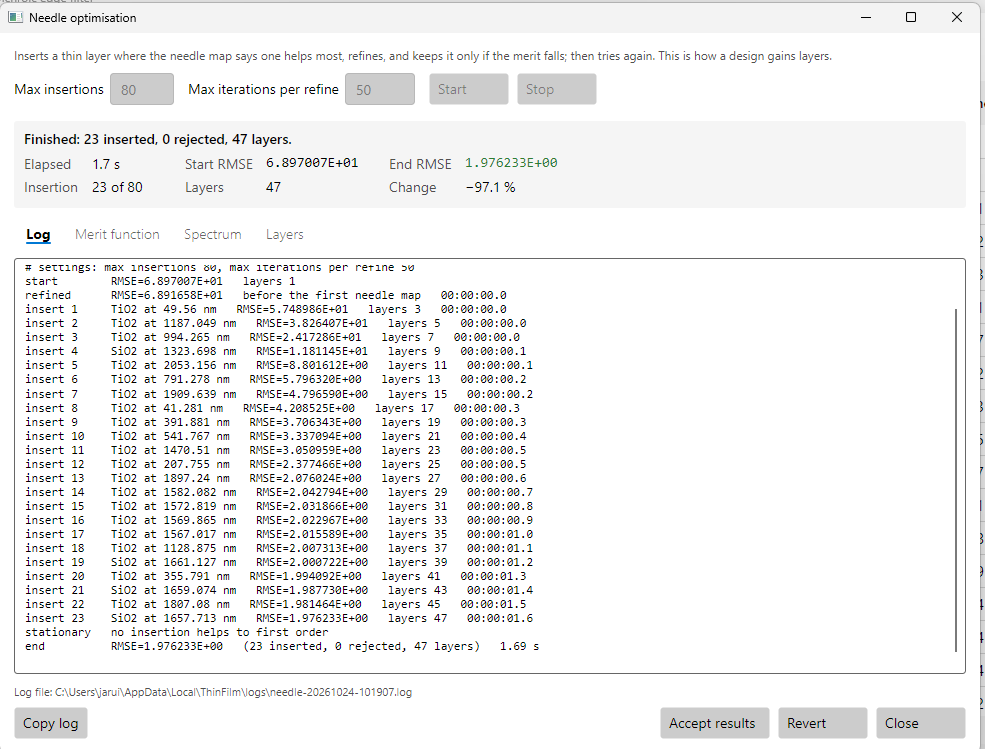
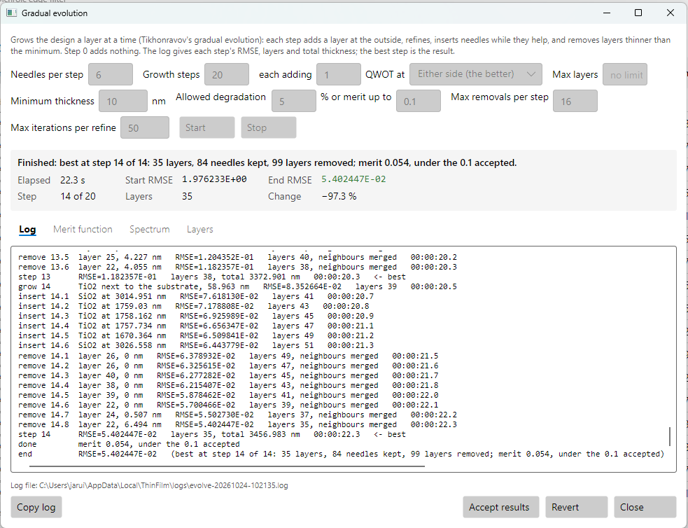
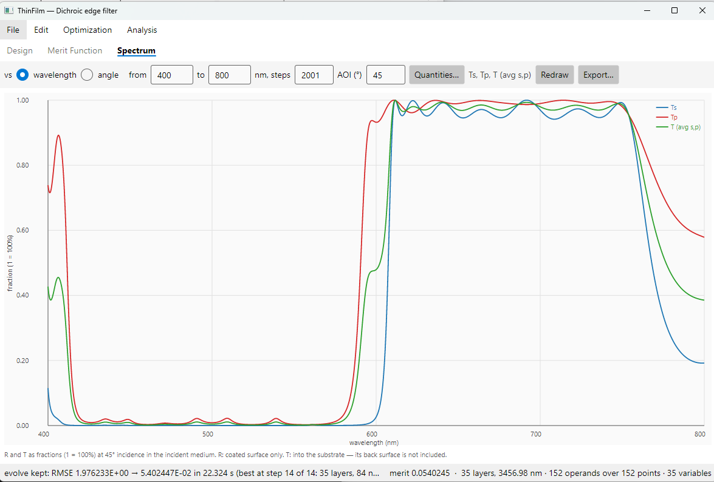
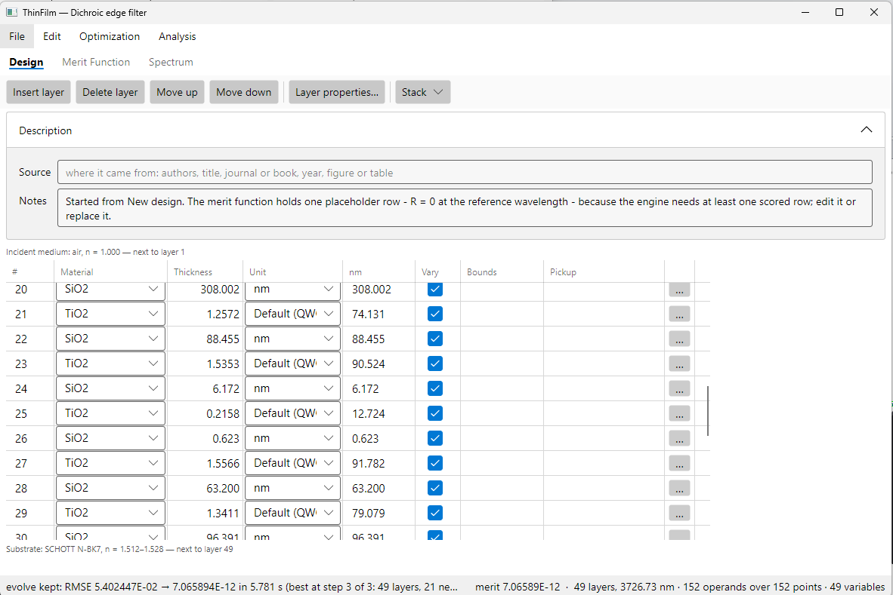
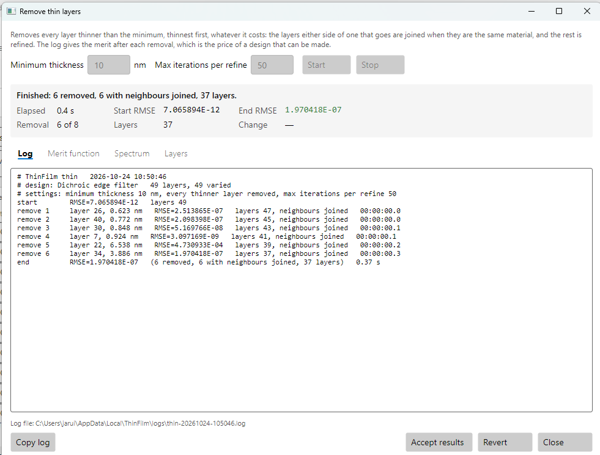
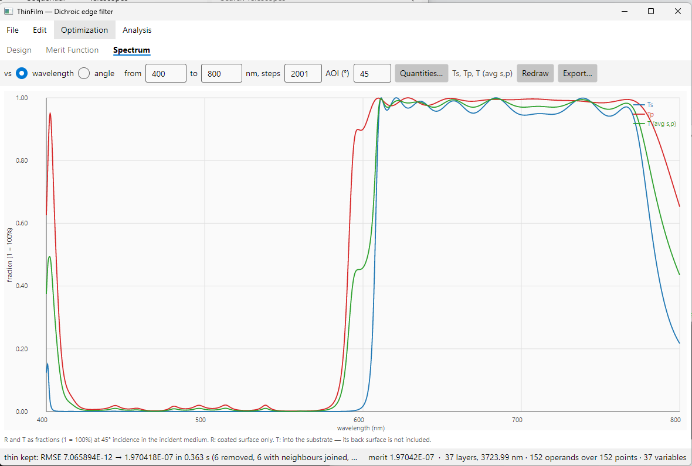
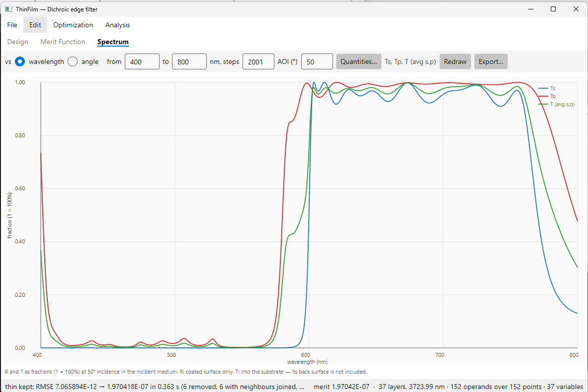

# 3. A dichroic edge filter at 45°

A dichroic filter splits light by colour. This one is a coated plate at 45° in air: it reflects
blue and green and transmits red. The edge between them is at about 600 nm.

This chapter is about two things that the first two chapters did not need: an edge that has to be
steep for unpolarised light, and a design that can actually be made.

## 3.1 The filter

| | Requirement |
|---|---|
| Reflect, 420 to 580 nm | TA at most 1% |
| Transmit, 610 to 750 nm | TA at least 97% |
| Light | unpolarised, at 45° in air |

**TA** is the transmittance for unpolarised light: the average of Ts and Tp.

**45° is what makes it hard.** At normal incidence s and p light are the same. At 45° they are
not: the s edge and the p edge of a stack fall at different wavelengths, and the p stopband is
narrower than the s one. Unpolarised light sees the average, so the edge it sees is only as
steep as the gap between the s edge and the p edge allows. Here the edge has 30 nm, from 580 to
610 nm, to go from reflecting to transmitting.

The designs from this chapter are in [samples/User guide/3 Dichroic edge filter](../../samples/User%20guide/3%20Dichroic%20edge%20filter):

| File | What it is |
|---|---|
| [dichroic-start.tfd](../../samples/User%20guide/3%20Dichroic%20edge%20filter/dichroic-start.tfd) | start for 3.4: one 3000 nm SiO2 layer and the spec |
| [dichroic-needle.tfd](../../samples/User%20guide/3%20Dichroic%20edge%20filter/dichroic-needle.tfd) | after needle: 47 layers |
| [dichroic-35.tfd](../../samples/User%20guide/3%20Dichroic%20edge%20filter/dichroic-35.tfd) | after gradual evolution: 35 layers, close to the spec |
| [dichroic-49.tfd](../../samples/User%20guide/3%20Dichroic%20edge%20filter/dichroic-49.tfd) | evolved to the spec: 49 layers, with slivers |
| [dichroic-37.tfd](../../samples/User%20guide/3%20Dichroic%20edge%20filter/dichroic-37.tfd) | the slivers removed: 37 layers, the design to make |

## 3.2 Create the design

Choose **File > New design…**.



- **Name**: `Dichroic edge filter`
- **Incident medium**: **Air or database**, `air`. The plate is in air this time.
- **Substrate**: **Catalogue glass**, **SCHOTT**, **N-BK7**.
- **Coating materials**: tick **TiO2** and **SiO2**.
- **Reference (nm)**: `550`
- **Starting layers**: `1`

Press **Create**. Then, as in the earlier chapters:

1. In **Edit > System Parameters…**, set **Maximum for unconstrained layers** to `5000` nm.
2. In the **Design** tab, set layer 1 to **SiO2**, `3000`, **nm**.

## 3.3 The merit function

On the **Merit Function** tab, press **Clear all**. Then press **Add operands…** twice:

| Code | Mode | Target | WV1 | WV2 | Step WV | AOI (°) |
|---|---|---|---|---|---|---|
| TA | Max | 0.01 | 420 | 580 | 2 | 45 |
| TA | Min | 0.97 | 610 | 750 | 2 | 45 |



There are 152 rows, and the merit is about 69. Nothing is asked between 580 and 610 nm: that is
where the edge goes, and the optimiser is free to put it anywhere in there.

## 3.4 Needle

Choose **Optimization > Needle optimisation…**, set **Max insertions** to `80` and **Max
iterations per refine** to `50`, and press **Start**.



In under two seconds needle is *stationary* at 47 layers, with merit 1.98. As in
[chapter 2](02-pbs-plate.md), no needle helps at this total thickness, and a thicker stack is
gradual evolution's job. Press **Accept results**.

## 3.5 Gradual evolution

Choose **Optimization > Gradual evolution…**. Set **Growth steps** to `20`, **Minimum
thickness** to `10` nm and **Max iterations per refine** to `50`. Leave **% or merit up to** at
`0.1`. Press **Start**.



```
step 12      RMSE=1.348877E-01   layers 37, total 3279.207 nm   <- best
step 13      RMSE=1.182357E-01   layers 38, total 3372.901 nm   <- best
step 14      RMSE=5.402447E-02   layers 35, total 3456.983 nm   <- best
done         merit 0.054, under the 0.1 accepted
```

In 20 to 45 seconds, depending on the computer, the merit falls from 1.98 to 0.054, with 35 layers. Evolution stops there
because the merit is under the 0.1 accepted. Press **Accept results**.

On the **Spectrum** tab, plot **TA**, **TS** and **TP** (choose them with **Quantities…**) from 400
to 800 nm, at **AOI** `45`:



It is close, but checked every 0.01 nm it misses at both ends of the edge:

| | Spec | 35 layers |
|---|---|---|
| TA, 420 to 580 nm | at most 1% | 1.61% at 580 nm |
| TA, 610 to 750 nm | at least 97% | 96.51% at 617 nm |

A merit of 0.1 is a good place to stop for many designs, but not when the spec is a hard limit.

## 3.6 All the way to the spec

Open **Gradual evolution…** again, with the same settings but **% or merit up to** `0`. Now
only reaching the target, or running out of steps, stops it. Press **Start**.

```
step 0       RMSE=4.566275E-02   layers 34, total 3564.795 nm   <- best
step 1       RMSE=2.054153E-02   layers 41, total 3599.615 nm   <- best
step 2       RMSE=1.046352E-02   layers 42, total 3716.304 nm   <- best
step 3       RMSE=7.065894E-12   layers 49, total 3726.732 nm   <- best
done         target met
```

In ten seconds it meets the spec at every sample point: 49 layers, merit 7×10⁻¹². Press
**Accept results** and look at the **Design** tab:



Eight of the layers are thinner than the 10 nm minimum that was asked for:

| Layer | 6 | 7 | 24 | 26 | 32 | 42 | 43 | 44 |
|---|---|---|---|---|---|---|---|---|
| Material | SiO2 | TiO2 | SiO2 | SiO2 | SiO2 | SiO2 | TiO2 | SiO2 |
| nm | 3.9 | 1.0 | 6.2 | 0.6 | 0.8 | 0.8 | 1.2 | 6.7 |

Nobody can deposit 0.6 nm of SiO2. These are needles that refinement drove thin but did not
remove.

Gradual evolution removes a thin layer only if the merit afterwards is no more than the
**Allowed degradation**, 5%, worse. That keeps a thin layer that is doing real work. But at a
merit of 7×10⁻¹² every removal costs more than 5% of almost nothing, so every sliver stays.

## 3.7 Remove thin layers

Choose **Optimization > Remove thin layers…**, set **Minimum thickness** to `10` nm and **Max
iterations per refine** to `50`, and press **Start**.



It removes every layer under the minimum, whatever it costs, thinnest first. When the layers
either side of a removed one are the same material they are joined into one. After each removal
the rest of the stack is refined, with every remaining layer held at 10 nm or more so that
refining cannot make a new sliver. The log gives the merit after each removal, which is the price
of a design that can be made:

```
remove 1     layer 26, 0.623 nm   RMSE=2.513865E-07   layers 47, neighbours joined
remove 2     layer 40, 0.772 nm   RMSE=2.098398E-07   layers 45, neighbours joined
remove 3     layer 30, 0.848 nm   RMSE=5.169766E-08   layers 43, neighbours joined
remove 4     layer 7, 0.924 nm    RMSE=3.097169E-09   layers 41, neighbours joined
remove 5     layer 22, 6.538 nm   RMSE=4.730933E-04   layers 39, neighbours joined
remove 6     layer 34, 3.886 nm   RMSE=1.970418E-07   layers 37, neighbours joined
end          RMSE=1.970418E-07   (6 removed, 6 with neighbours joined, 37 layers)
```

Here the price is nothing. Eight layers were under the minimum, but six removals were enough:
each one joined the two layers either side, and two of the slivers went in those joins. For
example, removing the 1.0 nm of TiO2 in layer 7 joined the 3.9 nm of SiO2 in layer 6 to the 83 nm
of SiO2 in layer 8. The design goes from 49 layers to 37, and
the merit is still 2×10⁻⁷: it still meets the spec. The thinnest layer is now
11.8 nm. The slivers were doing nothing at all. Press **Accept results**.

Run **Remove thin layers** as the last step before a design goes to be made. When the price is
not nothing, the log shows which removal cost the most, and a short **Gradual evolution** with a
minimum of 10 nm may win some of it back.

## 3.8 Reading the result



Checked every 0.01 nm at 45°:

| | 50% edge | 420 to 580 nm, worst | 610 to 750 nm, worst |
|---|---|---|---|
| TA | 603.1 nm | 1.04% | 96.96% |
| Ts | 607.5 nm | 0.14% | 94.14% |
| Tp | 590.8 nm | 2.09% | 97.45% |

- **The s and p edges are 17 nm apart.** Ts reflects well past 600 nm and Tp starts to transmit
  before 591 nm. TA is their average, so between the two edges it sits at about 50%. A steeper
  edge for unpolarised light needs the two edges closer together, which is a different spec:
  ask for **TS** and **TP** separately.
- **Between sample points the spec is met to within a whisker.** The 2 nm sampling misses 1.04%
  against a 1% limit at 513 nm, and 96.96% against 97% at 615 nm. The program's check between
  sample points does not flag misses this small. If they matter, sample every 1 nm.
- **The edge moves with angle.** The filter is designed for 45°. Change the **AOI** on the
  Spectrum tab:

| AOI | 0° | 40° | 45° | 50° |
|---|---|---|---|---|
| TA 50% edge | 649.0 nm | 610.8 nm | 603.1 nm | 594.5 nm |



Near 45° the edge moves about 1.7 nm per degree. A converging beam sees all its angles at once,
so it sees a blurred edge. To design for a cone, add rows at more than one angle, as
[chapter 2](02-pbs-plate.md) did.

## 3.9 The same design from the command line

```sh
thinfilm new --materials TiO2,SiO2 --substrate N-BK7 --name "Dichroic edge filter" \
             --reference 550 --layers 1 -o dichroic.tfd
thinfilm units dichroic.tfd --maximum 5000
thinfilm layer set dichroic.tfd --layer 1 --material SiO2 --thickness 3000 --unit nm
thinfilm merit clear dichroic.tfd
thinfilm merit add dichroic.tfd --code TA --mode Max --target 0.01 --from 420 --to 580 --step 2 \
                                --aoi-from 45 --aoi-to 45
thinfilm merit add dichroic.tfd --code TA --mode Min --target 0.97 --from 610 --to 750 --step 2 \
                                --aoi-from 45 --aoi-to 45
thinfilm needle dichroic.tfd --insertions 80 --iterations 50 -o dichroic.tfd
thinfilm evolve dichroic.tfd --growth-steps 20 --min-thickness 10 --iterations 50 -o dichroic.tfd
thinfilm evolve dichroic.tfd --growth-steps 20 --min-thickness 10 --iterations 50 --accept-merit 0 \
                -o dichroic.tfd
thinfilm thin dichroic.tfd --min-thickness 10 --iterations 50 -o dichroic.tfd
thinfilm evaluate dichroic.tfd
thinfilm spectrum dichroic.tfd --from 400 --to 800 --steps 4001 --angle 45 --quantities TA,TS,TP \
                 -o dichroic-45.csv
```

In the MCP server, Remove thin layers is `optimise_start` with `method` `thin` and
`min_thickness`.
