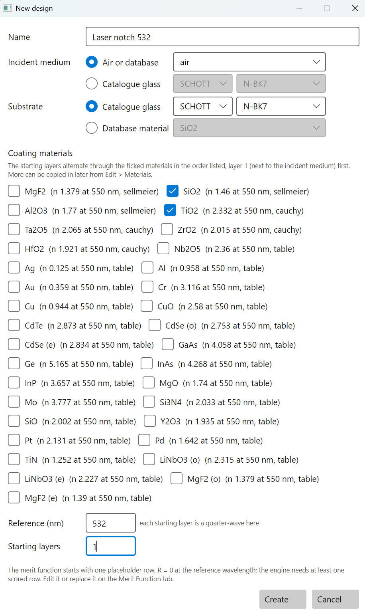
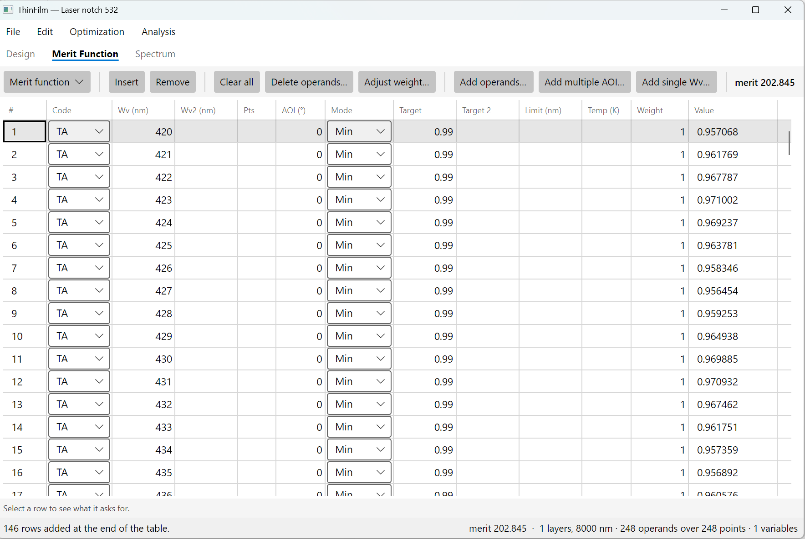
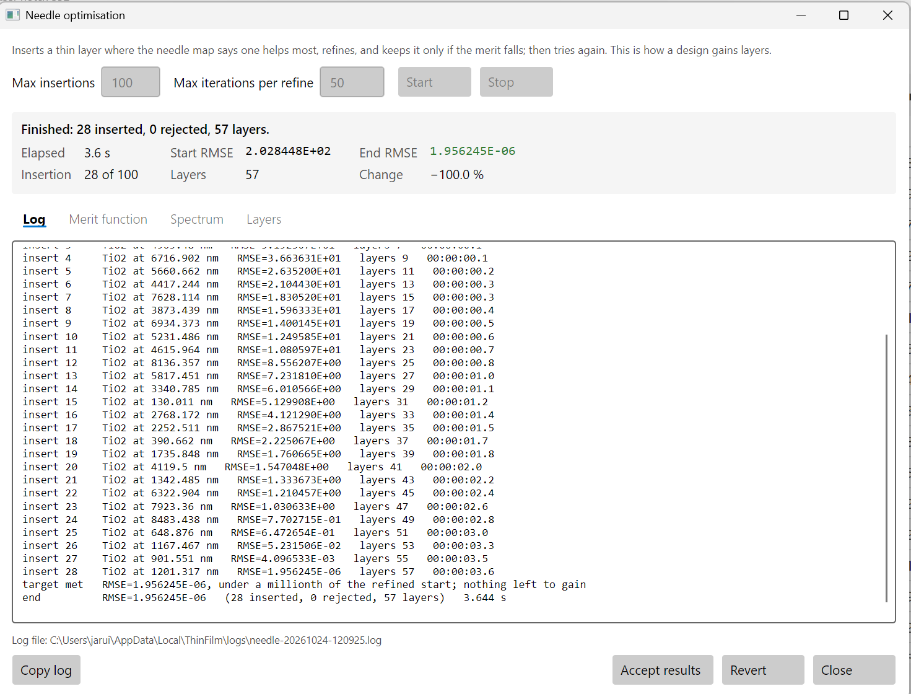
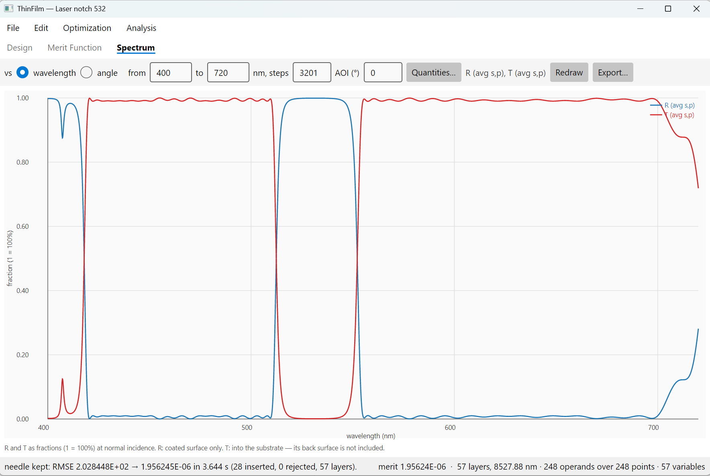
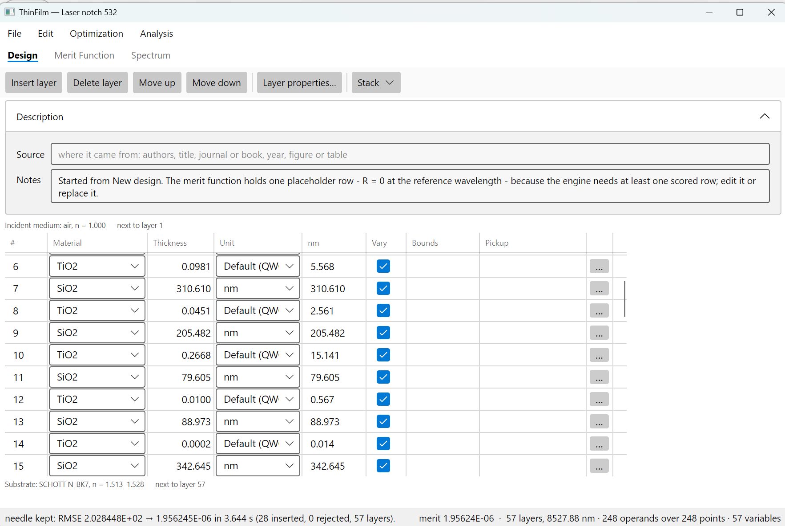
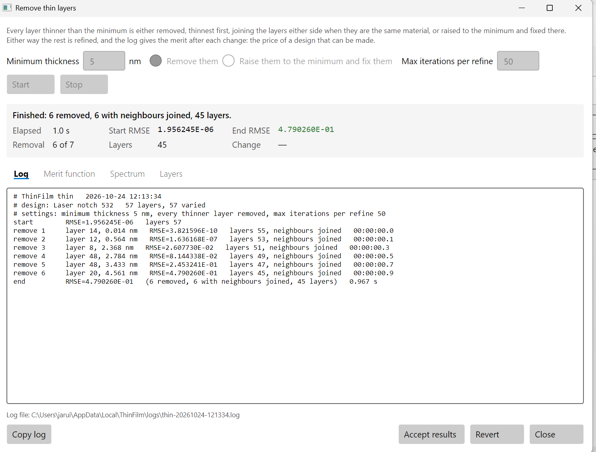
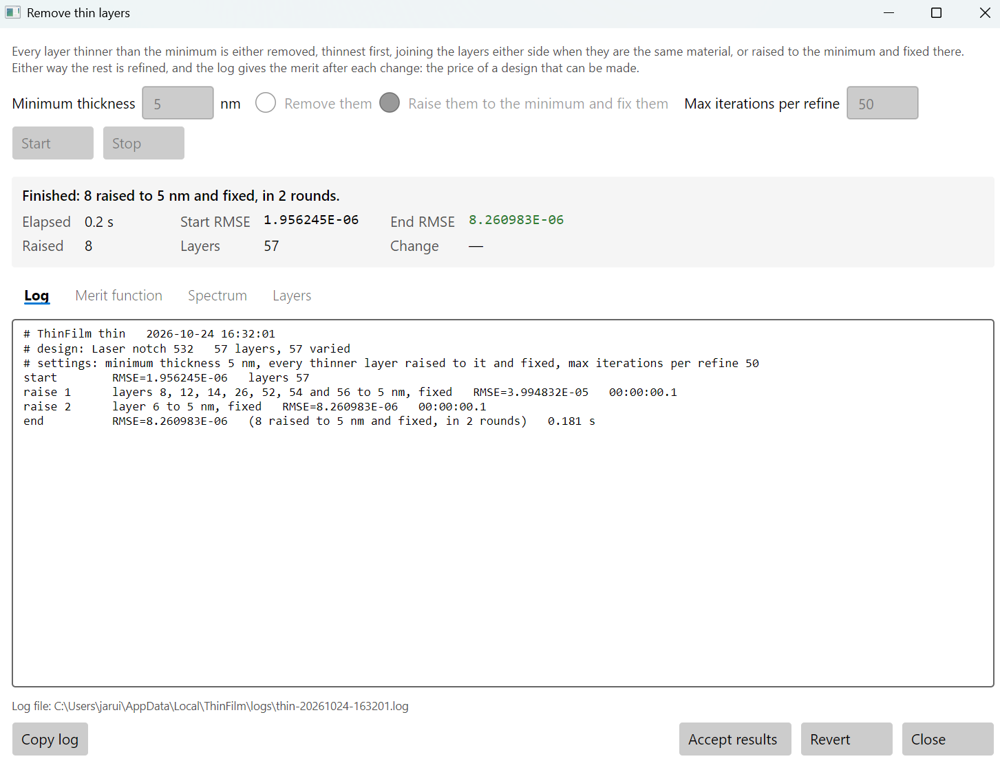
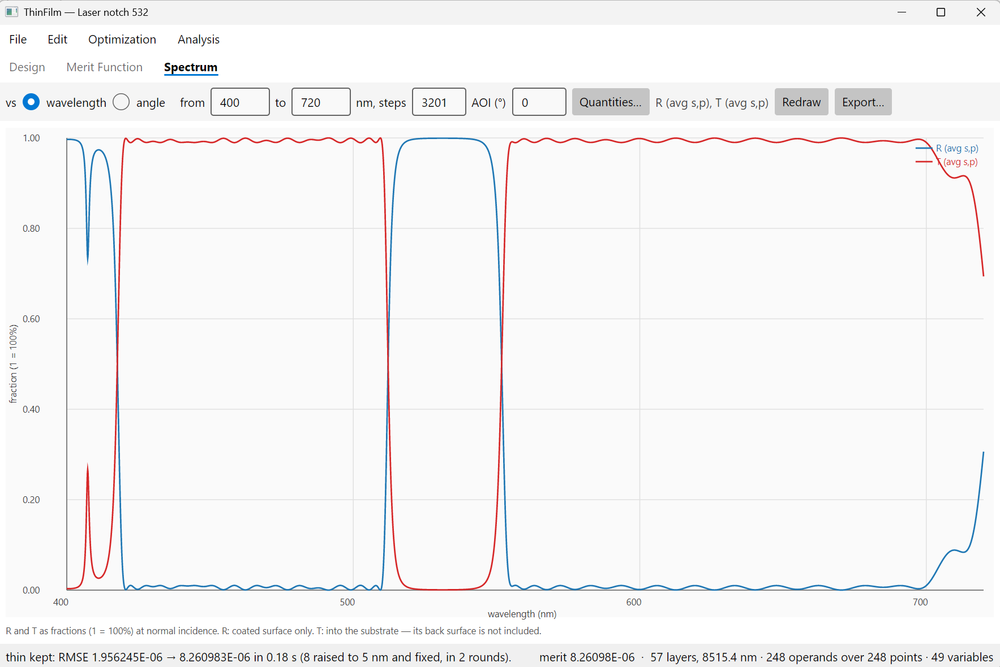
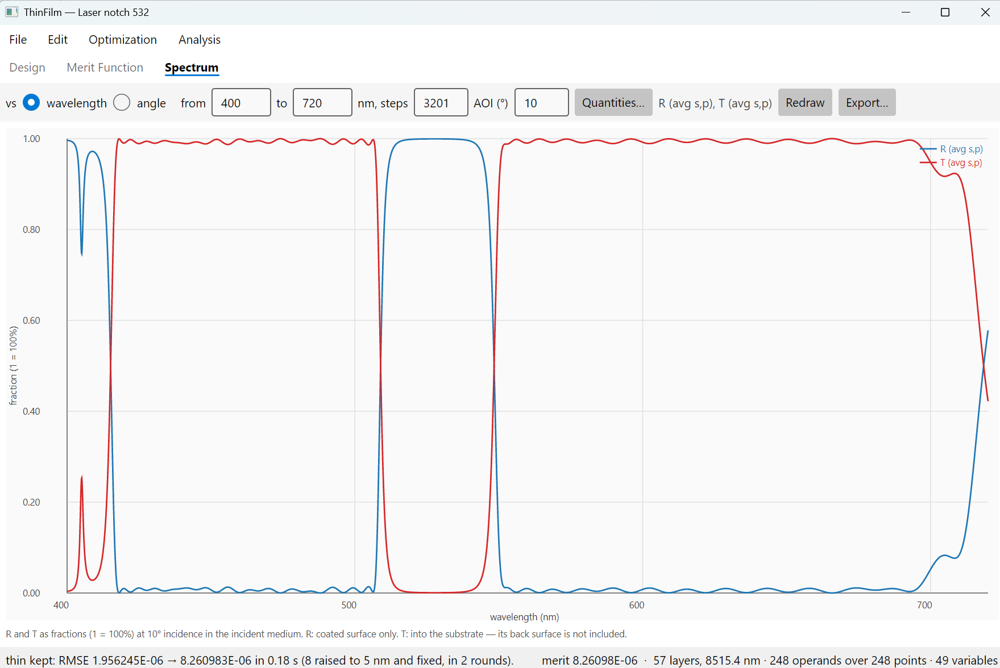

# 4. A laser notch filter

A notch filter blocks one narrow band and passes everything either side of it. This one blocks
the 532 nm line of a green laser, for example to keep it out of a camera, and passes the rest of
the visible.

This chapter is about two things: how steep edges cost layers, and what to do when the thin layers
of a design are doing real work.

## 4.1 The filter

| | Requirement |
|---|---|
| Block, 527 to 537 nm | TA at most 0.1% (optical density 3) |
| Pass, 420 to 510 nm and 555 to 700 nm | TA at least 99% |
| Light | normal incidence, in air, on N-BK7 |

The edges have 17 and 18 nm to go from passing to blocking. That does not sound like much of a
difference from 15 nm, but it is. Run with edges 2 nm steeper on each side (passing to 512 nm and
from 552 nm), needle used 100 insertions and finished with 201 layers that still missed the
spec. As specified here, it needs 57.

The designs from this chapter are in [samples/User guide/4 Laser notch filter](../../samples/User%20guide/4%20Laser%20notch%20filter):

| File | What it is |
|---|---|
| [notch-start.tfd](../../samples/User%20guide/4%20Laser%20notch%20filter/notch-start.tfd) | start for 4.3: one 8000 nm SiO2 layer and the spec |
| [notch-needle.tfd](../../samples/User%20guide/4%20Laser%20notch%20filter/notch-needle.tfd) | after needle: 57 layers, meets the spec, with slivers |
| [notch-5nm.tfd](../../samples/User%20guide/4%20Laser%20notch%20filter/notch-5nm.tfd) | the slivers raised to 5 nm and fixed: the design to make |

## 4.2 Create the design

Choose **File > New design…**:

- **Name**: `Laser notch 532`
- **Incident medium**: **Air or database**, `air`
- **Substrate**: **Catalogue glass**, **SCHOTT**, **N-BK7**
- **Coating materials**: tick **TiO2** and **SiO2**
- **Reference (nm)**: `532`
- **Starting layers**: `1`



Press **Create**. Then:

1. In **Edit > System Parameters…**, set **Maximum for unconstrained layers** to `10000` nm.
2. In the **Design** tab, set layer 1 to **SiO2**, `8000`, **nm**.

The start is thicker than in the earlier chapters. A narrow notch needs a thick stack, and needle
works inside the thickness it is given.

## 4.3 The merit function

On the **Merit Function** tab, press **Clear all**, then **Add operands…** three times:

| Code | Mode | Target | WV1 | WV2 | Step WV | AOI (°) |
|---|---|---|---|---|---|---|
| TA | Min | 0.99 | 420 | 510 | 1 | 0 |
| TA | Max | 0.001 | 527 | 537 | 1 | 0 |
| TA | Min | 0.99 | 555 | 700 | 1 | 0 |



There are 248 rows, and the merit is about 203. The rows are 1 nm apart because a design this
thick has narrow features, and [chapter 2](02-pbs-plate.md) showed what 2 nm can miss.

## 4.4 Needle

Choose **Optimization > Needle optimisation…**, set **Max insertions** to `100` and **Max
iterations per refine** to `50`, and press **Start**.



In about four seconds needle meets the spec: 57 layers, merit 2×10⁻⁶. Press **Accept results**.



## 4.5 Slivers that do real work

Look at the **Design** tab. Seven layers, all TiO2, are thinner than 5 nm, a common minimum for
a coating run:

| Layer | 8 | 12 | 14 | 26 | 52 | 54 | 56 |
|---|---|---|---|---|---|---|---|
| nm | 2.56 | 0.57 | 0.01 | 3.79 | 4.57 | 4.21 | 2.73 |



In [chapter 3](03-dichroic-edge.md) **Remove thin layers** took slivers like these out at no
cost. Try it: **Optimization > Remove thin layers…**, **Minimum thickness** `5`, **Remove them**,
**Max iterations per refine** `50`, **Start**.



```
remove 1     layer 14, 0.014 nm   RMSE=3.821596E-10   layers 55, neighbours joined
remove 2     layer 12, 0.564 nm   RMSE=1.636168E-07   layers 53, neighbours joined
remove 3     layer 8, 2.368 nm    RMSE=2.607730E-02   layers 51, neighbours joined
remove 4     layer 48, 2.784 nm   RMSE=8.144338E-02   layers 49, neighbours joined
remove 5     layer 48, 3.433 nm   RMSE=2.453241E-01   layers 47, neighbours joined
remove 6     layer 20, 4.561 nm   RMSE=4.790260E-01   layers 45, neighbours joined
```

This time the log tells a different story. The first two slivers were doing nothing. From the
third on, every removal costs more, and the design ends at merit 0.48, well outside the spec.
These layers are thin, but the notch needs them. Press **Revert**.

## 4.6 Raise them instead

Open **Remove thin layers…** again, with **Minimum thickness** `5`, but choose **Raise them to
the minimum and fix them**. Press **Start**.



```
raise 1      layers 8, 12, 14, 26, 52, 54 and 56 to 5 nm, fixed   RMSE=3.994832E-05
raise 2      layer 6 to 5 nm, fixed                               RMSE=8.260983E-06
end          RMSE=8.260983E-06   (8 raised to 5 nm and fixed, in 2 rounds)
```

Every layer under 5 nm is set to exactly 5 nm and fixed there, and the other layers are refined
to make up for the change. Refining pushed layer 6 under 5 nm, so a second round raised and fixed
it too. After 0.2 seconds every layer is 5 nm or more and the merit is 8×10⁻⁶: the spec is still
met. Press **Accept results**.

On the **Design** tab, the eight raised layers have **Vary** unticked. They stay at 5 nm through
any later refine, until you tick them again.

Why fix them rather than give every layer a minimum of 5 nm and refine? That was tried: with a
5 nm minimum on every layer, refinement reached only a merit of 0.015 after 2000 iterations, its
steps bouncing off the minimum. A fixed layer is simply not a variable, and the rest refine
freely.

**Remove or raise?** Try **Remove** first: fewer layers are easier to make, and as in chapter 3 the
slivers are often doing nothing. When the log shows the merit climbing, the slivers are doing
work, and **Raise** keeps it.

## 4.7 Reading the result



Checked every 0.01 nm at normal incidence:

| | Spec | Result |
|---|---|---|
| TA, 420 to 510 nm | at least 99% | 98.94% at 502.5 nm |
| TA, 527 to 537 nm | at most 0.1% | 0.100%; 0.06% at the centre, 531.1 nm |
| TA, 555 to 700 nm | at least 99% | 98.95% at 556.6 nm |

The passbands dip to 98.9% between the 1 nm samples, a hair under the spec. The program's check
between sample points does not flag a miss this small.

**Tilting moves the notch.** Change the **AOI** on the Spectrum tab:

| AOI | 0° | 5° | 10° |
|---|---|---|---|
| Notch centre | 531.1 nm | 530.3 nm | 527.8 nm |
| TA at 510 nm | 99% | 90% | 23% |



A few degrees of tilt tunes the notch onto a laser line that is slightly off, but by 10° its blue
edge has moved into the passband. A notch filter in a converging beam sees all of its angles at
once; to design for that, add rows at more than one angle, as in [chapter 2](02-pbs-plate.md).

## 4.8 The same design from the command line

```sh
thinfilm new --materials TiO2,SiO2 --substrate N-BK7 --name "Laser notch 532" \
             --reference 532 --layers 1 -o notch.tfd
thinfilm units notch.tfd --maximum 10000
thinfilm layer set notch.tfd --layer 1 --material SiO2 --thickness 8000 --unit nm
thinfilm merit clear notch.tfd
thinfilm merit add notch.tfd --code TA --mode Min --target 0.99  --from 420 --to 510 --step 1
thinfilm merit add notch.tfd --code TA --mode Max --target 0.001 --from 527 --to 537 --step 1
thinfilm merit add notch.tfd --code TA --mode Min --target 0.99  --from 555 --to 700 --step 1
thinfilm needle notch.tfd --insertions 100 --iterations 50 -o notch.tfd
thinfilm thin notch.tfd --min-thickness 5 --iterations 50 --revert      # see what removing costs
thinfilm thin notch.tfd --min-thickness 5 --raise --iterations 50 -o notch.tfd
thinfilm evaluate notch.tfd
```

In the MCP server, raising is `optimise_start` with `method` `thin`, `min_thickness` and `raise`
true.
