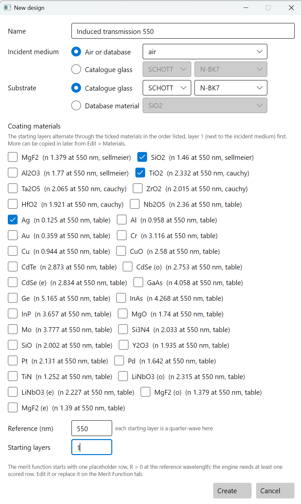
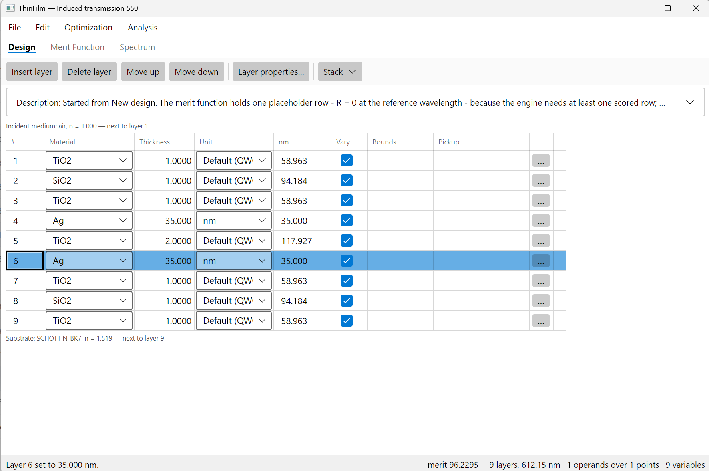
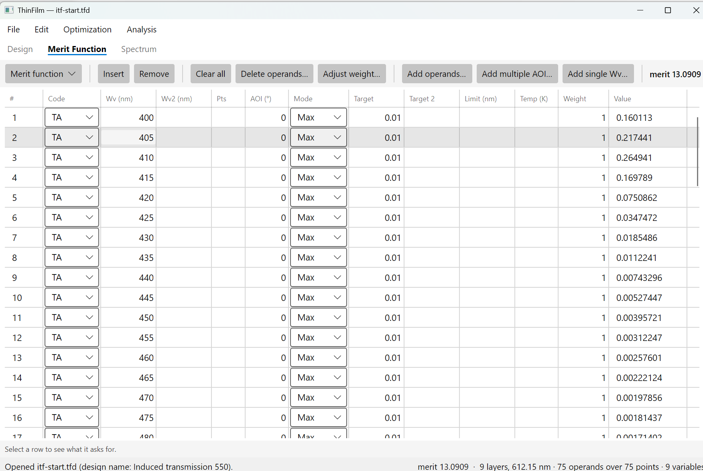
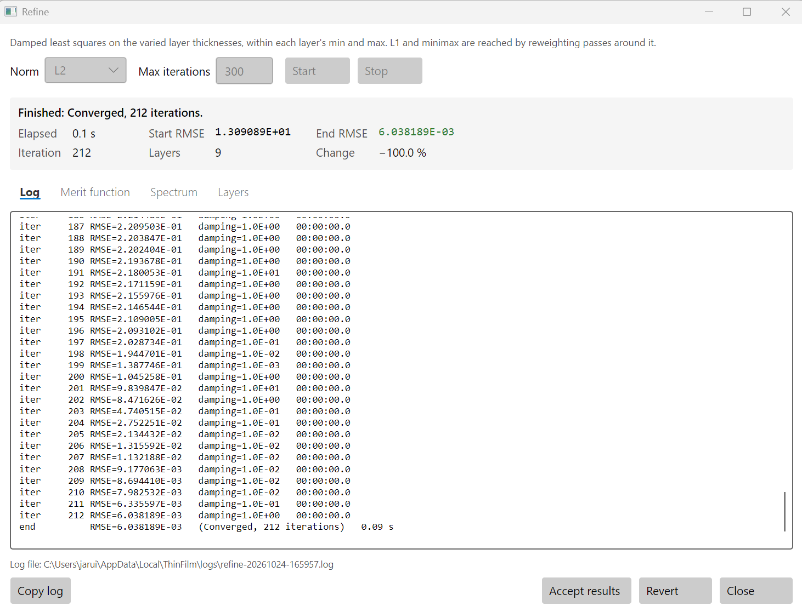
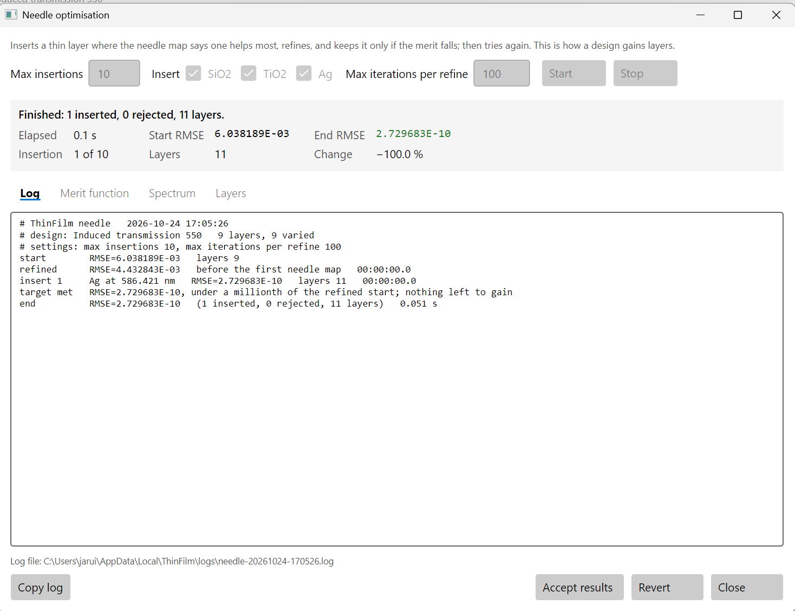
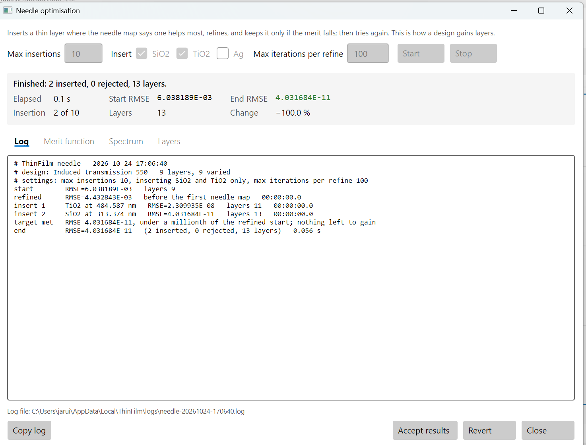
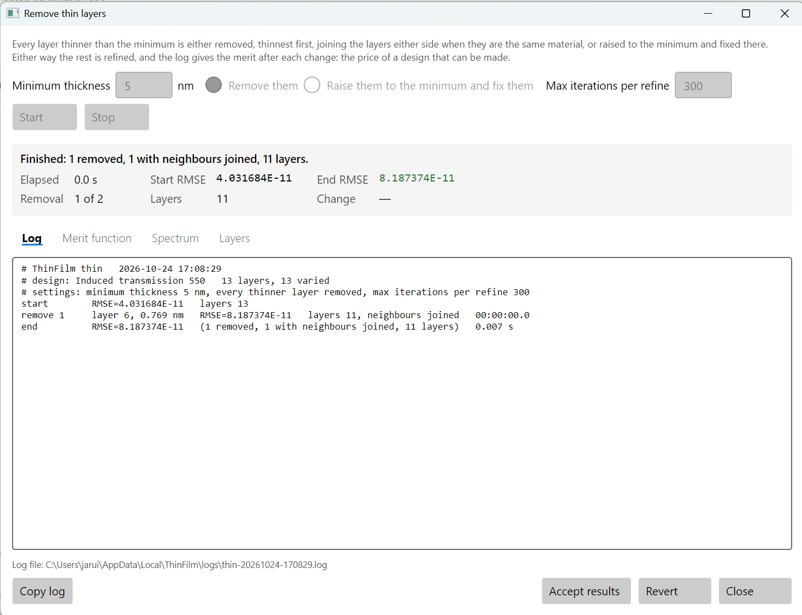
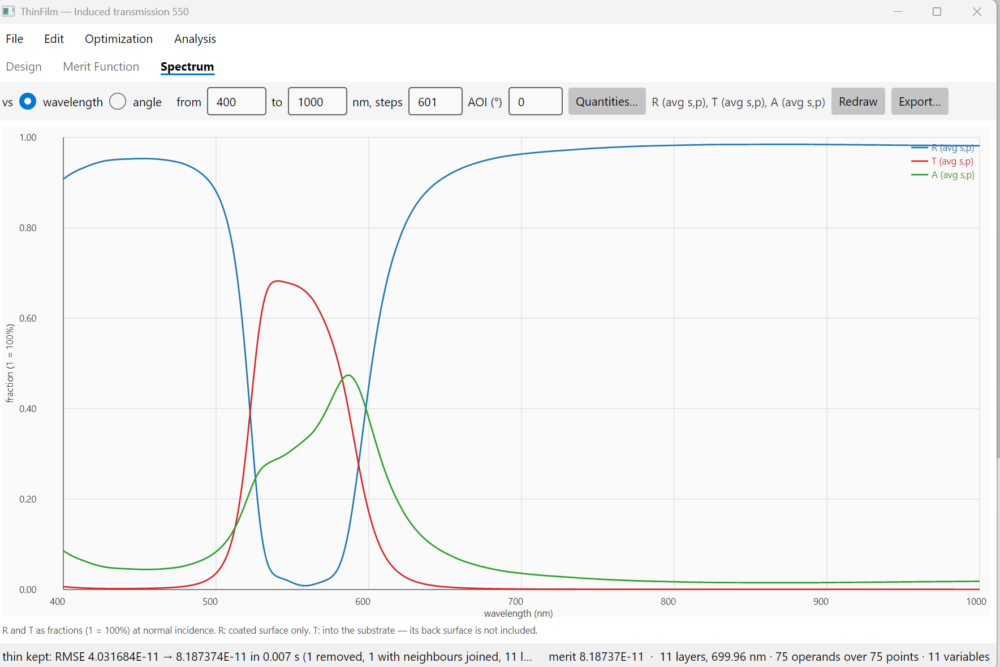
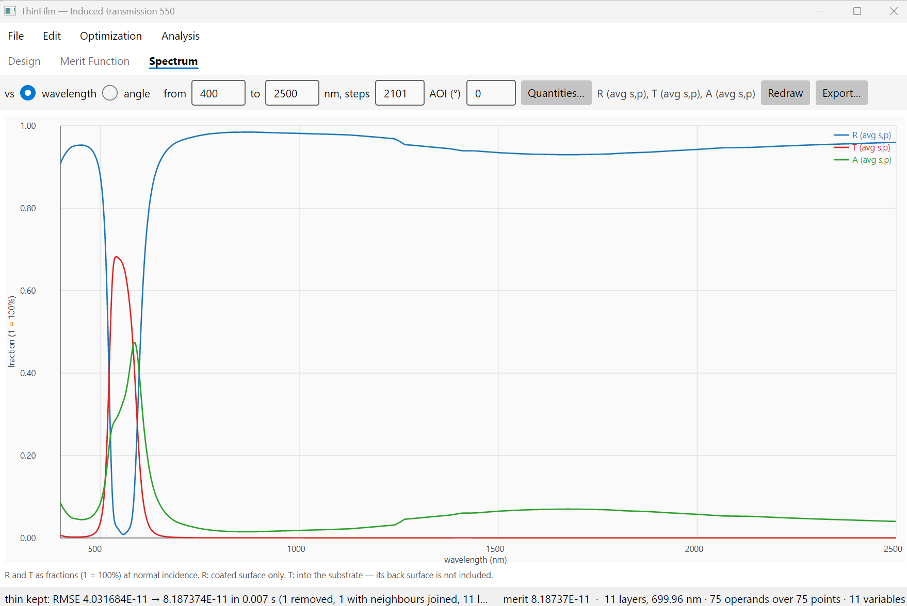

# 5. An induced-transmission filter: light through silver

A silver film 40 nm thick reflects almost everything. Put the right dielectric layers on both sides
of it, and at one band of wavelengths the light goes through. This is an induced-transmission
filter: the dielectric layers match the silver to the media either side, the way an antireflection
coating matches glass to air, and the light tunnels through the metal. Away from that band the
matching fails and the silver reflects, out to the far infrared.

This filter's appeal is its blocking. An all-dielectric bandpass blocks only near its passband, and
blocking out to 2500 nm takes extra stacks with many layers. Silver blocks all of it with two
layers. The price is absorption: part of the light that gets into the silver is absorbed there.

This chapter is about designing with a metal: building a structured start, seeing where the light
goes, and keeping needle from inserting a metal layer that cannot be made.

## 5.1 The filter

| | Requirement |
|---|---|
| Pass, 530 to 570 nm | TA at least 60% |
| Block, 400 to 480 nm | TA at most 1% |
| Block, 640 to 1000 nm | TA at most 1% |
| Light | normal incidence, in air, on N-BK7 |
| Materials | TiO2 and SiO2, and silver (Ag) |

The designs from this chapter are in [samples/User guide/5 Induced-transmission filter](../../samples/User%20guide/5%20Induced-transmission%20filter):

| File | What it is |
|---|---|
| [itf-start.tfd](../../samples/User%20guide/5%20Induced-transmission%20filter/itf-start.tfd) | the start for 5.4: two 35 nm silver layers between quarter waves, and the spec |
| [itf-needle.tfd](../../samples/User%20guide/5%20Induced-transmission%20filter/itf-needle.tfd) | after refine and needle with TiO2 and SiO2 only: 13 layers |
| [itf-final.tfd](../../samples/User%20guide/5%20Induced-transmission%20filter/itf-final.tfd) | the thin layer removed: 11 layers, the design to make |

## 5.2 Create the design

Choose **File > New design…**:

- **Name**: `Induced transmission 550`
- **Incident medium**: **Air or database**, `air`
- **Substrate**: **Catalogue glass**, **SCHOTT**, **N-BK7**
- **Coating materials**: tick **SiO2**, **TiO2** and **Ag**
- **Reference (nm)**: `550`
- **Starting layers**: `1`



Press **Create**.

## 5.3 A structured start

Earlier chapters started needle from one thick layer. Here the silver has to be there from the
start, in the right places, because needle only adds thin layers. The classic structure is two
silver layers with a half-wave of TiO2 between them, and a matching stack of quarter waves on
the outside of each:

```
H L H  Ag  2H  Ag  H L H
```

H is a quarter wave of TiO2 and L one of SiO2. On the **Design** tab, choose **Stack > Input
design string…** and type:

```
1H 1L 1H 1A 2H 1A 1H 1L 1H
```

Under **Materials**, set **H** to **TiO2**, **L** to **SiO2** and **A** to **Ag**. Untick **Pick up
every layer of a letter**: needle cannot run while layers pick up from others.


Press **OK**. A quarter wave means nothing useful for a metal: layers 4 and 6 come out 1100 nm thick.
Set both to `35`, **nm**.



## 5.4 The merit function

On the **Merit Function** tab, press **Clear all**, then **Add operands…** three times:

| Code | Mode | Target | WV1 | WV2 | Step WV | AOI (°) |
|---|---|---|---|---|---|---|
| TA | Max | 0.01 | 400 | 480 | 5 | 0 |
| TA | Min | 0.6 | 530 | 570 | 2 | 0 |
| TA | Max | 0.01 | 640 | 1000 | 10 | 0 |



There are 75 rows, and the merit is 13.09. The passband target is 60%, not the 90% or more of
the earlier chapters: section 5.8 shows why.

## 5.5 Refine

Choose **Optimization > Refine…**, keep **L2** and **Max iterations** `300`, and press **Start**.



Refine converges in 212 iterations at a merit of 6.04×10⁻³. The silver layers are now 49 and
34 nm, and the spec is nearly met. A few rows at the edges of the passband are just short of 60%.
Press **Accept results**.

## 5.6 Needle, without silver

Choose **Optimization > Needle optimisation…**. Set **Max insertions** to `10` and **Max
iterations per refine** to `100`. The **Insert** boxes list the design's materials, all ticked.
Leave them ticked for now, and press **Start**.



```
insert 1     Ag at 586.421 nm   RMSE=2.729683E-10   layers 11
```

One insertion meets the spec, and it is silver. On the **Layers** tab the new layer is 2.1 nm
thick. Silver that thin does not form a film when it is deposited: it grows as separate islands,
with optical properties nothing like the database's. The design looks good on paper and cannot be
made. Press **Revert**.

Now untick **Ag** under **Insert**, so needle may insert only TiO2 and SiO2, and press **Start**
again.



```
# settings: max insertions 10, inserting TiO2 and SiO2 only, max iterations per refine 100
insert 1     TiO2 at 484.587 nm   RMSE=2.309935E-08   layers 11
insert 2     SiO2 at 313.374 nm   RMSE=4.031684E-11   layers 13
target met   RMSE=4.031684E-11, under a millionth of the refined start; nothing left to gain
```

Two dielectric needles meet the spec with 13 layers. Press **Accept results**.

The same choice is in **Gradual evolution**, where it also limits the layers evolve grows. Leave a
metal out whenever a thin layer of it could not be made.

## 5.7 Remove thin layers

Needle left a 0.77 nm SiO2 layer between two TiO2 layers, next to the second silver layer.
Choose **Optimization > Remove thin layers…**. Set **Minimum thickness** to `5`, choose **Remove
them**, keep **Max iterations per refine** at `300`, and press **Start**.



```
remove 1     layer 6, 0.769 nm   RMSE=8.187374E-11   layers 11, neighbours joined
```

The two TiO2 layers join, and the spec is still met. The thinnest layer left is 9.9 nm of TiO2.
Press **Accept results**.

| Layer | 1 | 2 | 3 | 4 | 5 | 6 | 7 | 8 | 9 | 10 | 11 |
|---|---|---|---|---|---|---|---|---|---|---|---|
| Material | TiO2 | SiO2 | TiO2 | **Ag** | TiO2 | **Ag** | TiO2 | SiO2 | TiO2 | SiO2 | TiO2 |
| nm | 67.7 | 88.4 | 37.4 | **48.6** | 73.6 | **37.8** | 64.4 | 64.3 | 9.9 | 143.3 | 64.5 |

## 5.8 Where the light goes

On the **Spectrum** tab, press **Quantities…** and tick **TA**, **RA** and **AA**. Set 400 to 1000
nm, **steps** `601`, **AOI** `0`, and press **Redraw**.



At the peak, at 540.6 nm, 68% of the light is transmitted, 3% is reflected and 29% is absorbed in
the silver. Across the passband the coating reflects almost nothing; what it does not transmit, it
absorbs. Outside the passband it reflects, and absorbs a few percent.

| | Spec | Result |
|---|---|---|
| TA, 530 to 570 nm | at least 60% | at least 60.0%; 68% at the peak, 540.6 nm |
| TA, 400 to 480 nm | at most 1% | at most 0.74% |
| TA, 640 to 1000 nm | at most 1% | at most 1.00% |
| Half-width | | 521 to 590 nm |

**Why not more than 60%?** With a 0.8 target, refine and needle with TiO2 and SiO2 grew the design
to 41 layers before needle could find nothing more. The passband reached 72 to 79%, and about 20% or
more was absorbed throughout it. That absorption is the limit. More dielectric layers can match the silver
better, but light that enters the silver loses part of itself there. Thinner silver absorbs less,
and blocks less.

## 5.9 Blocking into the infrared

Set the Spectrum tab to 400 to 2500 nm, **steps** `2101`, and **Redraw**.



From 1000 to 2500 nm, TA stays under 0.04%, and nothing in the merit function asked for it. The
silver reflects the whole infrared. An all-dielectric filter would need a blocking stack for each
octave.

The small step in R and A at 1250 nm is in the silver's data, not the design. The database's
silver comes from Palik's tables, and its k rises steadily to 8.38 at 1225 nm, then drops to 7.83
at 1275 nm. The program interpolates the table as it is.

## 5.10 The same design from the command line

```sh
thinfilm new --materials TiO2,SiO2,Ag --substrate N-BK7 --name "Induced transmission 550" \
             --reference 550 --layers 1 -o itf.tfd
thinfilm stack string itf.tfd --text "1H 1L 1H 1A 2H 1A 1H 1L 1H" --letters H=TiO2,L=SiO2,A=Ag --no-pickups
thinfilm layer set itf.tfd --layer 4 --thickness 35 --unit nm
thinfilm layer set itf.tfd --layer 6 --thickness 35 --unit nm
thinfilm merit clear itf.tfd
thinfilm merit add itf.tfd --code TA --mode Max --target 0.01 --from 400 --to 480  --step 5
thinfilm merit add itf.tfd --code TA --mode Min --target 0.6  --from 530 --to 570  --step 2
thinfilm merit add itf.tfd --code TA --mode Max --target 0.01 --from 640 --to 1000 --step 10
thinfilm refine itf.tfd --iterations 300 -o itf.tfd
thinfilm needle itf.tfd --insertions 10 --iterations 100 --insert TiO2,SiO2 -o itf.tfd
thinfilm thin itf.tfd --min-thickness 5 -o itf.tfd
thinfilm spectrum itf.tfd --from 400 --to 2500 --steps 2101 --quantities TA,RA,AA
```

In the MCP server, the materials needle may insert are `insert` on `optimise_start`, for example
`"insert": "TiO2,SiO2"`.
