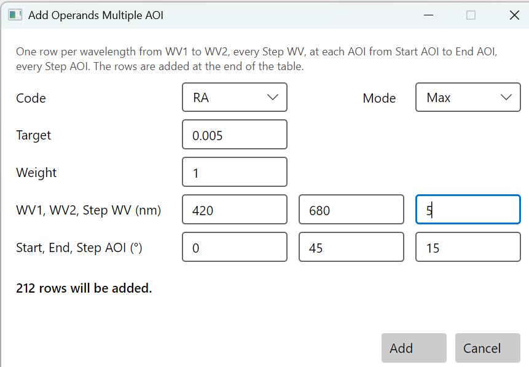
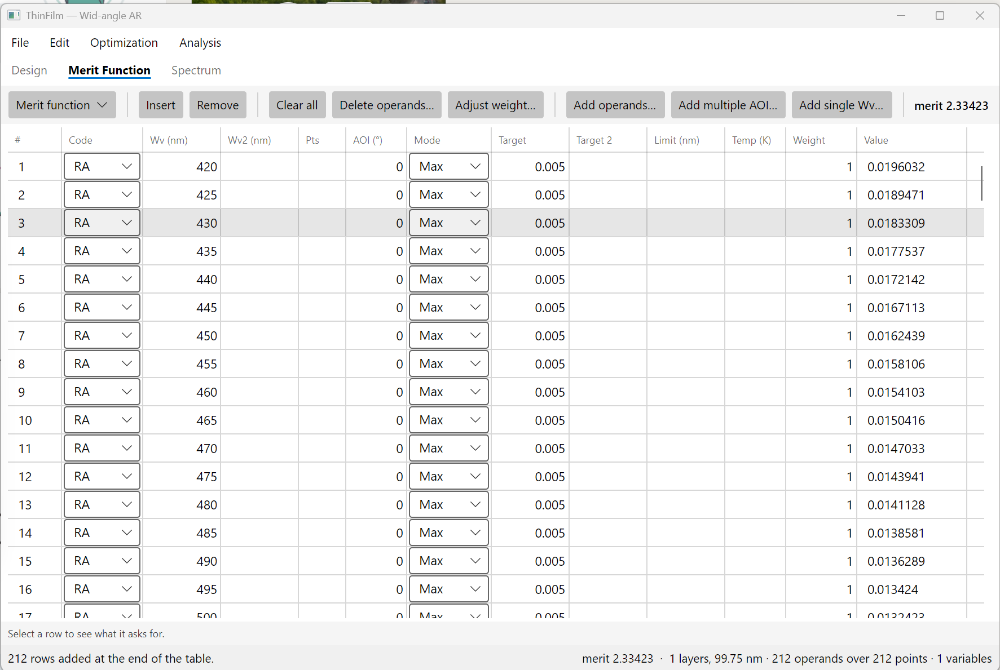
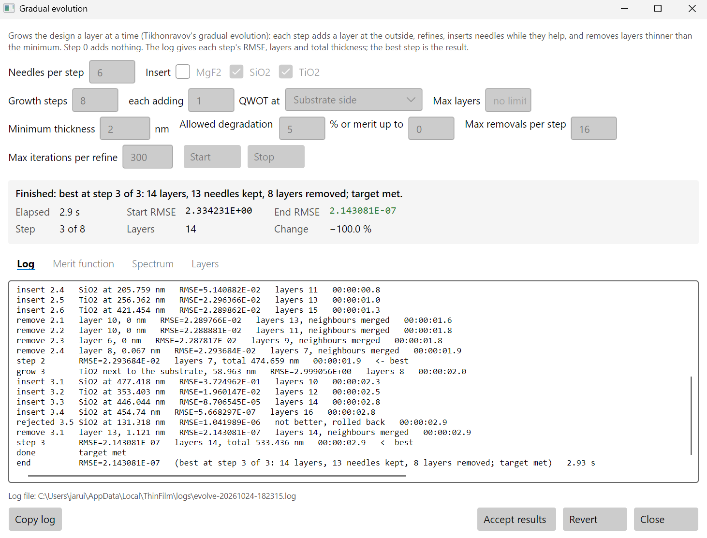
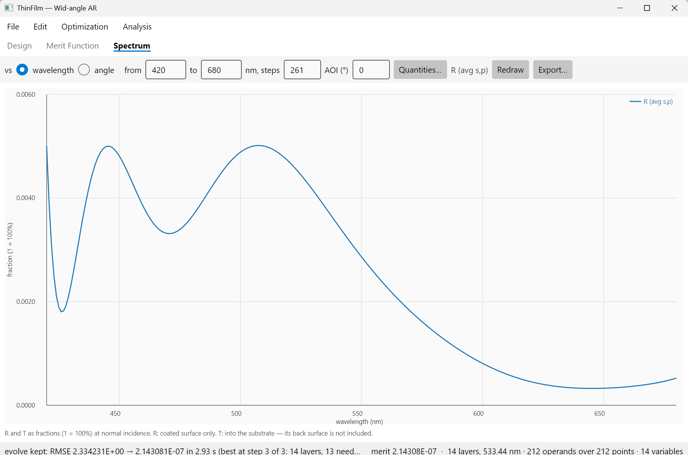
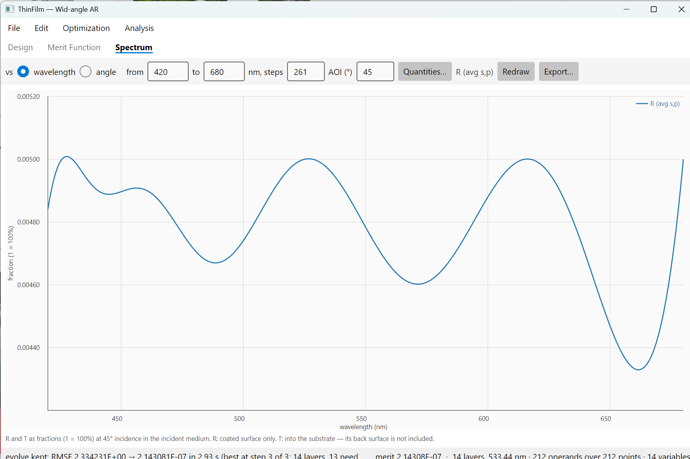
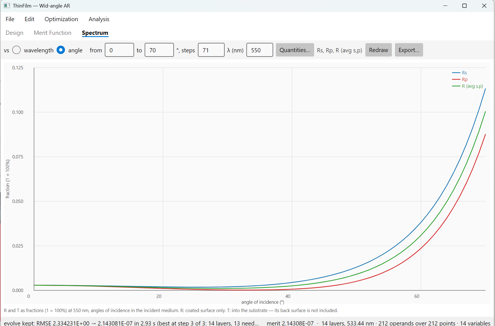

# 6. An antireflection coating for a wide range of angles

An antireflection coating on a camera lens sees light from many directions at once: straight
through near the axis, and at 40° or more at the edge of a wide-angle lens. A coating designed
for normal incidence works less well at a tilt: its layers look thinner, and s and p light
reflect differently. This chapter designs one coating that keeps reflection under 0.5% from 0° to
45°.

This chapter is about specifying several angles at once, letting gradual evolution build the
design from almost nothing, and keeping a soft material where it belongs.

## 6.1 The coating

| | Requirement |
|---|---|
| Reflect, 420 to 680 nm | RA at most 0.5%, at 0°, 15°, 30° and 45° |
| Light | unpolarised, in air, on N-BK7 |
| Materials | TiO2 and SiO2, and MgF2 as the outer layer only |

Bare N-BK7 reflects 4.2% at normal incidence and 5.3% at 45°.

**MgF2 goes only next to air.** It has the lowest index of the three, 1.38, so it is the best
outer layer, the one that meets the air. But MgF2 is soft, and it grows with high tensile
stress; it adheres well only when deposited hot. Buried inside a stack, under layers of TiO2 and
SiO2, it is a weak point. So MgF2 is used once, on the outside, and the rest of the stack is TiO2
and SiO2.

The designs from this chapter are in [samples/User guide/6 Wide-angle AR](../../samples/User%20guide/6%20Wide-angle%20AR):

| File | What it is |
|---|---|
| [wide-ar-start.tfd](../../samples/User%20guide/6%20Wide-angle%20AR/wide-ar-start.tfd) | the start: one quarter wave of MgF2, and the merit function over four angles |
| [wide-ar-14.tfd](../../samples/User%20guide/6%20Wide-angle%20AR/wide-ar-14.tfd) | after gradual evolution: 14 layers, MgF2 outside |
| [wide-ar-normal.tfd](../../samples/User%20guide/6%20Wide-angle%20AR/wide-ar-normal.tfd) | for comparison, the same spec at 0° only: 6 layers |

## 6.2 Create the design

Choose **File > New design…**:

- **Name**: `Wide-angle AR`
- **Incident medium**: **Air or database**, `air`
- **Substrate**: **Catalogue glass**, **SCHOTT**, **N-BK7**
- **Coating materials**: tick **MgF2**, **SiO2** and **TiO2**
- **Reference (nm)**: `550`
- **Starting layers**: `1`

Press **Create**. Layer 1 is a quarter wave of MgF2, 99.7 nm: the start is a single-layer AR
coating, the oldest one there is.

## 6.3 Four angles in one step

On the **Merit Function** tab, press **Clear all**, then **Add multiple AOI…**:

| Code | Mode | Target | WV1 | WV2 | Step WV | Start AOI | End AOI | Step AOI |
|---|---|---|---|---|---|---|---|---|
| RA | Max | 0.005 | 420 | 680 | 5 | 0 | 45 | 15 |



One press adds a row for each wavelength at each angle: 53 wavelengths at 0°, 15°, 30° and 45°,
212 rows. The merit is 2.33.



RA is the average of s and p, for unpolarised light. Each angle is a separate row, so the
optimiser sees the coating at each one, and a design that is good at 0° but poor at 45° scores
badly.

## 6.4 Gradual evolution, with the defaults

Choose **Optimization > Gradual evolution…**. Leave every setting as it is, and press **Start**.

```
step 0       RMSE=1.651693E+00   layers 2, total 132.61 nm   <- best
grow 1       SiO2 next to the substrate, 94.184 nm   RMSE=1.651693E+00   layers 3
step 1       RMSE=1.651693E+00   layers 2, total 132.61 nm
came back    step 1 is the design of step 0 again; the next layer grows 2 times as thick
grow 2       SiO2 next to the substrate, 188.368 nm   RMSE=1.543532E+00   layers 3
step 2       RMSE=1.756795E-02   layers 11, total 522.06 nm   <- best
done         merit 0.0176, under the 0.1 accepted
```

Two things to read in this log.

**Came back.** Step 1 added a quarter wave of SiO2 next to the glass, and refining thinned it
back to nothing: SiO2 next to N-BK7, whose index is close to its own, does little. The step ended
on the design it started from. Growing the same layer again would only repeat that, so evolution
grows the next one twice as thick, and from there needles find an 11-layer design. If the double
layer had come back too, evolution would have tried four times as thick, and then stopped.

**Merit up to 0.1.** Evolution stopped at a merit of 0.0176 because the window's **merit up to**
setting accepts any merit under 0.1 as good enough. Reflection is at most 0.52% at 0° and 0.57% at
45°: close, but not the spec.

And on the **Layers** tab, layer 5 is 33 nm of MgF2, inside the stack. Evolution used every
material it was given. Press **Revert**.

## 6.5 MgF2 outside only

In the same window:

- Set **each adding … QWOT at** to **Substrate side**, so layers grow next to the glass, away from
  the MgF2.
- Under **Insert**, untick **MgF2**, so no needle or grown layer is MgF2.
- Set **merit up to** to `0`, so evolution goes on until the spec is met.

Press **Start**.



```
# settings: growth steps 8, each adding 1 QWOT at the substrate side, needles per step 6,
            inserting SiO2 and TiO2 only, ...
step 0       RMSE=1.651693E+00   layers 2, total 132.61 nm   <- best
step 1       RMSE=1.651693E+00   layers 2, total 132.61 nm
came back    step 1 is the design of step 0 again; the next layer grows 2 times as thick
step 2       RMSE=2.293684E-02   layers 7, total 474.659 nm   <- best
step 3       RMSE=2.143081E-07   layers 14, total 533.436 nm   <- best
done         target met
```

In three seconds evolution meets the spec with 14 layers, and MgF2 is only layer 1. Press
**Accept results**.

| Layer | 1 | 2 | 3 | 4 | 5 | 6 | 7 | 8 | 9 | 10 | 11 | 12 | 13 | 14 |
|---|---|---|---|---|---|---|---|---|---|---|---|---|---|---|
| Material | **MgF2** | TiO2 | SiO2 | TiO2 | SiO2 | TiO2 | SiO2 | TiO2 | SiO2 | TiO2 | SiO2 | TiO2 | SiO2 | TiO2 |
| nm | 107.3 | 30.9 | 7.4 | 81.9 | 33.1 | 21.3 | 36.8 | 21.1 | 24.6 | 57.2 | 16.6 | 38.4 | 45.8 | 11.1 |

The thinnest layer is 7.4 nm, so there is nothing for **Remove thin layers** to do.

Unticking MgF2 also keeps a needle from splitting the MgF2 layer: a needle inside it would leave
MgF2 on both sides, a new MgF2 layer inside the stack. To hold the MgF2 at exactly a quarter wave
as well, untick its **Vary** on the Design tab before evolving; a fixed layer stays as it is
through needle, evolution and Remove thin layers.

## 6.6 Reading the result

On the **Spectrum** tab, press **Quantities…** and tick **RA** only. Set 420 to 680 nm, **steps**
`261`, **AOI** `0`, and **Redraw**. Then the same at **AOI** `45`.





Checked every 0.1 nm:

| AOI | 0° | 15° | 30° | 45° |
|---|---|---|---|---|
| RA, worst | 0.50% | 0.43% | 0.29% | 0.50% |

The coating is best near 30° and has to reach out to both ends. To see the angle directly,
choose **vs angle** on the Spectrum tab, from 0 to 70°, at 550 nm, with **RA**, **RS** and **RP**:



| AOI | 0° | 15° | 30° | 45° | 55° | 60° | 70° |
|---|---|---|---|---|---|---|---|
| RA | 0.29% | 0.20% | 0.11% | 0.48% | 1.7% | 3.1% | 10% |
| RS | 0.29% | 0.23% | 0.20% | 0.76% | 2.2% | 3.8% | 11% |
| RP | 0.29% | 0.17% | 0.02% | 0.20% | 1.1% | 2.4% | 8.8% |

At 0° s and p are the same. With tilt they split, s reflecting more, and the coating holds RA,
their average, in the spec to 45°. Past 50° it climbs quickly: the coating was not asked about
those angles.

## 6.7 What the angles cost

[wide-ar-normal.tfd](../../samples/User%20guide/6%20Wide-angle%20AR/wide-ar-normal.tfd) is the same design run with only the 0° rows,
53 instead of 212. Evolution meets that spec with 6 layers. At 45° the 6-layer coating reflects up
to 2.8%, more than five times the spec. Holding 0.5% across 45° of angle takes 14 layers.

The angles also have a floor. With the target at 0.3% instead of 0.5%, and the same settings,
evolution ran 14 growth steps and chose a 32-layer design that reflects up to 0.40% at 0° and 0.52%
at 45°: more than twice the layers, and no better at the ends. Over a wide range of angles, s and p
cannot both be matched well at every wavelength, and more layers do not change that.

## 6.8 The same design from the command line

```sh
thinfilm new --materials MgF2,SiO2,TiO2 --substrate N-BK7 --name "Wide-angle AR" \
             --reference 550 --layers 1 -o ar.tfd
thinfilm merit clear ar.tfd
thinfilm merit add ar.tfd --code RA --mode Max --target 0.005 --from 420 --to 680 --step 5 \
                          --aoi-from 0 --aoi-to 45 --aoi-step 15
thinfilm evolve ar.tfd --grow-at substrate --insert TiO2,SiO2 --accept-merit 0 -o ar.tfd
thinfilm spectrum ar.tfd --vs angle --from 0 --to 70 --steps 71 --wavelength 550 --quantities RA,RS,RP
```

In the MCP server, the same evolution is `optimise_start` with `method` `evolve`, `grow_at`
`substrate`, `insert` `"TiO2,SiO2"` and `accept_merit` 0.
