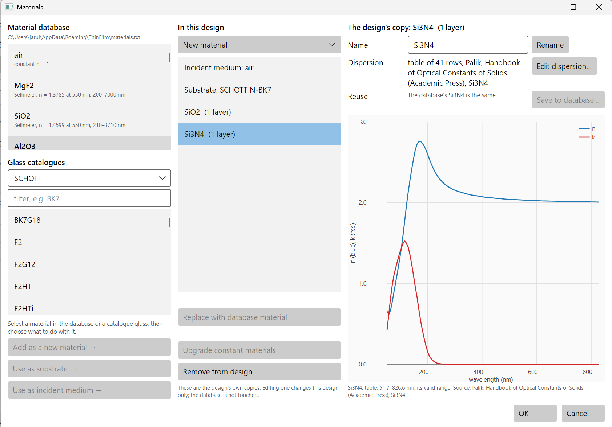
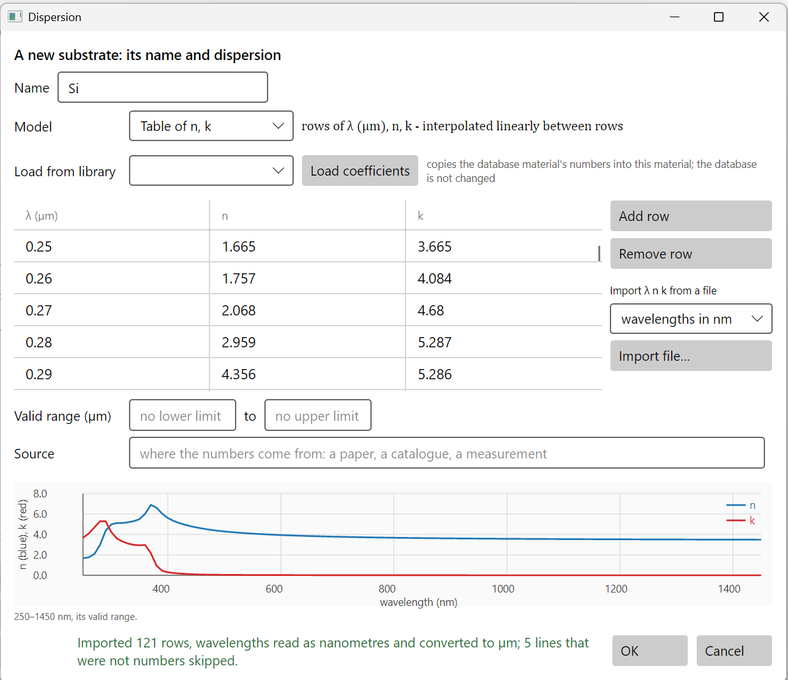
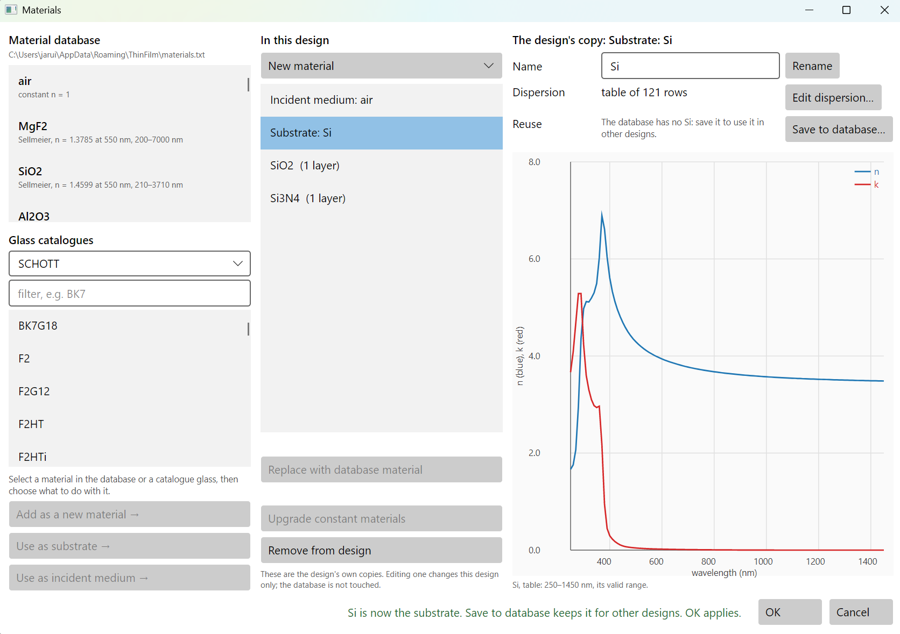
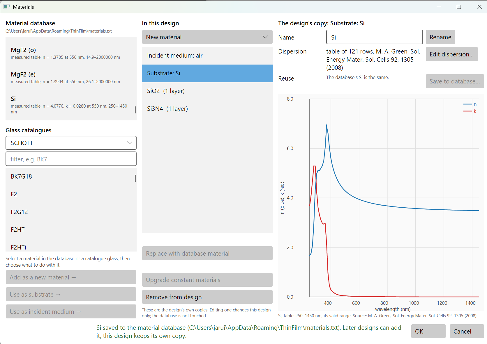
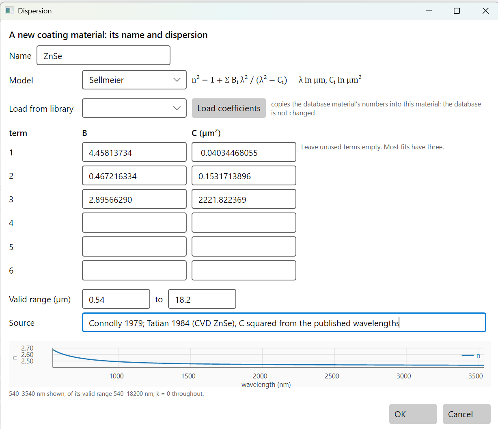
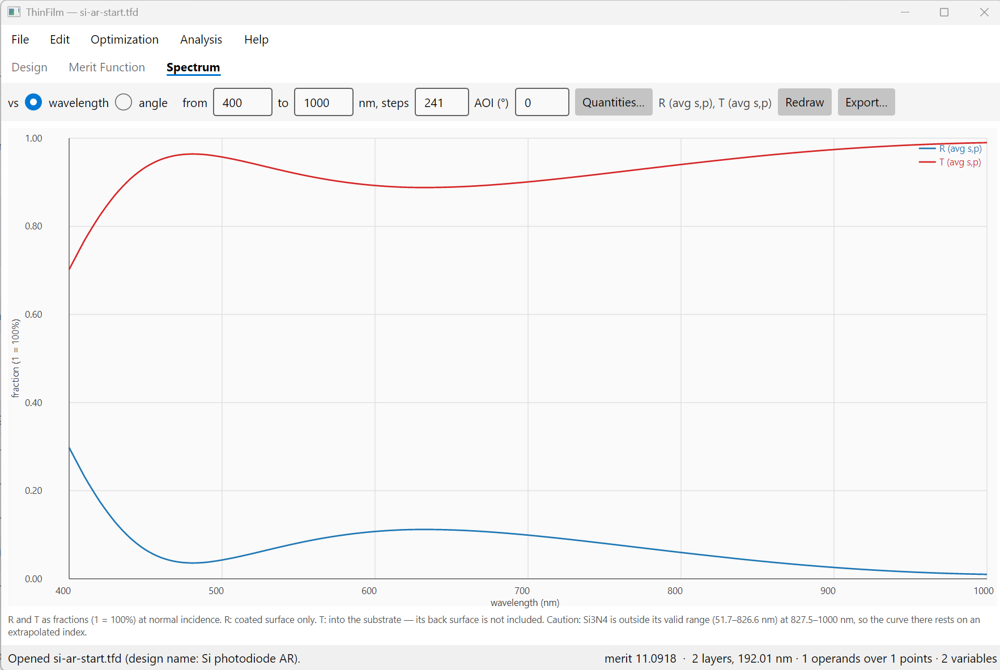
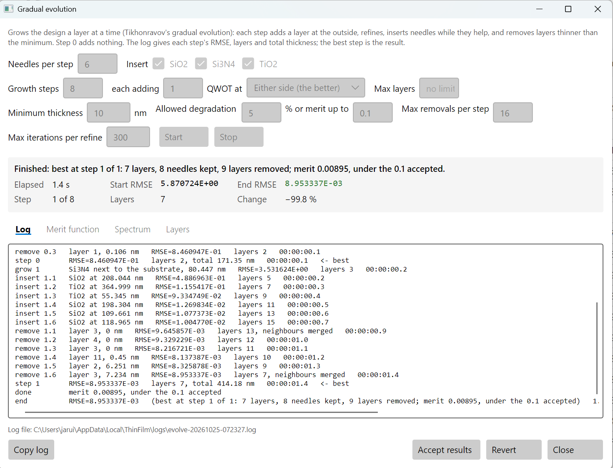
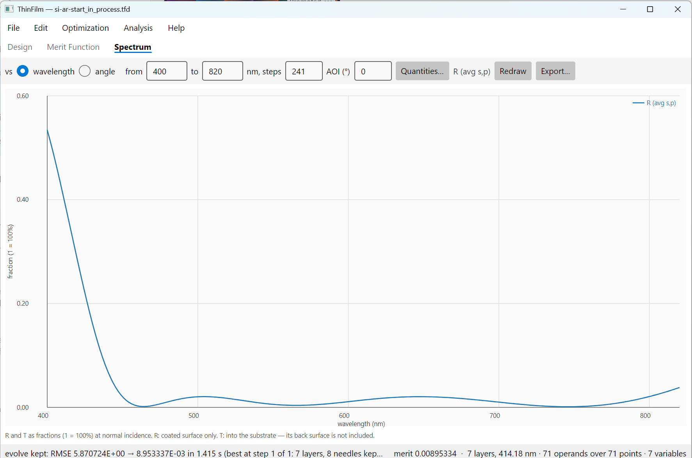

# 7. Materials: an antireflection coating on silicon

Every design so far used materials that came with the program. Sooner or later you need one
that didn't: a substrate measured by someone else, or a coating material whose dispersion you
found in a paper. This chapter shows where materials live, how to bring in new ones, and how to
keep them for the next design.

The coating is an antireflection coating for a silicon photodiode. Bare silicon reflects about
35% of visible light, so a photodiode without a coating loses a third of its signal before it
starts.

## 7.1 Where materials live

There are two kinds of copy, and the Materials window shows both side by side.

- **The material database** is a file of materials that every new design can use. Yours is
  `materials.txt` in your ThinFilm folder. It starts as a copy of the database shipped with the
  program, and from then on it is yours to add to.
- **The design's copies.** When a design uses a material, it keeps its own copy of the
  definition, saved inside the `.tfd` file. Editing that copy changes this design only. A design
  sent to someone else therefore opens with exactly the indices you used, whatever their
  database holds.

Create the design with **File > New design…**:

- **Name**: `Si photodiode AR`
- **Materials**: Si3N4 and SiO2
- **Substrate**: N-BK7 for now; it becomes silicon in 7.2
- **Reference wavelength**: 650 nm
- **Layers**: 2

Then open **Edit > Materials**:



The window has three columns.

**Left: where materials come from.**

- **Material database** lists your database, with its file path above it. Each entry shows its
  model and its index at 550 nm, with its valid range.
- **Glass catalogues** lists the glasses of a maker's catalogue (SCHOTT here). Type in the
  filter box to find one. A catalogue glass can only be a substrate or incident medium, never a
  coating layer, and the design names it rather than copying it.
- Select an entry in either list, then use one of the buttons below:
  - **Add as a new material →** puts a copy into the design as a coating material.
  - **Use as substrate →** and **Use as incident medium →** make it the medium on one side
    of the coating.

**Middle: in this design.** The incident medium, the substrate, and each coating material with
the number of layers that use it.

- **New material ▾** makes a material that isn't in any list: a new coating material, substrate
  or incident medium. Section 7.2 uses it.
- **Replace with database material** swaps the selected material for the one selected on the
  left. Before it does, it shows both definitions. The layers that used the old material keep
  their thicknesses and use the new one.
- **Upgrade constant materials** replaces materials that have only a fixed n and k with database
  materials of the same name that have real dispersion.
- **Remove from design** removes a material that no layer uses.

**Right: the selected copy.**

- **Name** and **Rename**. Renaming changes every layer that uses the material.
- **Dispersion** says how the index is defined: here a table of 41 rows from Palik's handbook.
  **Edit dispersion…** opens the fields, described in 7.2.
- **Reuse** compares this copy with the database. "The database's Si3N4 is the same" means there
  is nothing to save, so **Save to database…** is greyed out. Section 7.3 uses it.
- The graph shows n (blue) and k (red) against wavelength. The note under it gives the
  **valid range**: for this Si3N4, 51.7 to 826.6 nm. Section 7.5 explains why that matters.

**OK** keeps the changes to the design's copies; **Cancel** discards them.

## 7.2 Silicon: a new substrate from a measured table

The design needs a silicon substrate, and the database doesn't have one. Silicon is a semiconductor,
not a glass: it absorbs strongly below about 400 nm, and its index changes a lot across the visible.
No simple formula fits it well, so it is given as a **table** of measured n and k.

The table used here is crystalline silicon at 300 K, from M. A. Green, *Sol. Energy Mater. Sol.
Cells* **92**, 1305 (2008), as published in the refractiveindex.info database (public domain). It is
in [data/Si-Green-2008.csv](data/Si-Green-2008.csv), from 250 to 1450 nm in 10 nm steps. The file
starts like this:

```
# Crystalline silicon at 300 K: wavelength (nm), n, k.
# M. A. Green, "Self-consistent optical parameters of intrinsic silicon at 300K including
# temperature coefficients," Sol. Energ. Mat. Sol. Cells 92, 1305-1310 (2008).
# From the refractiveindex.info database (public domain, CC0), data/main/Si/nk/Green-2008.yml.
wavelength_nm,n,k
250,1.6650e+00,3.6650e+00
260,1.7570e+00,4.0840e+00
```

Any text or CSV file with one wavelength, n and k per line will do. Commas, tabs, spaces or
semicolons can separate the numbers. Lines that aren't numbers, like the comments and the header
here, are skipped and counted.

In the Materials window, open **New material ▾** and choose **New substrate…**. The dispersion
window opens, empty. Fill it in:

- **Name**: `Si`
- **Model**: **Table of n, k**
- Under **Import λ n k from a file**, choose **wavelengths in nm**, then press **Import file…** and
  pick `Si-Green-2008.csv`.



The message at the bottom says what happened: 121 rows, read as nanometres and converted to µm,
5 lines skipped. **Check that message every time.** The table always holds wavelengths in µm,
because the dispersion formulas are written in µm. So 250 nm shows as 0.25.

**The wavelength unit is never guessed.** A file of nanometres read as micrometres puts silicon at
250 to 1450 µm, in the far infrared, a thousand times off. The program protects you in two ways:

- If you don't choose a unit, the file's header is used when it names one (here `wavelength_nm`),
  and the message says so. A file whose header names no unit is refused until you choose.
- If the unit you chose contradicts the header, the import is refused, with the reason.

The program never judges the unit by the size of the numbers. Most files are obvious, but a wrong
guess on the rare one that isn't would give a design built on indices a thousand times off.

The graph is the second check. Silicon's n peaks near 7 around 370 nm and settles to about 3.9 at
633 nm and 3.6 at 1000 nm. Its k is large in the ultraviolet and falls through the visible. Light at 370 nm
reaches only about 13 nm into silicon, light at 450 nm about 0.4 µm, and light at 1000 nm about
150 µm. So nearly all the light that gets past the coating is absorbed, which is what a photodiode
needs.

Leave **Valid range** empty for a table: its range is its first and last row, 250 to 1450 nm, as
the note under the graph says.
**Source** says where the numbers come from. It is optional, but fill it in when you can. It goes
with the material into the design and into the database. Section 7.3 adds it to this material.

Press **OK**. Back in the Materials window, select **Substrate: Si**:



The design now sits on silicon. The message at the bottom says so: "Si is now the substrate. Save to
database keeps it for other designs. OK applies." **Reuse** says the database has no Si, so
**Save to database…** is ready to press. Nothing reaches the design until **OK** in this window,
and nothing reaches the database until **Save to database…**.

## 7.3 Keeping a material for later designs

Silicon is in this design now, but only in this design. The next photodiode design would have to
import the table again. **Save to database…** keeps it.

First give it its source, so whoever opens it later knows where the numbers came from. Select
**Substrate: Si**, press **Edit dispersion…**, type
`M. A. Green, Sol. Energy Mater. Sol. Cells 92, 1305 (2008)` in **Source**, and press **OK**.
**Edit dispersion…** is also how you change any of the design's materials later: the same window,
with its name already given.

Then press **Save to database…**:



- Si is now at the end of the **Material database** list: "measured table, n = 4.0770, k = 0.0280
  at 550 nm, 250–1450 nm".
- **Reuse** says "The database's Si is the same", so **Save to database…** is greyed out.
- The message at the bottom gives the file it went into. Later designs can add it from the list
  on the left. This design keeps its own copy.

Saving adds the material's lines to the end of your database file and leaves everything else in
the file as it was, comments included.

**Saving under a name the database already has** opens a confirmation window first. It shows both
definitions, the database's and the design's, so you can see what would be lost. Replacing is
for correcting a material you saved earlier. To keep both, **Rename** the design's copy first,
for example to `Si (Green 2008)`.

Two kinds of material can't be saved:

- **A catalogue glass**, such as N-BK7, is already in its maker's catalogue. The design names it
  rather than copying it.
- **The materials shipped with the program** stay as they are. Your database starts as a copy of
  them, and it's your copy that changes.

## 7.4 A coating material from a published formula

Most materials in papers aren't tables but formulas: a few coefficients fitted to measurements.
This section types one in. The material is zinc selenide (ZnSe), an infrared material, from the
fit of Connolly (1979) as refitted by Tatian (1984), for ZnSe grown by chemical vapour deposition.
It isn't used in the photodiode coating. It's here because it shows the commonest trap in typing in
a formula.

The program's Sellmeier formula is the one shown beside **Model**:

n² = 1 + Σ Bᵢ λ² / (λ² − Cᵢ),  with λ in µm and Cᵢ in µm².

Papers and databases often write the same formula as Bᵢ λ² / (λ² − Cᵢ²), giving each Cᵢ as a
wavelength in µm. refractiveindex.info's "formula 1" does this. The paper's numbers for ZnSe are:

| term | B | C as published (µm) | C squared (µm²), what you type |
|---|---|---|---|
| 1 | 4.45813734 | 0.200859853 | 0.04034468055 |
| 2 | 0.467216334 | 0.391371166 | 0.1531713896 |
| 3 | 2.89566290 | 47.1362108 | 2221.822369 |

**Look at how the paper writes the formula before typing its C values.** If it has Cᵢ² in the
denominator, square them. Typed unsquared, the formula still evaluates, and nothing stops you, but
the material is wrong everywhere:

| wavelength | n, C squared (right) | n, C unsquared (wrong) |
|---|---|---|
| 632.8 nm | 2.591 | 5.528 |
| 1 µm | 2.489 | 2.699 |
| 10.6 µm | 2.403 | 3.305 |

A published n at one or two wavelengths is the check. For ZnSe, 2.40 at 10.6 µm is well known.

In the Materials window, open **New material ▾** and choose **New coating material…**. Fill in:

- **Name**: `ZnSe`
- **Model**: **Sellmeier**
- The three terms, B and squared C, from the table above. Leave terms 4 to 6 empty.
- **Valid range**: `0.54` to `18.2` µm, the range of the measurements the fit was made to.
- **Source**: `Connolly 1979; Tatian 1984 (CVD ZnSe), C squared from the published wavelengths`



**Load from library** fills these fields from a material already in your database. It is the
quick way to start from a similar material and change it.

The note under the graph says "540–3540 nm shown, of its valid range 540–18200 nm". The graph
shows at most 3 µm of a material's range, starting from its low end. Plotted all the way to 18 µm,
the visible and near infrared, where most coatings work, would be squeezed into the left edge.
k = 0 throughout: a Sellmeier formula describes a transparent material.

**The valid range matters.** Outside it the formula is still a formula and gives a number, but no
measurement supports that number. Section 7.5 shows what the program does when a design reaches
outside a material's range.

Press **OK**. ZnSe appears in the middle column, with no layer count because no layer uses it yet. Press **Save to database…** to keep
it for the infrared designs it belongs in. Then press **Remove from design**, since no layer uses
it. A material that a layer still uses can't be removed: change those layers' material first.

## 7.5 A material's valid range

Every material in the database comes from measurements over some range of wavelengths. Inside
that range its index is backed by data; outside it, it isn't. The range is shown wherever the
material is: in the database list, and under the graph in the Materials window. For the shipped
Si3N4, a table from Palik's handbook, it is 51.7 to 826.6 nm.

Outside its range a material still gives an index, so a design can be computed:

- **A table** is held at its end value: Si3N4 at 900 nm gets the index of its last row, at 826.6 nm.
- **A formula** is evaluated anyway. A Sellmeier fit a little past its last measured point is
  usually close; far past it, it can be badly wrong.

Either way, the result rests on numbers nobody measured, and the program says so.

To see this, go to the **Spectrum** tab and plot from 400 to 1000 nm. The starting design is two
layers, Si3N4 and SiO2, on silicon:



The curve above 827 nm looks as smooth as the rest, but the note under the graph says: "Caution:
Si3N4 is outside its valid range (51.7–826.6 nm) at 827.5–1000 nm, so the curve there rests on an
extrapolated index." The merit function says it too: a row that uses a material outside its range
gets the same caution in the help bar above the merit table when you select it.

So this chapter designs from 450 to 800 nm, inside Si3N4's data. Silicon photodiodes are also used
in the near infrared, to about 1000 nm. A coating for that range would need Si3N4 data that goes
that far: for example a table measured on your own coating machine, imported as in 7.2. Data
measured on your own films is better anyway: an evaporated or sputtered film's index often
differs from a handbook value by a few percent.

## 7.6 The coating

Now the materials are ready, the design itself takes a few minutes.

**Finish the materials.** In **Edit > Materials**:

- select ZnSe, press **Save to database…**, then **Remove from design**;
- in the **Material database** list, select **TiO2** and press **Add as a new material →**.

TiO2, at n ≈ 2.4, has a higher index than Si3N4 (about 2.03). Silicon's index is near 4, so a
coating that steps down from silicon to air needs a high index next to the silicon. Press **OK**.
The design has SiO2, Si3N4 and TiO2, on silicon.

**Start from one layer.** On the **Design** tab, choose **Stack > Input design string…**, type `1L`
(L is SiO2, the lowest index), and press **OK**: one quarter wave of SiO2, 111.6 nm.

**The merit function.** On the **Merit Function** tab, press **Clear all**, then **Add operands…**:

| Code | Mode | Target | WV1 | WV2 | Step WV |
|---|---|---|---|---|---|
| RA | Max | 0.02 | 450 | 800 | 5 |

That is reflectance at most 2% at each of 71 wavelengths from 450 to 800 nm. The merit is 5.87.

**Gradual evolution.** Choose **Optimization > Gradual evolution…**. Set **Minimum thickness** to
`10` nm and leave everything else as it is. Ten nanometres is a thickness most coating machines can
control. With the default of 2 nm, the result keeps two layers of 6 and 7 nm. Press **Start**:



```
step 0       RMSE=8.460947E-01   layers 2, total 171.35 nm   <- best
grow 1       Si3N4 next to the substrate, 80.447 nm   RMSE=3.531624E+00   layers 3
insert 1.1   SiO2 at 208.044 nm   RMSE=4.886963E-01   layers 5
...
remove 1.6   layer 3, 7.234 nm   RMSE=8.953337E-03   layers 7, neighbours merged
step 1       RMSE=8.953337E-03   layers 7, total 414.18 nm   <- best
done         merit 0.00895, under the 0.1 accepted
```

Evolution grew a layer of Si3N4 against the silicon, and needles inserted SiO2 and TiO2 into it.
Then it removed every layer under 10 nm, refining after each removal. It stopped after one growth step,
because the merit had fallen under the 0.1 that **merit up to** accepts. Press **Accept results**.

| Layer | 1 | 2 | 3 | 4 | 5 | 6 | 7 |
|---|---|---|---|---|---|---|---|
| Material | SiO2 | Si3N4 | SiO2 | Si3N4 | SiO2 | Si3N4 | TiO2 |
| nm | 106.5 | 60.8 | 49.7 | 17.8 | 114.0 | 11.7 | 53.6 |

Layer 1 meets the air, and layer 7, TiO2, lies on the silicon. The total is 414 nm.

On the **Spectrum** tab, from 400 to 820 nm:



| | Reflectance, 450 to 800 nm |
|---|---|
| Bare silicon | 33% to 42%, mean 36% |
| The 7-layer coating | at most 2.1%, mean 1.1% |

The merit is not quite zero: reflectance just touches 2.09% at 800 nm, the band's edge. Setting
**merit up to** to `0` makes evolution go on until every point is under 2%: it does, with 17 layers
and 754 nm. Ten more layers to remove the last 0.09% at one edge is a poor trade for a photodiode,
so this chapter keeps the 7-layer design.

Below 450 nm the reflectance climbs steeply, to 53% at 400 nm. The merit function asked for
nothing there. A photodiode for blue and violet light would need the band to start lower, and
silicon's index changes fast there (7.2), so the coating would be harder.

The coating itself absorbs nothing in the band: the light that isn't reflected goes into the
silicon. That is what **T** means here: "into the substrate", as the note under the graph says.

The designs are in [samples/User guide/7 Materials, AR on silicon](../../samples/User%20guide/7%20Materials%2C%20AR%20on%20silicon):

| File | What it is |
|---|---|
| [si-ar-start.tfd](../../samples/User%20guide/7%20Materials%2C%20AR%20on%20silicon/si-ar-start.tfd) | after 7.4: Si3N4 and SiO2 on the new silicon substrate, ZnSe not yet removed |
| [si-ar-start_in_process.tfd](../../samples/User%20guide/7%20Materials%2C%20AR%20on%20silicon/si-ar-start_in_process.tfd) | the start of 7.6: one SiO2 layer, TiO2 added, the merit function |
| [si-ar-7.tfd](../../samples/User%20guide/7%20Materials%2C%20AR%20on%20silicon/si-ar-7.tfd) | the result: 7 layers, 414 nm |

Each design carries its own copy of silicon. It opens on another computer even if that computer's
database has never heard of Si.

## 7.7 Other ways to bring in a material

The **Materials** window has two more buttons that bring in materials.

**Replace with database material.** Select a material in the middle column and one in the
database on the left, and press it. The design's material is replaced by the database's, and its
layers keep their thicknesses. A confirmation window shows the two definitions first. Use it when
you have better data for a material a design already uses: for example, your own measured Si3N4
in place of the handbook's.

**Upgrade constant materials.** Older designs, and designs imported from other programs, often
give a material as a single n and k at every wavelength. This button replaces each such material
with the database material of the same name, which has real dispersion. It lists what it changed,
and what it couldn't change because the database has no material of that name. For those, use
**Edit dispersion…** to give the material a formula or a table, or **Replace with database
material** to pick another.

A design opened from a file keeps its own materials whatever your database holds. Nothing
changes a design's materials behind your back: only these buttons and **Edit dispersion…** do.

## 7.8 The same from the command line

Every step of this chapter can be done with the `thinfilm` command line. The MCP server does the
same through `define_material`, `save_material_to_database`, `edit_materials`, `add_operands`, and `optimise_start` with method `evolve`.

```
thinfilm new --materials Si3N4,SiO2 --substrate N-BK7 --reference 650 --layers 2 --name "Si photodiode AR" -o si.tfd

# 7.2: silicon from the table; the file's header says nm, so --table-unit could be left out
thinfilm materials si.tfd --define Si --as substrate --table Si-Green-2008.csv --table-unit nm \
    --source "M. A. Green, Sol. Energy Mater. Sol. Cells 92, 1305 (2008)"
# 7.3
thinfilm database --save si.tfd --material Si

# 7.4: ZnSe, with C squared; --range in µm
thinfilm materials si.tfd --define ZnSe \
    --sellmeier 4.45813734,0.04034468055,0.467216334,0.1531713896,2.89566290,2221.822369 \
    --range 0.54,18.2 --source "Connolly 1979; Tatian 1984 (CVD ZnSe)"
thinfilm database --save si.tfd --material ZnSe
thinfilm materials si.tfd --remove ZnSe

# 7.5: a spectrum past Si3N4's data prints a caution beside the CSV
thinfilm spectrum si.tfd --from 400 --to 1000 --steps 61 -o past.csv

# 7.6
thinfilm materials si.tfd --add TiO2
thinfilm stack string si.tfd --text "1L" --letters L=SiO2
thinfilm merit clear si.tfd
thinfilm merit add si.tfd --code RA --mode Max --target 0.02 --from 450 --to 800 --step 5
thinfilm evolve si.tfd --min-thickness 10
```

`thinfilm materials si.tfd` lists the design's materials as the Materials window does, each with its
model, n at 550 nm, valid range and source. `--define Si --source "..."` with no model changes only
the source, as in 7.3; `--rename` and `--upgrade` are the Materials window's Rename and Upgrade
constant materials. `database --save` asks for `--replace` before overwriting a database material of the same name.
A table whose header names no unit needs `--table-unit nm` or `--table-unit um`. A unit that
contradicts the header is refused.
