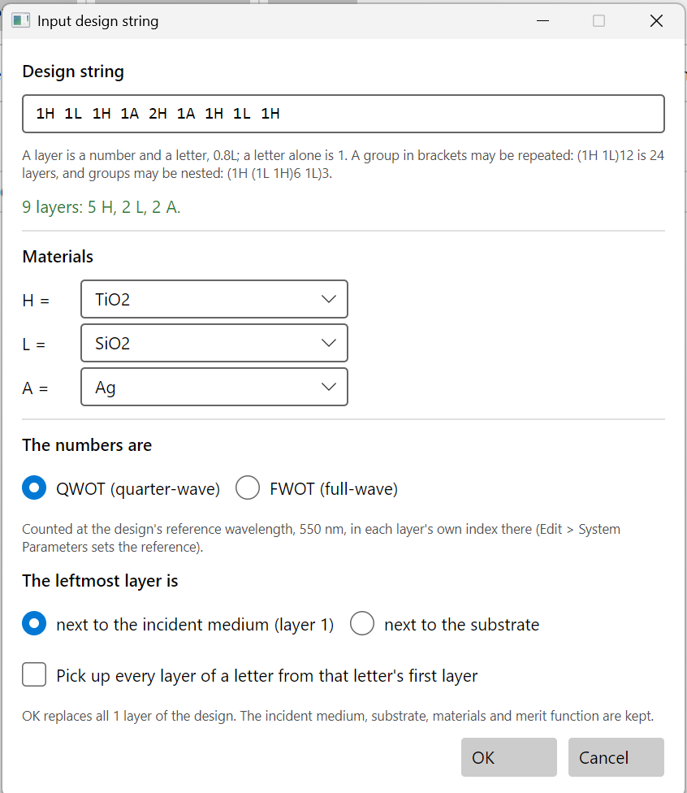

# Input design string

**Stack > Input design string…** on the Design tab builds a whole stack from a line of text, the
way designs are written in papers and textbooks: `(1H 1L)12 1H` is a 25-layer quarter-wave
mirror. It is the quickest way to a structured start: a mirror, an edge filter, a Fabry–Perot
cavity, or the induced-transmission start of chapter 5.



## Writing the string

| You write | It means |
|---|---|
| `1H` | One layer: a number, then a letter. The letter is a material; the number its thickness in quarter waves (or full waves, see below). |
| `0.8L` | Numbers may be fractions. |
| `H` | A letter alone is `1H`. |
| `1H 1L 1H` | Layers one after another. The spaces are optional: `HLH` is the same. |
| `(1H 1L)12` | A group in brackets, repeated: 24 layers. `(1H 1L)^12` is the same, as some programs write it. |
| `(1H (1L 1H)6 1L)3` | Groups may be nested. |
| `(1H 1L)2 0.5H` | A digit straight after `)` is always the repeat count, so put a space before a layer that follows a group. |

Letters may be upper or lower case; `h` is `H`. Each layer must be thicker than zero. More than
5,000 layers is refused as a typing slip.

As you type, the line under the box says what the string makes, "25 layers: 13 H, 12 L.", or
where it stops making sense.

## Materials

One row for each letter the string uses, with the material it stands for. The program guesses:

- **H**: the design's highest-index material at the reference wavelength.
- **L**: the lowest-index material.
- **M**: the one nearest the middle, when there are three or more.
- **Any other letter**: the first material whose name starts with it, as **A** for **Ag**
  above. If none does, choose one.

The list holds the design's own materials. To use another, add it first with **Edit >
Materials…**.

## The numbers are

- **QWOT** (quarter-wave optical thickness): `1H` is a quarter wave of H.
- **FWOT** (full-wave): `1H` is a full wave, four times as thick.

Both are counted at the design's reference wavelength, in each layer's own index there. The line
under the choice gives the reference; **Edit > System Parameters** changes it. The layers keep
these units in the layer table, so changing the reference later shifts the whole design, as a
quarter-wave design should.

A quarter wave means nothing useful for a metal: `1A` of silver comes out over a micrometre
thick. Set metal layers to their physical thickness afterwards in the layer table (chapter 5).

## The leftmost layer is

- **next to the incident medium (layer 1):** the string reads in the layer table's order, from
  the air side down. The usual choice.
- **next to the substrate:** the string is read from the substrate up, as many papers write
  their designs. Layer 1 of the table is then the rightmost layer of the string.

## Pick up every layer of a letter

Ticked, every layer of a letter follows that letter's first layer in the table, scaled by the
ratio of their numbers. In `(1H 0.8L)12`, layer 1 (H) and layer 2 (L) are free, and every other
layer follows one of them. Optimising then varies only two thicknesses, and the design stays a
periodic stack, which is what you want for tuning a mirror or an edge as a whole.

Leave it unticked for a start that needle, gradual evolution or remove thin layers will work on:
they add or remove layers, so they refuse to run while layers pick up from others. **Stack >
Decouple all layers** frees them later.

## OK

**OK replaces every layer of the design.** The incident medium, substrate, materials and merit
function are kept. A string that does not parse, or a letter with no material, keeps the dialog
open with the reason.

## From the command line and the MCP server

```sh
thinfilm stack string design.tfd --text "(1H 1L)12 1H" --letters H=TiO2,L=SiO2
```

`--letters` names the materials; a letter not named is guessed as above. `--no-pickups` leaves
every layer free, `--unit FWOT` counts in full waves, and `--substrate-first` reads the string from the
substrate side. The MCP server's `edit_stack` takes the same: `text`, `letters`, `unit`, `substrate_first` and `pickups`.
