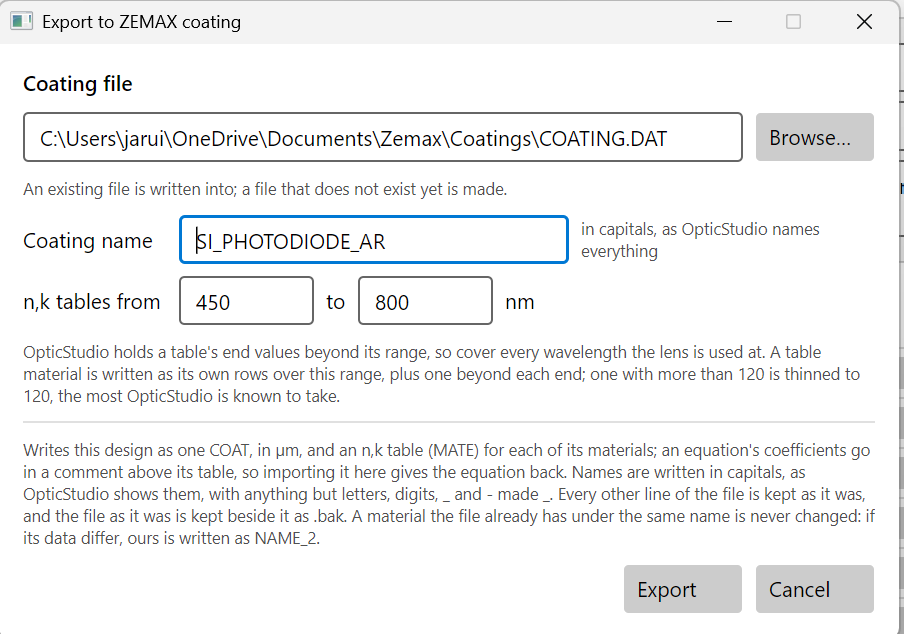
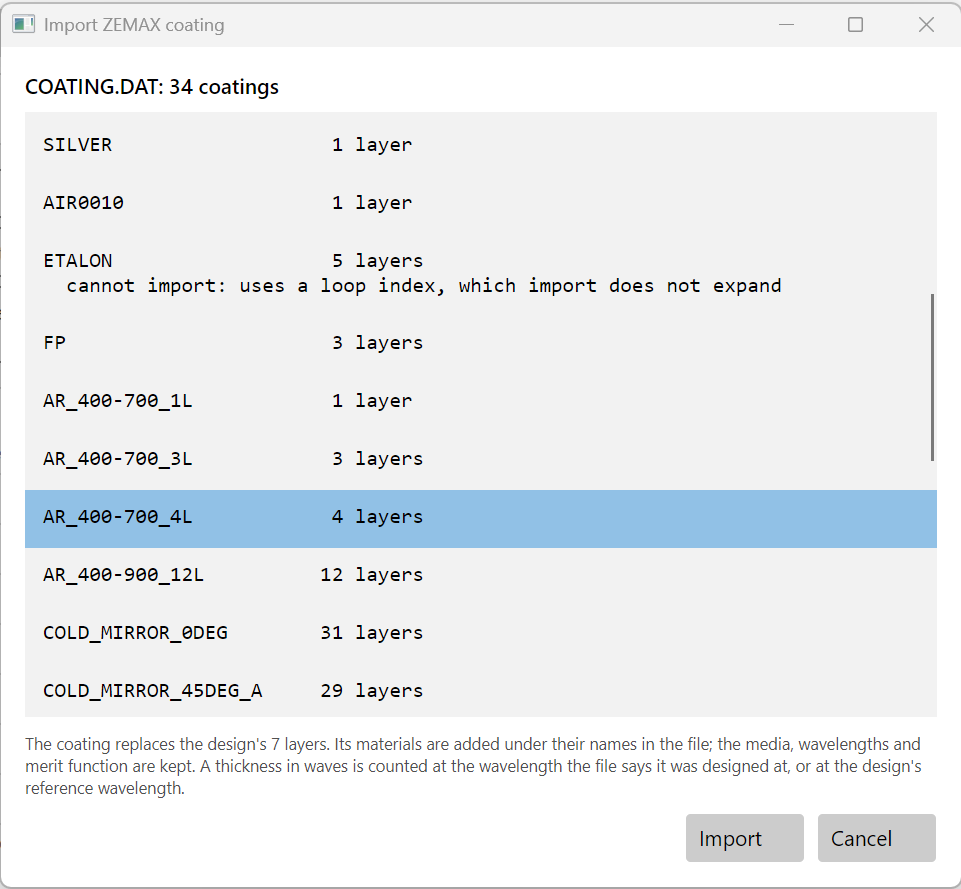

# The File menu: samples, OpticStudio, Optiland and the design report

**New design…**, **Open…**, **Save** and **Save As…** do what they say. A design is one `.tfd`
file holding everything: layers, its own copies of its materials, the merit function, the system
parameters, the Spectrum tab's settings, its description, and the history of optimisation runs. This
page is about the rest of the File menu:

- **Open sample…**: the designs that come with the program.
- **Import ZEMAX coating…** and **Export to ZEMAX coating…**: OpticStudio's coating files.
- **Import Optiland coating…** and **Export Optiland coating…**: coatings for the Optiland lens
  design library.
- **Export design report…**: the design as plain numbers, for any other program.

## Open sample

**File > Open sample…** opens a browser of about 380 sample designs in two folders:

- **Examples**: designs that show what the program can do, such as antireflection coatings,
  filters, beam splitters and mirrors.
- **Literature**: designs from published papers and books, each with its source.

Type in **Find** to narrow the list: words in a name, category, author, year or the notes, for
example `polarizer 1969`. Selecting a sample shows its **Source** and **Notes** before you open it.

A sample opens as a copy. **Save** then asks where to write it, so the sample itself never changes.

## Coatings for OpticStudio

OpticStudio keeps every coating in one shared text file, usually
`Documents\Zemax\Coatings\COATING.DAT`. It holds dozens of coatings and the materials they use,
and lenses refer to both by name. Two kinds of block matter here:

- **MATE** defines a material as a table of wavelength (µm), n and k.
- **COAT** defines a coating as a list of layers, each a MATE name and a thickness. The first layer
  listed faces the medium the light comes from, as layer 1 does here.

The two programs order layers the same way. In OpticStudio's own COATING.DAT, the classic
three-layer antireflection coating HEAR1 is listed as MgF2, ZrO2, CeF3, with the low-index MgF2
first, next to air. Imported here, the file's 4-layer Essential Macleod example `AR_400-700_4L`
reflects at most 0.5% from 400 to 700 nm on N-BK7, as it should; turned upside down it would
reflect up to 11%.

A coating in OpticStudio has no substrate: it's applied to a lens surface, and the lens decides
the glass on each side. So only the layers and their materials travel between the two programs.
The substrate and incident medium stay in the design.

### Export to ZEMAX coating

**File > Export to ZEMAX coating…** writes the design into a coating file.

| Box | What it does |
|---|---|
| **Coating file** | The file to write into. It starts at your OpticStudio coatings folder when there is one. A file that doesn't exist yet is made. |
| **Coating name** | The COAT's name, in capitals, as OpticStudio names everything. Spaces and anything other than letters, digits, `_` and `-` become `_`: "Si photodiode AR" is written as `SI_PHOTODIODE_AR`. A name starting `I.` is refused, because OpticStudio reads that as an ideal coating. |
| **n,k tables from … to** | The wavelength range the material tables cover. It starts as the design's own wavelength range, 450 to 800 nm here. Beyond a table's ends OpticStudio holds the end values, so cover every wavelength the lens will be used at. |

**The file is changed surgically.** Only this coating's COAT and the MATEs it needs are added.
Every other line, including the other coatings, materials and comments, is written back exactly
as it was, in the file's own text encoding. The file as it was is kept beside it as
`COATING.DAT.bak`.

**Existing names are never changed**, because other coatings in the file use them:

- A material the file already has, under the same name and with the same data (within 10⁻⁴ in n
  and k), is used as it is.
- If the data differ, the file's material is left alone and this design's is written as `NAME_2`.
  The export says so.
- A coating of the same name is replaced only when you confirm it.

**Thicknesses are written in µm**, never in waves. A coating in waves would be counted at the
primary wavelength of whatever lens it is put on. The design's reference wavelength goes in a
comment above the COAT instead.

**Materials are written as n,k tables**, because OpticStudio only reads tables:

- A formula (Sellmeier, Cauchy or a catalogue glass) is sampled where it bends, until OpticStudio's
  straight-line interpolation between rows is within 10⁻⁵ of it in n and k. It isn't sampled past
  the material's valid range.
- A table is written as its own rows over the range, plus one beyond each end.
- A material is written as at most **120 rows**. OpticStudio refuses a file with "Maximum
  Wavelength-index points exceeded in coating file" when a material has too many. The limit isn't
  documented, but OpticStudio's own COATING.DAT has 120-row materials. When 120 rows can't reach
  10⁻⁵, the export says how close they come. TiO2 from 400 to 850 nm is within 1.3×10⁻⁵.
- **A material whose data ends inside the range is named.** The tables can't reach past a
  material's data, and OpticStudio holds a table's end values. So exporting the chapter 7 coating to
  1100 nm says: "Si3N4 has data only from 51.7 to 826.6 nm; above 826.6 nm OpticStudio will hold
  its end values."
- **k changes sign.** OpticStudio writes an absorbing material with k below zero; this program
  writes it above zero. Export and import convert it.

**The formula travels too.** Above each table, comments starting `! ThinFilmDesigner` record the
material's model, coefficients, valid range and source. OpticStudio ignores them. Imported back
here, the material is a Sellmeier or Cauchy formula again, not a table, as long as the formula still
gives the table. If someone has edited the numbers in OpticStudio, the edited table wins.

### Import ZEMAX coating

**File > Import ZEMAX coating…** asks for a coating file, then lists its layer-stack coatings,
with each one's layer count and the wavelength it says it was designed at. A coating that can't be
imported is listed with the reason. Choose one and press **Import**.

The file here is an OpticStudio COATING.DAT with 34 coatings. ETALON can't be imported: it uses
a loop index. The window says what will happen: the coating replaces the design's 7 layers.

- **The coating replaces the design's layers.** The substrate, incident medium, wavelengths and
  merit function are kept.
- **Its materials are added under their names in the file.** If the design already has a material
  of that name with the same data, the design's own is used. With different data, the file's comes
  in as `NAME_2`.
- **A thickness in waves** is counted at the wavelength a comment above the COAT gives, or at the
  design's reference wavelength if there's none, and comes in as QWOT (one wave is 4 QWOT).
- **Refused, with the reason:** a coating that uses a loop index, ideal (`I.`), TABLE and ENCRYPTED
  coatings, and a coating that uses a material with no MATE in the file.
- **A tapered coating** is read at its nominal thickness, with a note.

A design exported and imported back is the same design. The chapter 7 coating's reflectance
from 450 to 800 nm comes back within 4×10⁻¹⁰, with SiO2, Si3N4 and TiO2 as the design's own
materials.

## Coatings for Optiland

[Optiland](https://github.com/HarrisonKramer/optiland) is an open-source optical design library
in Python. It has no coating file of its own. A coating is a ThinFilmCoating object saved as
JSON, either in a file of its own or on a surface of a lens file. Its layers are listed incident
side first, in nm, as here, and its k is positive for an absorber, also as here.

### Export Optiland coating

**File > Export Optiland coating…** asks only where to save. It suggests `<design>-coating.json`,
so the export can't be mistaken for, or written over, a design. In Python, Optiland reads the file
with `load_obj_from_json(BaseCoating, path)`.

The file holds:

- the layers, incident side first, in nm;
- the design's incident medium and substrate, as the coating's two media;
- each material as a formula or a table. Optiland can hold the same formulas this program uses
  (Sellmeier, Cauchy, and the catalogue-glass formulas), so a formula goes as a formula, not as
  samples;
- the design's name, reference wavelength and each material's valid range, in an entry Optiland
  keeps and ignores. Optiland refuses to evaluate a formula outside its range, where this program
  only flags it, so the range is kept out of the formula itself.

The file is written whole. Unlike a coating file, it holds only this coating.

### Import Optiland coating

**File > Import Optiland coating…** reads a coating file or a whole lens file. A lens file can have
a coating on any of its surfaces; each is listed by surface number. Choose one and press **Import**.

- The coating replaces the design's layers. Materials come in as for OpticStudio: the design's own
  when name and data agree, otherwise `NAME_2`.
- **The coating's media aren't used.** The design keeps its own substrate and incident medium, and
  a note says what the file had.
- **Materials:** anything Optiland can hold is read. That covers a formula or table, an ideal
  material, a catalogue glass, and a database material, as long as the refractiveindex.info file it
  names is on this computer. A formula this program has no model for is tabulated finely, with a
  note.
- **Refused:** an Abbe material, which is a fit to two numbers, not data.

The same round trip as above comes back exact.

**Checking one program against the other.** Optiland computes reflectance and transmittance with
its own code. The two programs agree to 10⁻¹⁰ on R, T and A, and [Verification](../verification.md)
shows how to repeat the comparison for any design.

## Export design report

**File > Export design report…** writes the design as plain numbers, for a program that can't
read dispersion formulas: a coating machine's software, a spreadsheet, another design program.

- **The layers in nm**, whatever unit each is shown in here, and the total.
- **Every material the design uses, as an n,k table**, including the substrate and incident
  medium. Choose the range and the step: the range starts as the Spectrum tab's, and the step at
  10 nm.
- **What you should know.** Each table gives the material's source. If a table reaches outside the
  material's valid range, the report says where: "Outside the data's valid range (51.7 to 826.6 nm)
  at 830-1000 nm: those rows are extrapolated."

It is one text file. Every line that isn't data starts with `#` or `[`. The tables are
tab-separated, so each pastes into a spreadsheet as it stands.

## From the command line and MCP

| File menu | Command line | MCP |
|---|---|---|
| Open sample… | `thinfilm samples [words]` lists them, for example `thinfilm samples polarizer` | `list_samples` |
| Import ZEMAX coating… | `thinfilm zemax list COATING.DAT`, then `thinfilm zemax import d.tfd --file COATING.DAT --coating NAME` | `zemax_coatings`, `import_zemax_coating` |
| Export to ZEMAX coating… | `thinfilm zemax export d.tfd --file COATING.DAT [--coating NAME] [--from 400 --to 700] [--replace]` | `export_zemax_coating` |
| Import Optiland coating… | `thinfilm optiland list lens.json`, then `thinfilm optiland import d.tfd --file lens.json [--coating 1]` | `optiland_coatings`, `import_optiland_coating` |
| Export Optiland coating… | `thinfilm optiland export d.tfd --file d-coating.json` | `export_optiland_coating` |
| Export design report… | `thinfilm report d.tfd [--from 400 --to 800 --step 10] [-o report.txt]` | `design_report` |

`zemax export` refuses to overwrite a coating of the same name unless given `--replace`, as the
window asks first.
