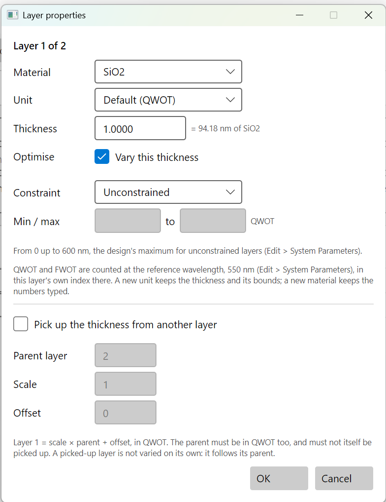

# Layer properties

**Layer properties** sets everything about one layer: its material, the unit its thickness is
in, the thickness, whether the optimisers may change it, the limits they must keep to, and
whether it follows another layer. Open it from the **…** button at the end of a layer's row on
the Design tab, or select a row and press **Layer properties…**.

Nothing changes until **OK**. If a box holds something the program cannot accept, the dialog
stays open and says which box and why.

## Material, unit and thickness

**Material.** Any of the design's materials. To use another, add it first with **Edit >
Materials…**.

**Unit.** The unit this layer's thickness is shown and typed in:

- **Default**: the design's thickness unit (Edit > System Parameters), shown in brackets. The
  layer follows it if the design's unit is changed later.
- **nm** (or **µm** in a µm design): a physical thickness.
- **QWOT**: quarter-wave optical thickness, 4nd/λ. 1 QWOT is a quarter wave.
- **FWOT**: full-wave optical thickness, nd/λ. 1 FWOT is 4 QWOT.

QWOT and FWOT are counted at the design's reference wavelength, in this layer's own index there.
Choosing another unit converts the number in the box; the layer stays the same thickness.

**Thickness.** In the chosen unit. Zero is allowed. For QWOT and FWOT the line beside the box
gives the physical thickness, "= 58.51 nm of TiO2".

**A new material keeps the number typed.** A layer of 1 QWOT of TiO2 changed to SiO2 becomes 1
QWOT of SiO2, a quarter wave again, and so physically thicker. A layer in nm keeps its nm.

## Optimise

**Vary this thickness.** Ticked, the optimisers may change this layer's thickness. Unticked, the
layer is **fixed**: nothing changes it. Needle never inserts a layer inside it, and Remove thin
layers never removes it or joins it to its neighbour. Chapter 6 fixes an outer MgF2 layer this
way. In the layer table this is the **Vary** column, which can be ticked there directly.

## Constraint, min and max

The limits an optimiser must keep this layer's thickness within:

| Constraint | Means |
|---|---|
| **Unconstrained** | From 0 up to the design's maximum for unconstrained layers (Edit > System Parameters). |
| **Between min and max** | Between the two numbers. |
| **Greater than min** | At least the minimum, and up to the design's maximum for unconstrained layers (unless the minimum is above it). |
| **Less than max** | From 0 up to the maximum. |

The line under the boxes says what an open side means, so no limit goes unseen. The numbers are
in the layer's unit; a QWOT bound is counted in this layer's own index. The maximum must be more
than the minimum.

These are true limits, not penalties in the merit function: a step that would cross one is
reflected back inside by the amount it overshot (see [references](../references.md#methods)).

Refine and Global search keep to them. **Needle, Gradual evolution and Remove thin layers refuse
to run while any layer has a minimum or maximum of its own**: they add and remove layers, and
the limits belong to layers by number. Set the layers back to Unconstrained first, and use the
design-wide maximum in System Parameters instead.

## Pick up the thickness from another layer

Ticked, this layer's thickness is not its own: it follows another layer.

    this layer = scale × parent + offset

- **Parent layer**: the layer number it follows.
- **Scale**: 1 for the same thickness, 0.5 for half, and so on.
- **Offset**: added after scaling, in this layer's unit.

The parent must be in the same unit as this layer, and must not itself follow another layer. A
picked-up layer is not varied on its own; when the optimiser changes the parent, this layer moves
with it. Pickups keep a periodic design periodic while it is refined: a mirror of 24 layers
becomes a problem of two thicknesses. **Stack > Couple all layers** picks up every layer of a
material from its first layer at once, and **Stack > Decouple all layers** frees them all.

Like bounds, pickups name layers by number, so needle, gradual evolution and remove thin layers
refuse to run while any layer picks up from another.

## Many layers at once: Set vary constraints

**Stack > Set vary constraints…** gives the same limits to many layers at once:

- **Layers … to …**: a range of layer numbers; all of them to begin with.
- **Material**: all materials, or only the layers of one.
- **Constraint**, **Min / max**: as above.
- **Unit**: QWOT, FWOT or physical, for every layer it reaches. A QWOT bound is counted in each
  layer's own index, so "at least 0.5 QWOT" over TiO2 and SiO2 layers is half of each one's own
  quarter wave.

The dialog says which layers the range and material reach. A picked-up layer is passed over: it
follows its parent's thickness, not limits of its own.

## From the command line and the MCP server

| Dialog | Command line | MCP |
|---|---|---|
| Layer properties | `thinfilm layer set d.tfd --layer 3 --material SiO2 --thickness 1 --unit QWOT --vary no --min 0.5 --max 2 --pickup 1 --scale 1 --offset 0` (`--min none` removes a bound; `--free` removes a pickup) | `edit_layer` |
| Set vary constraints | `thinfilm stack bounds d.tfd --layers 1-24 --material TiO2 --unit QWOT --min 0.5 --max 2` | `edit_stack`, action `bounds` |
| Couple, Decouple all layers | `thinfilm stack couple d.tfd`, `stack decouple` | `edit_stack` |

On the command line and in the MCP server, layers count from 1, as on the Design tab.
