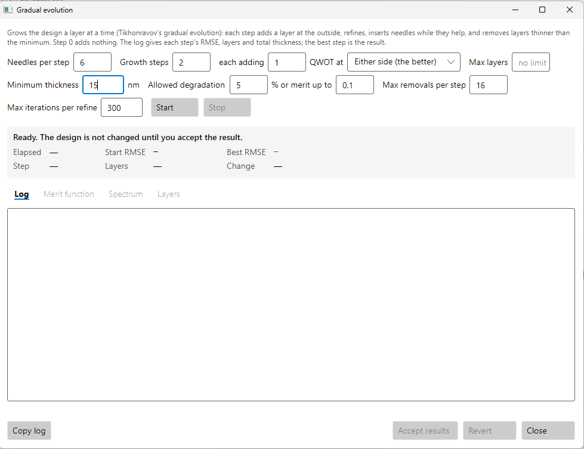

# The optimisation windows

The **Optimization** menu opens one window per method:

| Menu item | What it does |
|---|---|
| **Refine…** | Improves the layer thicknesses it has. Never adds or removes a layer. |
| **Global search…** | Refines from many starting points and keeps the best. |
| **Needle optimisation…** | Adds thin layers where they help most, one at a time. |
| **Gradual evolution…** | Grows the design a layer at a time, adding needles and removing thin layers as it goes. |
| **Remove thin layers…** | Removes, or raises and fixes, every layer under a minimum thickness. |

They are one window that shows only the settings its method uses. This page explains every
setting. The chapters of this guide show them in use.

*The Gradual evolution window from chapter 1. Since then an **Insert** row of material check
boxes has been added beside Needles per step; see [Needle optimisation](#needle-optimisation).*

## What every window has

**The description** at the top says in a sentence or two what the method does.

**Max iterations** (refine) or **Max iterations per refine** (the others). How many least-squares
iterations a refinement may take. The other methods refine after every start, insertion, growth
step or removal, and this is the budget for each one. Default 300. A refinement usually stops well
before this, when the merit stops improving.

**Start** runs it, and **Stop** stops it and keeps the best design found so far. The run works on
a copy: **the design is not changed until you accept the result.**

**The readout** while it runs:

| | |
|---|---|
| Elapsed | Seconds since Start. |
| Start RMSE | The merit of the design it started from. |
| Best RMSE / End RMSE | The best merit so far; once the run ends, the merit it ended with. |
| Iteration, Start, Hop, Insertion, Step, Removal or Raised | How far it has got, as "3 of 24" where there is a fixed number. |
| Layers | The number of layers in the design now. |
| Change | The merit now against the start, in percent. It shows — when the design already met its spec at the start, where a percentage of a merit near zero means nothing. |

**The tabs.** **Log** shows the run line by line. When it ends, three more open, each comparing
the run's design with the one it started from:

- **Merit function:** every row, its value before and after, and the difference.
- **Spectrum:** before and after on one plot, or either alone. Choose the range, the angle and the quantities,
  then press **Redraw**.
- **Layers:** both stacks side by side.

**The log file.** Every run is also written to a log file, named under the readout. Its folder is
given in [building.md](../building.md#where-the-program-keeps-your-files). **Copy log** puts the
log on the clipboard.

**Accept results** puts the new design into the editor; save it to keep it. **Revert** drops the
result and leaves the window open to try other settings. **Close**,
Escape or the window's X stop a run that is going and drop its result.

## Refine

Damped least squares (Levenberg–Marquardt) on the thicknesses of the layers that vary, within
each layer's minimum and maximum.

**Norm.** What "a better merit" means:

- **L2** (the default): the sum of the squared misses, the usual least squares. Big misses count
  most, but many small ones add up.
- **L1:** the sum of the misses themselves. A few rows are allowed to miss badly if that brings
  most of the others right on.
- **minimax:** the single worst miss. It spreads the error evenly, so no row is much worse than
  the rest. It is the one to use for a spec with a hard limit everywhere.

L1 and minimax are reached by running the least-squares solver several times, each time
weighting the rows by how much they missed.

## Global search

Refine finds the nearest minimum, which may be a poor one. Global search refines from many
starting points and keeps the best result. The design you started from is one of the
candidates, so the result is never worse than it.

**Random starts / Basin hopping.** Where the starts come from:

- **Random starts:** each start is drawn afresh, every thickness at random. Use it when the
  design has no good structure to keep.
  - **Range 0 to … × each thickness:** each thickness is drawn between zero and this multiple
    of its present value, and inside the layer's bounds. Default 2.
- **Basin hopping (around the best):** each start is the best design so far with every thickness
  moved a little, then refined. A good structured design, such as a bandpass, is searched around
  rather than thrown away; 40 random starts on a bandpass never came within 50% of the design
  they started from.
  - **Perturbation:** how far each thickness may move, as a percentage of itself, either way.
    Default 10%.
  - **Accept worse by up to:** a hop that is worse than the best by no more than this percentage
    still moves the walk there, so it can cross into a neighbouring valley instead of falling
    back into the same one. The best design seen is always kept. Default 0: hop only from the
    best.

**Starts** (or **Hops**). How many. Default 24.

**Seed.** The starting number for the random draws. Blank, the default, means a new one each run,
so running again tries other starts. The log gives the seed used; type it here to repeat a run
exactly.

**Threads.** How many starts are refined at once, each on its own processor core. Default: every
core but one, so the computer stays usable. With basin hopping, this many hops are tried from
each point of the walk.

## Needle optimisation

Finds the place in the stack, and the material, where a very thin new layer would lower the merit
the most. It inserts it there, refines, and keeps it only if the merit fell; then it tries again.
This is how a design gains layers.

**Max insertions.** The most layers it will add. It stops sooner when no needle helps. Default 6.
Each insertion adds up to two layers, since a needle splits the layer it goes into.

**Insert.** One check box per material in the design: the materials a needle may be. All are
ticked to begin with. Untick a metal: a thin needle of silver refines well on paper but cannot
be made (chapter 5). A needle never goes inside a fixed layer, nor inside a layer of an unticked
material.

Needle cannot run while any layer has a minimum or maximum of its own. Remove those bounds in
Layer properties first.

## Gradual evolution

Grows the design a layer at a time (Tikhonravov's gradual evolution). Each step adds a layer at
the outside, refines, inserts needles while they help, and removes layers that have thinned
below the minimum. Step 0 adds nothing; it is the needle and removal pass on the design as
given. The log gives each step's RMSE, layer count and total thickness, and **the result is the
best step, not the last.**

**Needles per step.** The most needles tried in each step. Default 6.

**Insert.** The materials a needle or a grown layer may be, as for needle.

**Growth steps.** The most steps after step 0. Default 8. Evolution also stops sooner:

- when the merit falls under **merit up to**;
- after 3 steps in a row with no better design;
- at **Max layers**.

**each adding … QWOT.** The thickness of the layer each step adds, in quarter waves at the
reference wavelength. Default 1. If a step comes back to the design it started from, the next
added layer is made twice as thick, up to 4 times this. The log says when that happens
(chapter 6).

**at.** Where the layer is added:

- **Either side (the better)**, the default: both are tried and the better kept.
- **Incident side:** always the outer side.
- **Substrate side:** always next to the substrate.

**Max layers.** The most layers the design may have: growth stops there, and a needle that would take the stack past it is not inserted (a needle inside a layer adds two, at a boundary one). Blank is no limit.

**Minimum thickness.** Layers thinner than this are *candidates* for removal after each step.
Default 2 nm.

**Allowed degradation … % or merit up to ….** Whether a candidate is removed. A removal is kept
if, after refining, the merit is no more than this percentage worse (default 5%), **or** if the
merit is at or under the "merit up to" value whatever it cost (default 0.1; 0 turns it off). The
second rule matters for a design that already meets its spec: 5% of a merit near zero is
nothing, so without it no layer could ever be removed. Reaching the "merit up to" value also
stops the growth.

**Max removals per step.** The most layers removed in one step. Default 16.

## Remove thin layers

The last step before a design is made: every layer under the minimum goes, whatever it costs.
After each change the rest of the design is refined, and the log gives the merit, so you can see
the price of a design that can be made.

**Minimum thickness.** Default 2 nm, in the design's length unit.

**Remove them.** Each thin layer is removed, thinnest first. When the layers either side are the
same material they are joined into one. A fixed layer is never removed, and never joined to its
neighbour.

**Raise them to the minimum and fix them.** Each thin layer is set to the minimum thickness and
fixed there, and the rest refined. Use it when a thin layer is doing real work (chapter 4).
Refining can push another layer under the minimum, so the count is of layers raised, not of a
fixed number.

## From the command line and the MCP server

Every setting has a command-line option of the same meaning. The MCP server's `optimise_start`
takes the same settings by name. Percentages are typed as percentages on the command line.

| Window | Command line |
|---|---|
| Refine | `thinfilm refine d.tfd --norm L2\|L1\|minimax --iterations 300` |
| Global search | `thinfilm global d.tfd --mode random\|hop --starts 24 --range 2 --perturbation 10 --accept-worse 0 --seed N --threads N` |
| Needle optimisation | `thinfilm needle d.tfd --insertions 6 --insert TiO2,SiO2` |
| Gradual evolution | `thinfilm evolve d.tfd --insertions 6 --growth-steps 8 --growth 1 --grow-at both\|incident\|substrate --max-layers N --min-thickness 2 --degradation 5 --accept-merit 0.1 --removals 16` |
| Remove thin layers | `thinfilm thin d.tfd --min-thickness 2 [--raise]` |

`--revert` runs and logs without changing the design, like pressing Revert; `--compare` prints
what the Merit function and Layers tabs show. See [cli.md](../cli.md#optimisation).
