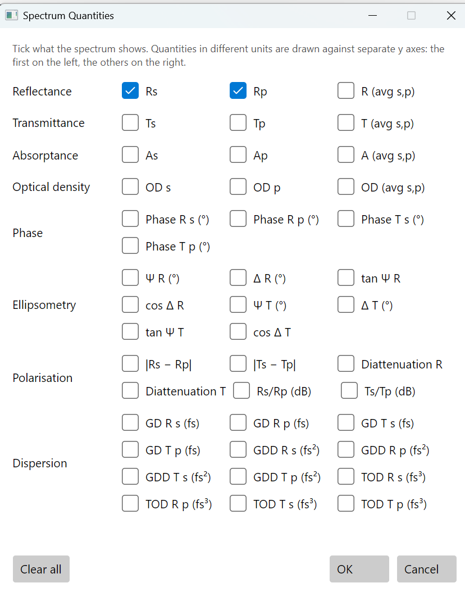
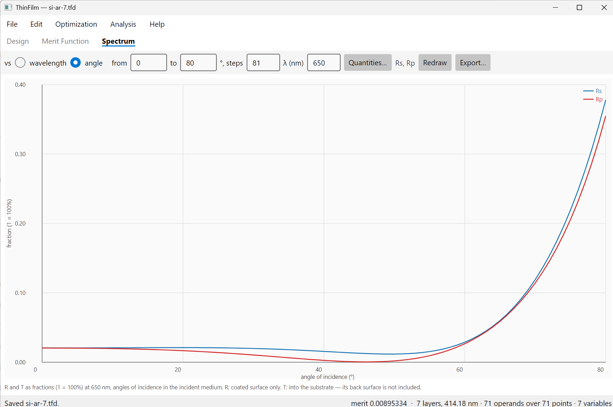

# The Spectrum tab

The **Spectrum** tab plots what the design does: reflectance, transmittance, absorptance, phase and
more, against wavelength or against angle of incidence. **Analysis > Spectrum** opens it.

The plot follows the design. After an edit, an optimisation or a change of materials it is redrawn
by itself. The settings on the tab are saved with the design, so a design reopens to the plot it
was saved with. Changing only the plot doesn't count as an edit: it doesn't make the design ask
to be saved.

## The settings

| Setting | What it does |
|---|---|
| **vs wavelength / angle** | What the horizontal axis is. The two axes keep their own settings: switching back and forth doesn't lose either. |
| **from, to** | Against wavelength: the range, in the design's length unit (nm or µm, Edit > System Parameters). Against angle: the range of angles, in degrees, at least 0 and below 90. |
| **steps** | How many points are computed, ends included. 241 points from 400 to 1000 nm are 2.5 nm apart. A narrow feature, such as a bandpass filter's peak, needs points closer than its width. |
| **AOI (°)** | Against wavelength: the one angle of incidence the spectrum is computed at. |
| **λ** | Against angle: the one wavelength, in the design's unit. This box replaces AOI when **angle** is chosen. |
| **Quantities…** | What is plotted; see below. The names of the chosen quantities are shown beside the button. |
| **Redraw** | Applies what you typed in the boxes and draws the plot again. |
| **Export…** | Writes the plotted curves to a text file; see below. |

**Angles are measured in the incident medium** by default, which for most coatings is air. For a
design whose light comes from glass or oil, such as the oil-immersed plate of chapter 2, Edit >
System Parameters can switch to angles given in air, as for a plate tilted in a beam in air but
measured in glass. Then, against angle, an angle that can't be reached in the incident medium is
left as a gap, and the note under the plot says so. The note always says which way angles are
measured.

## The note under the plot

The note says what the numbers mean, so a screenshot or an exported file can't be misread:

- **R and T as fractions (1 = 100%)**, and the angle or wavelength held fixed.
- **R: coated surface only. T: into the substrate.** The substrate's back surface isn't included
  unless it's switched on in Edit > System Parameters. Then the note gives the substrate's thickness
  and says R and T include the uncoated back surface.
- **A caution, when a material is outside its valid range** somewhere on the plot: which material,
  its range, and where the plot goes past it. The curve is still drawn there, but it rests on an
  extrapolated index (chapter 7.5).

## Quantities

**Quantities…** opens a window with a checkbox for everything that can be plotted, grouped by kind.
Hover over a box to see its operand code, the same code the merit function uses, and the axis it is
drawn against. **Clear all** unticks everything, and **OK** needs at least one box ticked.

**Quantities in different units get separate vertical axes.** The first is on the left and the
others are on the right. Rs and a phase can be plotted together: the fraction on one axis, the
degrees on another.

"s" and "p" are the two polarisations: the electric field perpendicular to the plane of incidence
(s) and in it (p). At normal incidence they're the same. "avg s,p" is their average, the value for
unpolarised light.

| Group | Quantities | What they are |
|---|---|---|
| **Reflectance** | Rs, Rp, R (avg s,p) | The fraction of the light's power reflected. |
| **Transmittance** | Ts, Tp, T (avg s,p) | The fraction transmitted into the substrate (or through it, with the back surface switched on). |
| **Absorptance** | As, Ap, A (avg s,p) | The fraction absorbed in the coating: 1 − R − T. Zero for transparent materials. Light absorbed in the substrate isn't in A: T counts it as having entered the substrate. |
| **Optical density** | OD s, OD p, OD (avg s,p) | −log₁₀ T, for blocking filters. OD 3 is T = 0.1%; OD 6 is T = 0.0001%. On a fraction axis, OD 3 and OD 6 would both look like zero. |
| **Phase** | Phase R s, R p, T s, T p (°) | The phase of the reflected or transmitted field, in degrees from −180 to +180. Where the phase wraps from +180 to −180, the line is broken rather than drawn as a vertical jump. |
| **Ellipsometry** | Ψ R, Δ R, tan Ψ R, cos Δ R, and the same for T | The ratio of the p and s amplitudes, written rp/rs = tan Ψ · e^(iΔ). Ψ is the ratio's size as an angle (45° when p and s are equal), Δ the phase difference between p and s, from −180° to +180°. These are what an ellipsometer measures, for comparing a coating with its measurement. |
| **Polarisation** | \|Rs − Rp\|, \|Ts − Tp\| | How far a coating is from treating s and p alike. For a non-polarising beam splitter, both should be small. |
| | Diattenuation R, T | (p − s)/(p + s): from −1 (only s passes) to +1 (only p passes). |
| | Rs/Rp (dB), Ts/Tp (dB) | The extinction ratio of a polariser, 10 log₁₀(s/p). Ts/Tp of −30 dB means p is transmitted 1000 times more than s; +30 dB, the reverse. |
| **Dispersion** | GD, GDD and TOD, R or T, s or p | Group delay (fs), group delay dispersion (fs²) and third-order dispersion (fs³): the first three derivatives of the phase with frequency. For coatings that handle ultrashort laser pulses, such as chirped mirrors. A positive group delay is a delay. |

Every quantity here is also a merit function operand with the same code, so what you plot you can
also optimise ([The merit function](merit-function.md)).

## Against angle

Choose **angle**, set the range of angles and the wavelength, and press **Redraw**. This is how
chapter 6 checks a wide-angle antireflection coating, and chapter 2 the angles of a cone of light.

This is the silicon coating of chapter 7, designed for normal incidence only. At 650 nm it stays
at about 2% or less for both polarisations out to 55°: Rs is 2.05% at 0°, peaks at 2.1% near 20°,
and falls to 1.2% at 50°; Rp falls to 0.06% near 45°. Beyond 60° both rise steeply, Rs a little
faster: at 80° Rs is 38% and Rp 35%. A coating designed at normal incidence often holds up this
well over moderate angles; chapter 6 shows what it takes to hold it to 45° across a whole band.

## Export

**Export…** writes the plotted curves to a tab-separated text file. A few `#` lines first give the
design, the note under the plot and the units. Then come the column names (`wavelength_nm` or
`wavelength_um`, or `angle_deg`, then one column per quantity, by its code) and one row per point.

Every value is written in full precision, exactly as plotted: phases, Ψ and Δ in degrees, group
delay in fs, GDD in fs², TOD in fs³. An angle that can't be reached is written as `NaN`. Any
spreadsheet or plotting program reads the file.

## From the command line and MCP

| Spectrum tab | Command line | MCP |
|---|---|---|
| The plot, exported | `thinfilm spectrum d.tfd --from 400 --to 800 --steps 201 --angle 0 --quantities RA,TA -o out.csv` | `spectrum` |
| Against angle | `thinfilm spectrum d.tfd --vs angle --from 0 --to 80 --steps 81 --wavelength 650 --quantities RS,RP` | `spectrum` with `vs: "angle"` |
| Save the tab's settings into the design | `thinfilm plot d.tfd --from 400 --to 800 --quantities RA` | |

`thinfilm spectrum` writes comma-separated values with the same units as Export…. A caution about
a material's valid range goes to the error stream, so the file itself stays numbers only.
`thinfilm plot` doesn't print a spectrum: it changes the plot the design opens to, and writes the
design file.
